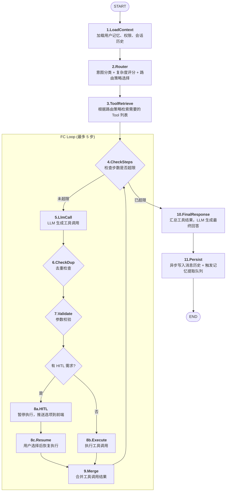
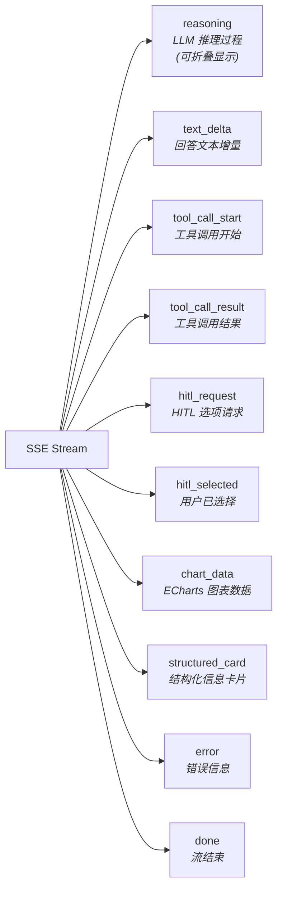
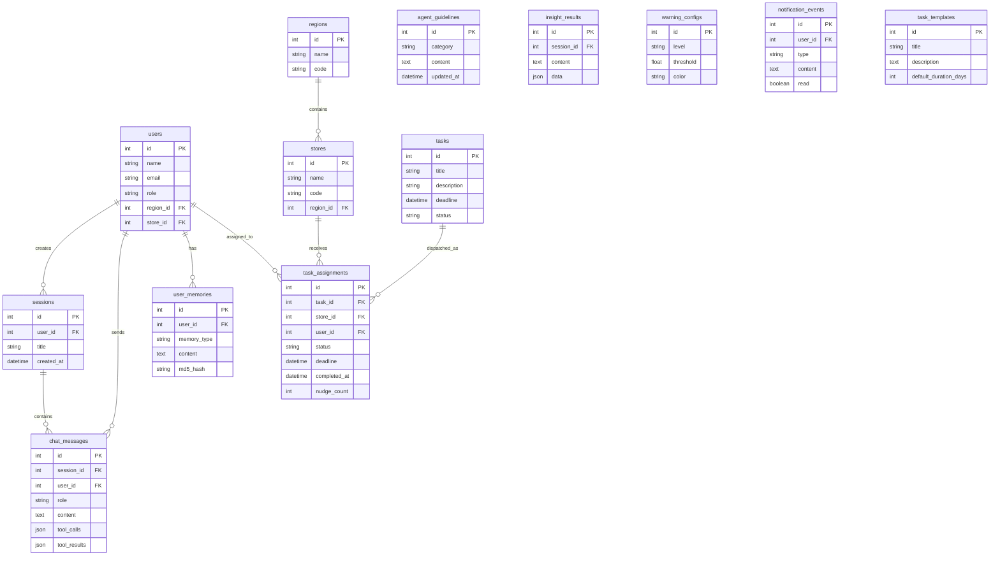

# TOT-Apple-Echat 2.0 产品需求文档 (PRD)

> **产品名称**：TOT (Training On Track) — Apple Retail 培训任务管理系统  
> **版本**：2.0 (Executive Chat)  
> **文档状态**：完整审查版  
> **目标平台**：Web (Desktop + Mobile)  
> **技术栈**：Node.js/Express + LangGraph.js + Vue 3 + DeepSeek/Gemini

---

## 目录

1. [需求背景 (Why)](#1-需求背景-why)
2. [产品定位 (What)](#2-产品定位-what)
3. [模型故事 (Model Story)](#3-模型故事-model-story)
4. [Agent 工作流设计 (How - 流程层)](#4-agent-工作流设计-how---流程层)
5. [功能清单 (What - 功能层)](#5-功能清单-what---功能层)
6. [数据模型](#6-数据模型)
7. [非功能性需求](#7-非功能性需求)
8. [附录：系统架构总览](#8-附录系统架构总览)

---

## 1. 需求背景 (Why)

### 1.1 业务背景

Apple Retail 在全球拥有超过 500 家零售门店，每家门店包含数十名至上百名员工。Apple 对零售员工的培训质量要求极高——新品发布、季节性活动、合规培训、技能认证等各类培训任务需要精确下发到每一位员工，并确保在规定时间内的完成率和质量达标。

在现有运营模式中，大中华区 VP 和区域总监需要了解各区域、各门店的培训进展时，通常依赖以下路径：

```
VP 提问 → 助理整理需求 → BI 团队跑数 → 制作报表 → 邮件回复
```

**痛点**：

- 从提问到获得答案的平均周期为 **1-3 天**，无法支撑快速决策
- 报表格式固定，无法灵活下钻到单个门店或员工的明细
- VP 的很多问题在提出时是不完整的（"最近那个培训怎么样了？"），需要多次来回确认意图
- 高层管理者不习惯操作复杂的数据系统，更偏好自然语言对话

### 1.2 核心问题定义

| 问题维度 | 现状 | 目标 |
|---------|------|------|
| 响应速度 | 平均 1-3 天 | 3 秒内流式响应 |
| 下钻深度 | 仅到区域汇总 | 区域 → 门店 → 员工逐级穿透 |
| 交互门槛 | 需 BI 技能 | 自然语言对话，零门槛 |
| 智能预警 | 人工巡检报表 | 主动推送风险预警 |
| 意图理解 | 多轮人工确认 | AI 主动追问 + 记忆沉淀 |

### 1.3 目标用户

| 角色 | 用户画像 | 核心场景 |
|------|---------|---------|
| **VP / Regional Director** | 管理 50-200 家门店，高频移动办公 | "上海最近两周新品培训完成率是多少？" |
| **HQ Admin** | 总部培训运营，负责任务下发和进度管控 | 在 Central Board 查看全量数据，批量下发任务 |
| **Store Manager / Employee** | 一线员工，接收并完成培训任务 | 在 Storesales 页面查看自己的待办任务 |

### 1.4 战略价值

本项目对标 Apple 内部 **"Democratizing Data Access"** 战略，通过 AI Agent 技术将原本需要数据团队介入的复杂分析能力，直接赋予业务决策者。核心目标不是做一个聊天机器人，而是构建一个 **能理解模糊意图、主动追问、逐步下钻、记住上下文** 的执行对话代理。

---

## 2. 产品定位 (What)

### 2.1 产品一句话定义

> **TOT Executive Chat 是面向 Apple Retail 管理层的 AI 驱动培训数据分析助手，通过自然语言对话实现门店培训进度的实时查询、智能诊断和主动预警。**

### 2.2 产品形态

产品由三个子平台构成，分别服务于不同角色的用户：

```
┌─────────────────────────────────────────────────────┐
│                   TOT 2.0 产品矩阵                     │
├─────────────────┬─────────────────┬─────────────────┤
│  Executive Chat │  Central Board  │   Storesales    │
│  (VP/总监端)     │  (HQ管理员端)    │  (员工端)        │
│                 │                 │                 │
│  · 自然语言对话  │  · KPI 仪表盘   │  · 待办任务列表  │
│  · 智能下钻分析  │  · 预警漏斗图   │  · 倒计时提醒    │
│  · 语音输入/TTS │  · AI 洞察面板  │  · 任务详情查看  │
│  · HITL 人机协同 │  · 任务管理CRUD │  · 推送通知     │
│  · Chat记忆系统  │  · 智能发布     │                 │
│  · 流式SSE响应   │  · 趋势图表     │                 │
└─────────────────┴─────────────────┴─────────────────┘
```

### 2.3 产品定位关键差异

| 维度 | 传统 BI 报表 | TOT Executive Chat |
|------|------------|-------------------|
| 交互方式 | 点选筛选器 + 表格 | 自然语言对话 + 结构化卡片 |
| 响应速度 | 异步生成（分钟级） | 流式 SSE（秒级首字） |
| 下钻能力 | 预设层级 | 无限下钻：区域→门店→员工 |
| 意图容错 | 不支持 | 模糊匹配 + 主动追问 (HITL) |
| 记忆能力 | 每次重新筛选 | 跨会话记忆用户关注的门店/指标 |
| 分析能力 | 描述性统计 | 描述 + 诊断 + 预测 + 归因 |

### 2.4 核心理念

**"Don't make executives learn a dashboard. Let them ask questions."**

产品设计遵循以下原则：

- **Conversation-First**：对话是主交互，图表是副产物
- **Progressive Disclosure**：先给结论，再给明细，最后给原因
- **Ambiguity Tolerance**：容忍模糊输入，通过追问收敛意图
- **Memory-Driven**：每次对话都在学习用户，越用越精准

---

## 3. 模型故事 (Model Story)

### 3.1 典型用户旅程

#### 场景一：VP 日常巡检

**时间**：周一上午 9:00  
**人物**：大中华区零售 VP Sarah  
**地点**：去机场的路上，用 iPad

```
Sarah:  "上海最近的培训做得怎么样？"
系统:   "上海区域整体完成率 87.3%，低于全国平均 91.2%。
         其中浦东店完成率最低（72.1%），有 15 名员工逾期未完成。
         需要我展开浦东店的明细吗？"
Sarah:  "浦东店是谁没做完？"
系统:   "浦东店逾期员工名单：
         · 张三 - 新品体验官培训，逾期 5 天
         · 李四 - 合规安全培训，逾期 3 天
         ...（共 15 人）
         建议：需要我为这些员工生成催促通知吗？"
Sarah:  "好，发通知给他们店长。"
系统:   "已为浦东店生成催促通知草稿，请确认后发送。[预览卡片]"
```

**价值点**：

- Sarah 在 30 秒内完成了从提问到行动的闭环
- 无需打开任何报表系统
- 系统记住了她对"上海"和"浦东店"的关注

#### 场景二：新产品发布前的合规检查

**时间**：iPhone 新品发布前一周  
**人物**：HQ 培训运营经理 Mike  
**场景**：确保所有门店员工完成新品培训

```
Mike:   "全国各区域 iPhone 新品培训完成情况"
系统:   "📊 全国新品培训概览：
         北区 94.2% | 东区 91.1% | 南区 88.7% | 西区 85.3%
         ⚠️ 西区低于 90% 阈值，有以下风险门店：
         · 成都太古里店 68.2%，78 人未完成
         · 西安钟楼店 71.5%，45 人未完成
         距离新品发布还有 7 天，按当前进度，西区将无法按时完成。
         需要我分析原因吗？"
Mike:   "成都太古里什么情况？"
系统:   "成都太古里店分析：
         · 近期新入职 32 人，占总未完成人数 41%
         · 'iPhone 摄影大师' 课程耗时长（平均 2.5h），完成率最低
         · 对比同区域其他门店，该店店长最近 2 周未跟进培训进度
         建议：1. 为新人安排集中培训日 2. 提醒店长建立跟踪节奏"
```

**价值点**：

- 自动关联了"新品发布倒计时"业务上下文
- 不仅告诉"是什么"，还解释了"为什么"（新人多、店长未跟进）
- 给出了可操作的建议

#### 场景三：模糊意图的 HITL 协同

```
Sarah:  "那个北京的培训数据看一下"
系统:   "我理解您想查看北京地区的培训数据。为了更精确地查询，请确认：
         [选项A] 北京市所有门店的培训总览
         [选项B] 北京朝阳大悦城店的培训明细
         [选项C] 北京地区「新品体验官」培训进度
         请选择一个选项。"
Sarah:  "A"
系统:   "北京区域培训总览：完成率 93.8%... [数据卡片]"
```

**价值点**：

- 从模糊指代"那个"中正确识别了北京（依赖记忆系统推断用户经常关注的区域）
- HITL 提供了三个合理的消歧选项
- 用户一步确认即获得结果

### 3.2 模型能力矩阵

| AI 能力 | 模型/技术 | 作用 |
|---------|----------|------|
| 意图识别 (Intent Classification) | DeepSeek-Chat 7-way 分类器 + 规则 fastpath | 将用户输入分类为概览/详情/下钻/对比/预警/操作/闲聊 |
| 实体抽取 (NER) | DeepSeek-Chat + 记忆增强 | 从自然语言中抽取区域、门店、任务名、时间范围 |
| 工具选择 (Tool Selection) | LangGraph Router 节点 | 根据意图 + 复杂度决定调用哪些数据工具 |
| 结构化回答 (Answer Structuring) | DeepSeek-Chat v4.0 模板 | 将工具返回的数据转为人性化的结构化回答 |
| 分析诊断 (Analytics + Diagnosis) | Dashboard ReAct Agent | 发现异常后自动归因分析 |
| 追问协同 (HITL) | LangGraph HITL 节点 + SSE 事件 | 实体不确定时生成选项菜单，等待用户确认后继续 |
| 记忆沉淀 (Memory) | DeepSeek + MD5 去重 → SQLite | 异步提取用户偏好（常关注区域/门店/指标） |
| 催促生成 (Nudge Generation) | DeepSeek/Gemini 双模型 | 自动生成个性化催促消息 |
| 代码分析 (Code Execution) | E2B Sandbox + Python | 复杂统计分析（分位数、分布、相关性） |

---

## 4. Agent 工作流设计 (How - 流程层)

### 4.1 总体架构

系统核心是一个基于 **LangGraph StateGraph** 构建的 Agent，包含 13 个节点，通过状态机驱动完整的对话生命周期。

```
┌────────────────────────────────────────────────────────────┐
│                    ExecChatGraphState                       │
│  (60+ 字段的状态对象，贯穿整个对话生命周期)                    │
├────────────────────────────────────────────────────────────┤
│  user_input | messages[] | tool_calls[] | tool_results[]   │
│  intent_type | entities | complexity_score | route_tier    │
│  hitl_pending | hitl_options | hitl_selection              │
│  memory_context[] | session_id | user_id | role            │
│  stream_buffer | final_response | abort_signal             │
└────────────────────────────────────────────────────────────┘
```

### 4.2 13-Node 状态图



### 4.3 三层路由策略 (Routing Policy)

系统根据输入复杂度动态选择路由层级，平衡速度与质量：

| 路由层级 | 复杂度评分 | 最大步数 | 策略说明 | 典型场景 |
|---------|----------|---------|---------|---------|
| **L2 (Intent Fastpath)** | ≤ 0.20 | 1 步 | 直接意图匹配 + 规则执行，无 LLM 调用 | "上海完成率多少？" |
| **L3 (FC Guarded)** | 0.20 - 0.60 | 3 步 | 单轮 LLM Function Calling + 结果生成 | "对比上海和北京的培训进度" |
| **L4 (Heavy FC)** | ≥ 0.60 | 5 步 | 多轮 LLM FC + 可能的 HITL + 分析 | "分析浦东店上周为什么完成率跌了" |

**复杂度评分因子**：

- 实体数量 (0-1个: 0.05, 2-3个: 0.15, 4+个: 0.25)
- 是否包含对比意图 (+0.20)
- 是否包含时间范围 (+0.10)
- 是否需要下钻 (+0.20)
- 是否包含原因分析 (+0.25)
- 记忆上下文匹配度 (-0.10, 越匹配越简单)

### 4.4 HITL (Human-in-the-Loop) 机制

当 Agent 对实体识别的置信度不足时，不会猜测执行，而是触发人机协同流程：

```
触发条件：
├── 实体置信度 < 0.70（低置信度）
├── 多实体匹配模糊（如"北京"匹配到 3 个相关实体）
├── 工具参数缺失必需字段
└── 权限边界模糊（用户请求超出其可访问范围）

HITL 执行流程：
1. Agent 暂停执行，生成 2-4 个消歧选项
2. 通过 SSE 将 HITL 事件推送到前端
3. 前端渲染选项按钮（Radio/Multi-Select）
4. 用户选择后，前端发送 /resume 请求
5. Agent 从暂停点恢复执行，注入用户选择作为上下文
```

### 4.5 记忆系统 (Memory System)

记忆系统采用 **异步提取 + 在线注入** 的双层架构：

```
┌──────────────────────────────────────────────────────┐
│                   记忆系统架构                         │
├──────────────────────────────────────────────────────┤
│                                                      │
│   在线层 (请求内)                                     │
│   ┌──────────┐    ┌──────────┐    ┌──────────────┐  │
│   │ 会话状态   │    │ 去重缓存   │    │ 记忆注入      │  │
│   │Session    │    │Dedup     │    │Memory        │  │
│   │State      │    │Cache     │    │Injection     │  │
│   └──────────┘    └──────────┘    └──────────────┘  │
│                                                      │
│   离线层 (请求外)                                     │
│   ┌──────────┐    ┌──────────┐    ┌──────────────┐  │
│   │ BullMQ    │───▶│ DeepSeek │───▶│ MD5 去重     │  │
│   │ Producer  │    │ 提取     │    │ → SQLite     │  │
│   └──────────┘    └──────────┘    └──────────────┘  │
│                                                      │
└──────────────────────────────────────────────────────┘
```

**记忆类型**：

| 记忆类型 | 示例 | 更新策略 |
|---------|------|---------|
| 关注区域 | "用户常关注上海区域" | 每次查询自动提取 |
| 关注门店 | "用户 3 次询问浦东店" | 频次计数 |
| 关注指标 | "用户偏好查看完成率" | 指标类型频率 |
| 偏好格式 | "用户喜欢表格 > 图表" | 回答反馈暗含 |

### 4.6 流式响应 (SSE Streaming)

整个对话过程通过 Server-Sent Events 流式传输，前端维护一个 **流式状态机** 实时解析和渲染：



---

## 5. 功能清单 (What - 功能层)

### 5.1 Executive Chat（VP/总监对话端）

#### F1. 自然语言查询

| ID | 功能点 | 描述 | 优先级 |
|----|-------|------|--------|
| F1.1 | 培训概览查询 | 支持"XX 区域培训完成率"等整体查询，返回完成率、准时率、平均学时 | P0 |
| F1.2 | 区域对比 | 支持"对比上海和北京的培训进度"，多维度横向对比 | P0 |
| F1.3 | 门店下钻 | 从区域逐级下钻到门店，展示门店排行榜 | P0 |
| F1.4 | 员工级明细 | 下钻到单个门店的员工完成明细列表 | P1 |
| F1.5 | 任务维度查询 | 按特定培训任务查询进度（如"新品体验官培训"） | P0 |
| F1.6 | 时间范围筛选 | 支持"上周"、"本月"、"Q1"等自然语言时间表达 | P0 |

#### F2. 智能预警

| ID | 功能点 | 描述 | 优先级 |
|----|-------|------|--------|
| F2.1 | 完成率预警 | 自动标记完成率 < 80% 的门店（4级阈值：80%/60%/40%/20%） | P0 |
| F2.2 | 逾期预警 | 识别已超 DDL 未完成的门店和员工 | P0 |
| F2.3 | 趋势恶化预警 | 当完成速度持续下降时主动提醒 | P1 |
| F2.4 | 新人集中预警 | 当新入职员工比例过高影响整体完成率时提示 | P2 |

#### F3. 分析诊断

| ID | 功能点 | 描述 | 优先级 |
|----|-------|------|--------|
| F3.1 | 分布分析 | 完成进度的分位数分布、直方图 | P1 |
| F3.2 | 相关性分析 | 店长跟进频率 vs 完成率的相关性 | P2 |
| F3.3 | 趋势分析 | 时间序列趋势 + 线性外推预测 | P1 |
| F3.4 | 归因分析 | ReAct Agent 自动探索异常原因的因果链 | P1 |
| F3.5 | 对比分析 | A/B 组对比（如南北区、旗舰店 vs 普通店） | P1 |

#### F4. 对话增强

| ID | 功能点 | 描述 | 优先级 |
|----|-------|------|--------|
| F4.1 | HITL 消歧 | 意图模糊时生成选项让用户确认 | P0 |
| F4.2 | 上下文记忆 | 跨会话记住用户偏好区域/门店/指标 | P0 |
| F4.3 | 推理过程展示 | 可折叠的 LLM 推理链（thinking 过程） | P1 |
| F4.4 | 多轮对话 | 支持指代消解和上下文继承（"那个"、"它"） | P0 |
| F4.5 | 结构化卡片 | 将数据结果渲染为信息卡片而非纯文本 | P0 |
| F4.6 | 图表自动生成 | 回答中自动嵌入 ECharts 图表（柱状图/饼图/折线图/散点图） | P1 |
| F4.7 | 催促消息生成 | 一键生成针对逾期员工的个性化催促消息 | P1 |

#### F5. 语音交互

| ID | 功能点 | 描述 | 优先级 |
|----|-------|------|--------|
| F5.1 | 语音输入 (ASR) | 通过阿里 DashScope 将语音转为文本 | P2 |
| F5.2 | 语音播放 (TTS) | WebSocket 实时音频流播放回答内容 | P2 |

#### F6. 用户反馈

| ID | 功能点 | 描述 | 优先级 |
|----|-------|------|--------|
| F6.1 | 回答评分 | 点赞/踩 + 可选反馈理由 | P1 |
| F6.2 | 结构化回答投票 | 对 AI 生成的回答结构投票优化 | P2 |

### 5.2 Central Board（HQ 管理端）

| ID | 功能点 | 描述 | 优先级 |
|----|-------|------|--------|
| C1 | KPI 概览卡片 | 总任务数、完成率、准时率、平均学时，数字滚动动画 | P0 |
| C2 | 预警漏斗图 | 按严重程度分级的预警漏斗（红色/橙色/黄色/蓝色） | P0 |
| C3 | 区域热力图 | 各区域完成率的可视化热力分布 | P1 |
| C4 | 门店排行榜 | 按完成率排序的门店列表，支持正序/倒序 | P0 |
| C5 | 趋势图表 | 完成率、任务量的时间序列趋势线 | P1 |
| C6 | AI 洞察侧边栏 | 嵌入式 Chat 侧边栏，可在看数据时向 AI 追问 | P0 |
| C7 | 洞察卡片流 | AI 自动生成的异常发现卡片，支持点赞/复制 | P1 |
| C8 | 任务管理 CRUD | 创建/编辑/删除培训任务，设置 DDL、指派门店 | P0 |
| C9 | 任务批量下发 | 选择任务 → 选择门店/区域 → 批量指派 | P0 |
| C10 | AI 智能发布 | 用自然语言描述任务需求，AI 自动填充表单 | P1 |
| C11 | 催促规则配置 | 设置自动催促的触发条件（提前X天/逾期Y天） | P1 |
| C12 | 权限管理 | 用户/角色/菜单的 CRUD 管理 | P0 |
| C13 | 洞察投票 | 对 AI 生成的洞察进行有用/无用投票 | P2 |

### 5.3 Storesales（员工端）

| ID | 功能点 | 描述 | 优先级 |
|----|-------|------|--------|
| S1 | 待办任务列表 | 展示当前员工的所有待完成培训任务 | P0 |
| S2 | 任务倒计时 | 距离 DDL 的倒计时显示（紧急/正常/宽裕三色） | P0 |
| S3 | 任务完成标记 | 标记任务完成 + 时间戳记录 | P0 |
| S4 | 通知卡片 | 系统推送的催促/提醒通知 | P1 |
| S5 | 培训内容链接 | 跳转到实际培训内容页面 | P1 |
| S6 | 完成记录 | 历史已完成任务的时间线 | P2 |

---

## 6. 数据模型

### 6.1 核心数据表（12 张表）



### 6.2 关键实体说明

**task_assignments**（核心业务表）：

- 关联 task_id → store_id → user_id 的三级指派
- 状态机：pending → in_progress → completed / expired
- 包含 deadline、completed_at、nudge_count 等关键字段

**user_memories**（记忆表）：

- 存储用户偏好：关注区域、常查门店、偏好指标
- MD5 哈希去重，避免重复写入
- 注入到 LoadContext 节点的 prompt 上下文中

**chat_messages**（对话表）：

- 完整的消息历史，包含 tool_calls 和 tool_results
- 支持会话级压缩（ChatHistoryCompress）

---

## 7. 非功能性需求

### 7.1 性能指标

| 指标 | 目标值 | 测量方式 |
|------|-------|---------|
| 首字响应时间 (TTFB) | < 1.5s (L2), < 3s (L3), < 8s (L4) | SSE 首个 text_delta 事件时间 |
| 完整回答时间 | < 5s (L2), < 15s (L3), < 30s (L4) | done 事件时间 |
| 并发会话数 | 支持 500+ 并发 SSE 连接 | 压力测试 |
| 记忆提取延迟 | < 30s（异步，不影响用户体验） | BullMQ 队列延迟 |

### 7.2 可靠性与安全

| 需求 | 描述 |
|------|------|
| JWT 认证 | 所有 API 需要 Bearer Token，支持过期刷新 |
| 角色权限 | EXEC / HQ / EMPLOYEE 三级角色，路由守卫 + API 中间件 |
| 数据隔离 | 门店经理只能看本店数据，区域总监只能看本区域 |
| 流中断处理 | SSE 断开自动重连，前端维护 abort_signal |
| 优雅降级 | LLM 不可用时返回缓存数据 + 友好提示 |
| 输入校验 | 用户输入长度限制、SQL 注入防护、XSS 过滤 |
| 审计日志 | 关键操作（登录、任务下发、权限变更）全量记录 |

### 7.3 可观测性

| 需求 | 实现 |
|------|------|
| 分布式追踪 | Langfuse 集成，采样率基于 session_id 哈希 |
| 日志 | JSON 结构化日志，包含 trace_id, session_id, user_id |
| PII 脱敏 | 追踪数据中的用户输入和 LLM 输出自动脱敏 |
| 性能监控 | PM2 进程守护 + 健康检查端点 |
| 错误追踪 | 统一错误中间件，分类错误码 |

### 7.4 平台兼容性

| 平台 | 要求 |
|------|------|
| Desktop Browser | Chrome 90+, Safari 15+, Edge 90+ |
| Mobile Browser (Executive) | iPad Safari, iPad Chrome（VP 高频场景） |
| Mobile Browser (Storesales) | 微信内置浏览器, iOS Safari, Android Chrome |
| 屏幕尺寸 | 响应式：1280px+ (Desktop) / 768-1024px (Tablet) / 320-428px (Mobile) |
| 网络环境 | 支持弱网环境（中国区门店网络），SSE 自动重连 |

---

## 8. 附录：系统架构总览

```
┌─────────────────────────────────────────────────────────────┐
│                      前端 (Vue 3 + Vite)                      │
│  ┌──────────┐  ┌──────────────┐  ┌──────────────────────┐   │
│  │ Executive │  │ Central Board│  │ Storesales (Mobile)  │   │
│  │ Chat SPA  │  │ Dashboard    │  │ Employee Dashboard   │   │
│  └─────┬─────┘  └──────┬───────┘  └──────────┬───────────┘   │
│        │               │                     │               │
│        └───────────────┼─────────────────────┘               │
│                        │                                     │
│              Alova HTTP + SSE Stream + WS                   │
└────────────────────────┼────────────────────────────────────┘
                         │
              HTTPS / WSS (Tailscale Funnel)
                         │
┌────────────────────────┼────────────────────────────────────┐
│                   Express.js Server                          │
│  ┌─────────────────────┼──────────────────────────────┐     │
│  │              Middleware Layer                        │     │
│  │  Auth (JWT) → Permissions → ErrorHandler            │     │
│  └─────────────────────┼──────────────────────────────┘     │
│                        │                                     │
│  ┌─────────────────────┼──────────────────────────────┐     │
│  │              Chat Service                           │     │
│  │  ┌──────────┐  ┌──────────┐  ┌──────────────────┐ │     │
│  │  │ LangGraph │  │ 9 Chat   │  │ Memory System    │ │     │
│  │  │ Agent     │  │ Tools    │  │ (Queue + SQLite) │ │     │
│  │  │ (13节点)  │  │          │  │                  │ │     │
│  │  └──────────┘  └──────────┘  └──────────────────┘ │     │
│  └─────────────────────┼──────────────────────────────┘     │
│                        │                                     │
│  ┌─────────────────────┼──────────────────────────────┐     │
│  │              External Services                      │     │
│  │  DeepSeek API │ Gemini API │ DashScope ASR │ E2B   │     │
│  │  Langfuse     │ Redis      │ SQLite        │ MyPal │     │
│  └────────────────────────────────────────────────────┘     │
└─────────────────────────────────────────────────────────────┘
```

---

## 文档修订记录

| 版本 | 日期 | 修订内容 | 作者 |
|------|------|---------|------|
| v1.0 | 2026-05-02 | 初始版本，完整 PRD | AI PM Review |
