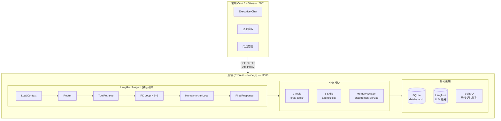
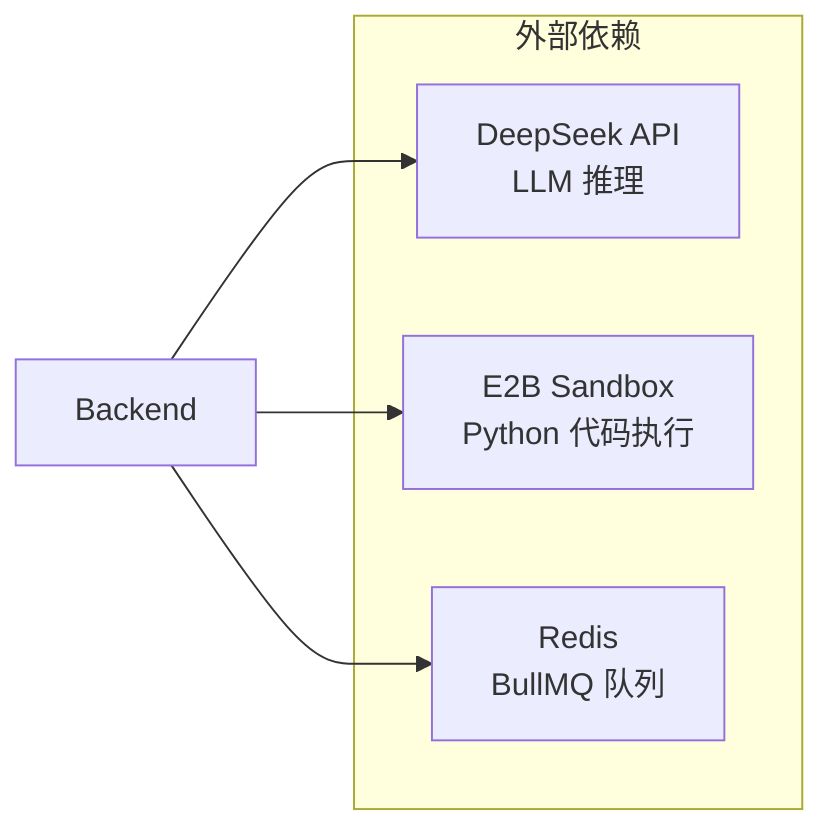
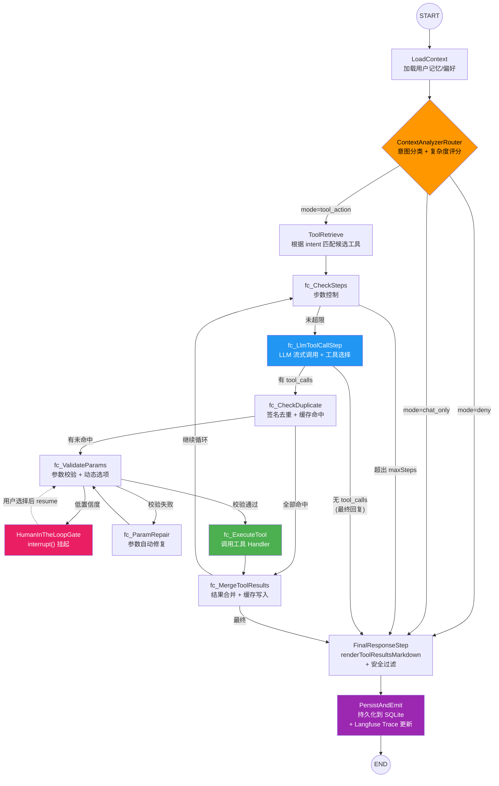
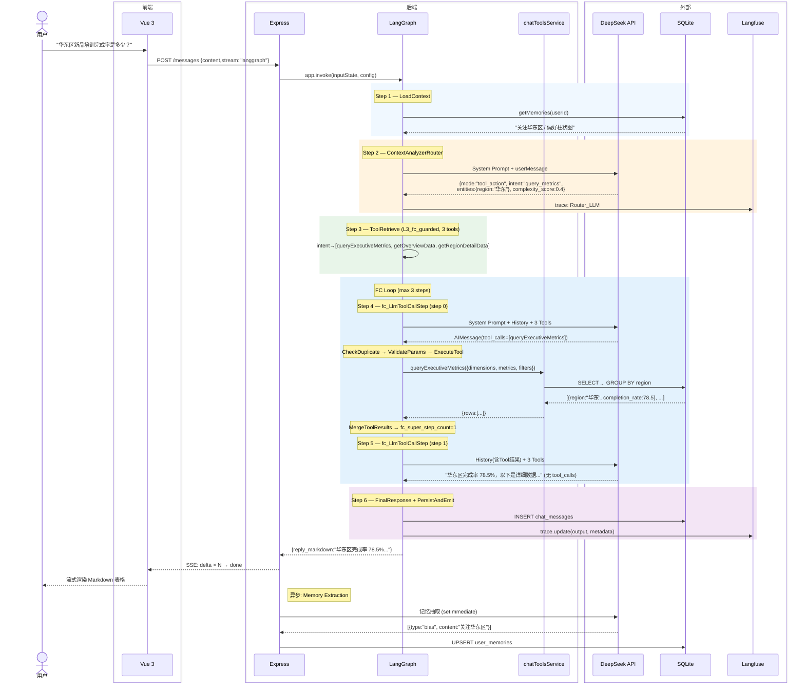
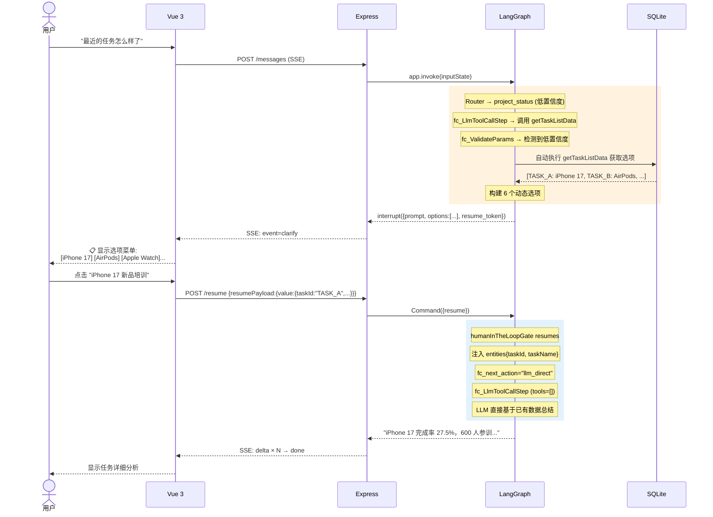

# TOT-Apple-Echat2.0 项目技术文档

> **审核日期**: 2026-04-30  
> **审核人**: AI PM (全量代码审查)  
> **技术栈**: Node.js + LangGraph.js v1.2.9 + DeepSeek API + SQLite + Vue 3 + Vite

---

## 1. 项目概述

### 1.1 定位

TOT-Apple-Echat2.0 是一个面向 Apple 零售培训体系的 **智能对话分析系统**（Executive Chat）。VP 和区域总监通过自然语言查询培训完成率、门店表现、任务进度等业务指标，由 LangGraph Agent 自动编排工具调用链，返回结构化的数据分析结果。

### 1.2 核心能力

| 能力 | 说明 |
|------|------|
| 自然语言查询 | 支持中文自然语言提问（"华东区新品培训完成率"、"哪些门店需要重点关注"） |
| 多意图路由 | Router 自动识别 5 种意图（查询指标/项目状态/预警/下钻/统计分析） |
| Function Calling 循环 | LLM 多轮工具调用 + 结果合并 + 总结，最多 5 步 |
| 人在回路 (HITL) | 模糊查询自动触发选项菜单，用户点选后继续执行 |
| 流式输出 (SSE) | LLM 思考过程和结果实时推送到前端 |
| 代码执行 | E2B 云沙盒运行 Python 进行高阶统计分析 |
| 记忆系统 | 用户偏好/业务定义持久化，注入后续对话上下文 |
| Langfuse 观测 | 全链路 LLM 调用追踪、Token 用量统计、Bad Case 分析 |

### 1.3 系统架构





---

## 2. Agent 工作流

### 2.1 状态图 (StateGraph)

Agent 基于 LangGraph 的 `StateGraph` 构建，使用单层拍平状态模型 `ExecChatGraphState`（60+ 字段）。图结构如下：



### 2.2 三层路由策略 (RoutingPolicy)

系统根据 Router 输出的 `complexity_score` 动态分配 FC 循环预算：

| Tier | 复杂度阈值 | 最大步数 | 工具数 | 修复次数 | 适用场景 |
|------|-----------|---------|--------|---------|---------|
| L2_intent_fastpath | ≤ 0.20 | 1 | 2 | 1 | 极简单问候/确认 |
| L3_fc_guarded | 0.20 < x < 0.60 | 3 | 3 | 2 | 常规数据查询 |
| L4_heavy_fc | ≥ 0.60 | 5 | 5 | 3 | 复杂统计分析 |

### 2.3 时序图 — 正常查询



### 2.4 时序图 — HITL 追问



---

## 3. 工具系统 (9 Tools)

所有工具位于 `server/chat_tools/`，通过 `chatToolsService` 动态加载和注册。每个工具包含 `schema`（OpenAI Function Calling 格式）和 `handler`（实际执行函数）。

### 3.1 查询类工具

| 工具名 | 文件 | 描述 | 关键参数 | 返回数据 |
|--------|------|------|---------|---------|
| `getOverviewData` | tool_getProgressMetrics.js | 查询培训任务整体完成率、进度统计、预警率等汇总数据 | taskId(可选), region(可选) | {totalAssignments, completedCount, completionRate, onTimeCompletionRate, avgCompletionTimeHours} |
| `getTaskListData` | tool_getProjectStatus.js | 查询当前所有已下发培训任务列表、截止时间与完成情况 | 无必填 | [{id, title, status, ddlAt, completionRate, ...}] |
| `getRegionDetailData` | tool_getRegionDetailData.js | 按区域下钻查询培训进度，含区域汇总与门店表现排行 | region(可选) | {region, summary, stores: [{name, completionRate, ...}]} |
| `getStoreDetailData` | tool_getDrillDownMetrics.js | 查询某一具体门店内所有员工培训进度明细 | **storeId**(必填), taskId(可选) | {store, summary, employees: [{employeeName, status, progress, ...}]} |
| `getWarningsData` | tool_getWarnings.js | 查询存在风险（进度慢、完成率低、临近截止）的门店列表 | 无必填 | [{storeId, storeName, region, completionRate, riskLevel, ...}] |

### 3.2 分析类工具

| 工具名 | 文件 | 描述 | 关键参数 | 返回数据 |
|--------|------|------|---------|---------|
| `queryExecutiveMetrics` | tool_queryExecutiveMetrics.js | 多维度高管指标矩阵查询（大区/业态/经销商/门店对比排序） | **metrics**(必填), **taskName**(必填), dimensions, filters, sort | {rows, dimensions, metrics} |
| `runAnalytics` | tool_runAnalytics.js | 高阶统计分析：分位数、分布、相关性、截尾均值、完成率预测 | analysisType, taskId | 结构化统计结果 |
| `fetchRawDataset` | tool_fetchRawDataset.js | 获取用于高阶分析的原始脱敏数据集（CSV 格式） | taskId | CSV 字符串 |
| `executeCode` | tool_executeCode.js | 在 E2B 云端沙盒中执行 Python 代码（pandas/matplotlib） | **code**(必填), dataRef(可选) | {text, plots: [base64 PNG]} |

### 3.3 意图→工具映射

```
query_metrics   → queryExecutiveMetrics, getOverviewData, getRegionDetailData
project_status  → getTaskListData, getOverviewData
warning_query   → getWarningsData, getStoreDetailData, getRegionDetailData
drill_down      → getWarningsData, getStoreDetailData, getRegionDetailData
analytics_query → runAnalytics, fetchRawDataset, executeCode
```

---

## 4. 技能系统 (5 Skills)

技能系统是 Dashboard Agent（总部看板机器人）的独立 Agent 框架，使用简单的 ReAct 循环（非 LangGraph），位于 `server/agent/skills/`。

| 技能名 | 文件 | 描述 | 模型 |
|--------|------|------|------|
| `generate_nudge_message` | generateNudge.js | 根据员工进度、门店情况生成催办文案（Gemini） | Gemini 2.5 Pro (Floodgate) |
| `generate_nudge_message_deepseek` | generateNudge.js | 同上（DeepSeek 版） | DeepSeek Chat |
| `generate_task_description` | generateTaskDesc.js | 根据指令扩写培训下发长文案（Gemini） | Gemini 2.5 Pro |
| `generate_task_description_deepseek` | generateTaskDesc.js | 同上（DeepSeek 版） | DeepSeek Chat |
| `parse_task_deepseek` | parseTask.js | 自然语言指令一键解析为 JSON 格式任务信息 | DeepSeek Chat |
| `dashboard_diagnose` | dashboardDiagnose.js | 看板任务深度诊断，含可进化经验记忆库 | DeepSeek Chat (ReAct) |

Dashboard Agent 每 1 小时自动执行一次诊断（`dashboardDiagnose`），结果存入 `dashboard_insights` 表。

---

## 5. 状态模型 (State Schema)

`ExecChatGraphState` 包含 60+ 字段，核心分组：

### 5.1 核心上下文
| 字段 | 类型 | 说明 |
|------|------|------|
| `sessionId` | string | 会话 ID |
| `userId` | string | 用户 ID |
| `userMessage` | string | 当前用户输入 |
| `messages` | BaseMessage[] | 对话历史（追加模式） |
| `regionScope` | object | 用户权限范围 (national/regional/rtm) |

### 5.2 Router 输出
| 字段 | 类型 | 说明 |
|------|------|------|
| `mode` | enum | chat_only / tool_action / deny |
| `intent` | string | query_metrics / project_status / warning_query / drill_down / analytics_query |
| `entities` | object | 提取的实体（如 metric, taskId, region） |
| `entities_confidence` | object | 实体置信度 |
| `selected_tier` | enum | L2 / L3 / L4 |
| `complexity_score` | number | 0-1 复杂度评分 |

### 5.3 FC 循环状态
| 字段 | 说明 |
|------|------|
| `candidateTools` | 候选工具名列表 |
| `pending_tool_calls` | 待执行的工具调用 |
| `toolResults` | 工具执行结果 (merge reducer) |
| `fc_super_step_count` | FC 循环计数（每次 merge 后 +1） |
| `fc_current_step` | 当前步数（每次 CheckSteps 后 +1） |
| `fc_repair_attempts` | 参数修复次数 |
| `fc_next_action` | 下一步路由 action |

### 5.4 HITL 状态
| 字段 | 说明 |
|------|------|
| `hitl_status` | idle / pending_interrupt / resumed |
| `interrupt_payload` | 中断时传给前端的选项数据 |
| `clarification_response` | 用户的选择/补充信息 |

---

## 6. 人在回路 (HITL) 机制

当用户查询模糊（低置信度实体）时，系统不会直接拒绝，而是：

1. **动态查询数据库** — 自动执行 `getTaskListData` 等工具获取真实选项
2. **构建选项菜单** — 将真实数据（如任务名、门店名）展示给用户
3. **中断等待** — LangGraph `interrupt()` 挂起图执行
4. **用户选择** — 前端显示选项，用户点击
5. **恢复执行** — `Command({resume})` 恢复图，注入用户选择上下文
6. **直接总结** — 跳过工具执行，LLM 直接基于已有数据生成分析

```
用户: "最近的任务怎么样了"
  → Router: project_status (低置信度)
  → 自动执行 getTaskListData → 6 个任务
  → HITL: "找到 6 个任务，请选择: [iPhone 17] [AirPods] ..."
  → 用户点击 "iPhone 17 新品培训"
  → Resume → LLM 直接总结: "iPhone 17 完成率 27.5%..."
```

---

## 7. 项目文件结构

```
TOT-Apple-Echat2.0/
├── TOT_backend/server/          # 后端
│   ├── app.js                   # Express 主入口
│   ├── agent/                   # Agent 核心
│   │   ├── core.js              # Agent 类 (技能注册/调度)
│   │   ├── index.js             # Agent 实例
│   │   ├── graph/               # LangGraph 图
│   │   │   ├── graph.js         # 图定义 (节点+边)
│   │   │   ├── nodes.js         # 节点实现 (12 个节点)
│   │   │   ├── state.js         # 状态模型
│   │   │   └── routingPolicy.js # 路由策略/阈值
│   │   ├── queue/               # BullMQ 异步队列
│   │   ├── skills/              # 技能 (5 个)
│   │   └── tools/               # Dashboard Agent 工具
│   ├── chat_tools/              # Executive Chat 工具 (9 个)
│   ├── services/                # 业务服务层
│   │   ├── chatService.js       # 核心对话服务 (SSE + LangGraph)
│   │   ├── chatAgentRunner.js   # 旧版 FC Agent (legacy_stream)
│   │   ├── chatToolsService.js  # 工具体系 (动态加载/校验/执行)
│   │   ├── chatMemoryService.js # 记忆系统
│   │   ├── chatSessionStateService.js # 会话状态/去重缓存
│   │   ├── executiveMetricsQueryService.js # 矩阵查询
│   │   └── dashboardAgentService.js # 看板 Agent
│   ├── routes/                  # API 路由
│   │   └── chat.js              # Chat API (send/resume/feedback)
│   ├── middleware/               # 中间件
│   │   ├── auth.js              # JWT 认证
│   │   └── errorHandler.js      # 统一错误处理
│   ├── utils/                   # 工具函数
│   │   ├── ai.js                # LLM 调用 (DeepSeek/Gemini)
│   │   ├── tracer.js            # Langfuse 追踪
│   │   ├── sseResponse.js       # SSE 响应工具
│   │   └── logger.js            # 结构化日志
│   ├── db/                      # 数据库
│   │   ├── index.js             # better-sqlite3 初始化
│   │   ├── schema.sql           # DDL
│   │   └── seed.js              # 种子数据
│   ├── ws/                      # WebSocket
│   └── jobs/                    # 定时任务
│       ├── autoNudgeScheduler.js
│       └── dashboardAgentScheduler.js
│
├── TOT_frontend/                 # 前端 (Vue 3 + Vite)
│   ├── src/
│   │   ├── views/executive/     # Executive Chat 页面
│   │   ├── views/central/       # 总部看板
│   │   ├── api/chat/            # Chat API 客户端
│   │   ├── utils/http/          # SSE 流式请求
│   │   ├── utils/execStreamReply.ts # 流式回复状态机
│   │   └── store/               # Pinia 状态管理
│   ├── .env.development         # 开发环境配置 (Vite Proxy)
│   └── vite.config.ts           # Vite 配置
│
├── DESIGN.md                    # 设计文档
└── README.md                    # 项目说明
```

---

## 8. API 接口

### 8.1 Chat API

| 方法 | 路径 | 说明 |
|------|------|------|
| POST | `/api/v1/chat/executive/sessions` | 创建会话 |
| POST | `/api/v1/chat/executive/sessions/:id/messages` | 发送消息 (SSE 流式) |
| POST | `/api/v1/chat/executive/sessions/:id/resume` | HITL 恢复 (SSE 流式) |
| GET | `/api/v1/chat/executive/sessions/:id/history` | 对话历史 |
| POST | `/api/v1/chat/executive/sessions/:id/messages/:msgId/feedback` | 消息反馈 |
| POST | `/api/v1/chat/executive/sessions/:id/messages/:msgId/regenerate` | 重新生成 |
| DELETE | `/api/v1/chat/executive/sessions/:id` | 删除会话 |

### 8.2 SSE 事件类型

| Event | Data | 说明 |
|-------|------|------|
| `delta` | `{text, phase}` | LLM 增量输出 (phase: content/reasoning/tool_start/tool_end) |
| `clarify` | `{type, prompt, options, resumeToken}` | HITL 选项菜单 |
| `done` | `{messageId, markdownContent, responseTime}` | 流结束 |
| `error` | `{message, code}` | 错误 |

---

## 9. 数据流

### 9.1 正常查询流程

```mermaid
flowchart LR
    A["👤 用户<br/>华东区完成率"] --> B["🧠 Router<br/>intent=query_metrics<br/>entities={region:华东}<br/>complexity=0.4"]
    B --> C["📊 L3_fc_guarded<br/>max 3 steps, 3 tools"]
    C --> D["🔧 ToolRetrieve<br/>[queryExecutiveMetrics,<br/>getOverviewData,<br/>getRegionDetailData]"]
    D --> E["🤖 FC Step 0<br/>LLM → queryExecutiveMetrics<br/>(dimensions=['channel_l3'],<br/>metrics=['completion_rate'],<br/>filters={region:'华东'})"]
    E --> F["✅ ValidateParams<br/>参数校验通过"]
    F --> G["⚡ ExecuteTool<br/>SQL 查询 → 矩阵数据"]
    G --> H["🔗 MergeToolResults<br/>fc_super_step_count=1"]
    H --> I["🤖 FC Step 1<br/>LLM 拿到数据<br/>生成 Markdown 表格"]
    I --> J["📝 FinalResponse<br/>renderToolResultsMarkdown"]
    J --> K["💾 PersistAndEmit<br/>INSERT chat_messages<br/>Langfuse trace.update"]

    style B fill:#ff9800,color:#000
    style E fill:#2196f3,color:#fff
    style G fill:#4caf50,color:#fff
    style K fill:#9c27b0,color:#fff
```



### 9.2 HITL 流程

```mermaid
flowchart LR
    A["👤 用户<br/>最近的任务怎么样了"] --> B["🧠 Router<br/>intent=project_status<br/>低置信度 entities"]
    B --> C["⚡ dynamicClarify<br/>自动执行 getTaskListData<br/>→ 6 个真实任务"]
    C --> D["⏸️ HITL interrupt<br/>选项菜单<br/>[iPhone 17] [AirPods] ..."]
    D --> E["👆 用户点击<br/>iPhone 17 新品培训"]
    E --> F["▶️ Resume<br/>注入 entities<br/>{taskId:'TASK_A'}"]
    F --> G["🤖 LLM 直接总结<br/>isOverCap=true<br/>tools=[] 无工具调用"]
    G --> H["📝 FinalResponse<br/>'iPhone 17 完成率 27.5%<br/>600 人参训...'"]

    style D fill:#e91e63,color:#fff
    style F fill:#2196f3,color:#fff
    style H fill:#4caf50,color:#fff
```



---

## 10. 配置与部署

### 10.1 环境变量

| 变量 | 说明 |
|------|------|
| `DEEPSEEK_API_KEY` | DeepSeek API 密钥 (必填) |
| `LANGFUSE_ENABLED` | Langfuse 开关 (true/false) |
| `LANGFUSE_PUBLIC_KEY` | Langfuse 公钥 |
| `LANGFUSE_SECRET_KEY` | Langfuse 私钥 |
| `LANGFUSE_SAMPLE_RATE` | 采样率 (默认 1.0) |
| `JWT_SECRET` | JWT 签名密钥 (生产必改) |
| `REDIS_URL` | Redis 连接 (记忆队列) |
| `PORT` | 后端端口 (默认 3000) |

### 10.2 启动命令

```bash
# 后端
cd TOT_backend/server
npm install --legacy-peer-deps
npm run seed    # 初始化数据库
npm run dev     # 开发模式 (node --watch)

# 前端
cd TOT_frontend
pnpm install
pnpm dev        # Vite dev server (localhost:8001)
```

### 10.3 测试账号

| 用户名 | 密码 | 角色 |
|--------|------|------|
| `executive` | `Train2026!` | Executive Chat (全国) |
| `executive_huadong` | `Train2026!` | Executive Chat (华东区) |
| `central` | `Train2026!` | 总部看板 |
| `admin` | `Admin2026!` | 管理员 |

---

## 11. 已修复的关键缺陷

本审核过程中修复了 20+ 个缺陷，关键修复包括：

| 类别 | 修复 |
|------|------|
| 运行时崩溃 | `better-sqlite3` Node v24 兼容性; `isSampled` 导出缺失; 文件被清空恢复 |
| 流式输出 | ChatOpenAI.stream() → chatWithToolsStream() 直调 DeepSeek API |
| 工具结果丢失 | `fc_MergeToolResults` 反向查找 AIMessage; tool 消息保留 |
| HITL 死循环 | `justResumedFromHitl` 守卫; 置信度提升; 动态选项 |
| 数据编造 | tool 消息过滤导致 LLM 看不到工具结果 → 改为保留完整 assistant+tool 对 |
| GraphRecursionError | recursionLimit 25 → 200 |
| checkpoint 泄漏 | inputState 显式重置 FC 状态字段 |
| 前端 import 缺失 | `streamResumeExecutiveChatMessage` 未导入 |
| Vite Proxy 路径 | target 末尾补 `/api` |
| dotenv 覆盖 | `override: true` |
