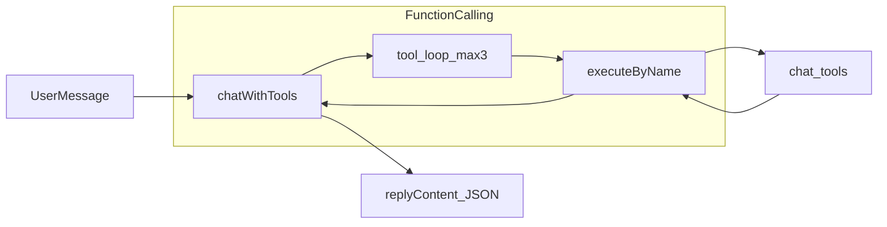

# Executive Chat 工具拓展计划（编排优先）

**创建日期：** 2026-04-17  
**状态：** Draft（待评审 / 分阶段执行）  
**关联规格：** [09-EXECUTIVE-CHAT.md](../specs/09-EXECUTIVE-CHAT.md)、[10-EXECUTIVE-CHAT-INTENTS-TOOLS.md](../specs/10-EXECUTIVE-CHAT-INTENTS-TOOLS.md)

---

## 背景与目标

- **优先级（已确认）**：组合查询与 FC 体验——复杂问法在一次对话轮次内通过**多工具调用**凑齐事实，再生成结构化 `replyContent`。
- **约束（分阶段闸门）**：**Phase A–B** 以 `server/` 内改动为主，HTTP 响应形态可尽量保持不变；**Phase C** 若引入新 `entities` 字段或 `replyContent` 扩展，再集中更新 [04-API-SPEC.md](../specs/04-API-SPEC.md) 与前端联调说明。**数据库迁移**仅在编排依赖新数据源（例如跨任务时间线）且无法用现有表表达时再启动，不作为 Phase A 前提。

---

## 现状锚点（实现入口）

- **FC 循环**：[../../server/services/chatAgentRunner.js](../../server/services/chatAgentRunner.js)（`runFunctionCalling`、`MAX_ITERATIONS`、系统提示词、`deriveIntentType`）。
- **工具加载与执行**：[../../server/services/chatToolsService.js](../../server/services/chatToolsService.js)（`TOOL_SCHEMAS`、`executeByName`）。
- **工具实现**：[../../server/chat_tools/](../../server/chat_tools/)（6 个工具；`runAnalytics` 的 OpenAI `function.name` 为 `runAnalytics`）。
- **意图（IR 模式）**：[../../server/services/chatIntentService.js](../../server/services/chatIntentService.js)（与 FC 并行存在）。

---

## Phase A — 编排「可调用」：schema 与提示词（低耦合、优先做）

**目的**：让模型在单轮内**稳定地**串 `getOverviewData` → `getWarningsData` → `getRegionDetailData` / `getStoreDetailData` 等组合，而不是只调一个工具就收尾。

| 动作 | 说明 |
|------|------|
| **梳理工具 description/parameters** | 在每个 `tool_*.js` 的 `schema.function` 中写清：**何时用、何时不用、与另一工具的分工**（例如「全局汇总用 getOverviewData，风险门店清单用 getWarningsData，不要重复问同一种聚合」）。重点文件：[tool_getProgressMetrics.js](../../server/chat_tools/tool_getProgressMetrics.js)、[tool_getWarnings.js](../../server/chat_tools/tool_getWarnings.js)、[tool_getRegionDetailData.js](../../server/chat_tools/tool_getRegionDetailData.js)、[tool_getDrillDownMetrics.js](../../server/chat_tools/tool_getDrillDownMetrics.js)、[tool_runAnalytics.js](../../server/chat_tools/tool_runAnalytics.js)。 |
| **FC 系统提示词** | 在 `chatAgentRunner.js` 的 FC `SYSTEM_PROMPT` 中明确：**允许多次 tool call**、推荐规划顺序（先概览/列表 → 再预警/下钻 → 再统计）、以及**最终必须输出**四段式 JSON 代码块。 |
| **迭代预算与兜底** | 复核 `MAX_ITERATIONS`（当前为 3）是否覆盖「2～3 个工具 + 1 次收尾」；若不足，评估调到 4 或拆分为「轻量规划 + 执行」两段（需评估延迟与成本）。 |

**验收**：固定一组 **多跳黄金问法**（例如「全国完成率怎样，最差区域是哪里，该区域垫底门店是哪几家」），在配置真实 API Key 下跑通 `toolIterations > 1` 且最终 `replyContent` 可解析。

---

## Phase B — 编排「可恢复」：部分失败与缓存一致性

**目的**：多工具时**单个工具失败**不拖垮整轮；缓存不误用。

| 动作 | 说明 |
|------|------|
| **错误语义** | 确认 `_toolError` / `error` 对象在 FC 上下文中被模型读懂；必要时在 `SYSTEM_PROMPT` 中规定「遇 TOOL_NOT_FOUND / PERMISSION_DENIED 时换策略或向用户说明」。参考现有：`executeByName` 返回结构。 |
| **会话缓存** | 核对 `chatSessionStateService` 的 signature 在多工具、多参数下是否唯一；避免「先查华东再查华南」串缓存。相关：`buildToolCacheSignature`（[chatAgentRunner.js](../../server/services/chatAgentRunner.js)）。 |

**验收**：注入单个工具失败（mock 或临时抛错）时，模型仍能输出可解析的降级 `replyContent`，且日志中 `intentResolvedBy` / `toolIterations` 合理。

---

## Phase C — 编排「可验收」：契约与文档（对外行为变化时）

**触发条件**（任一满足即做本阶段）：新增 `entities` 字段、前端需要展示新结构化块、或 FC 默认模式切换影响集成方预期。

| 动作 | 说明 |
|------|------|
| **04-API-SPEC** | 更新 §6 中 `entities` / 错误码 / 流式约定（若有）。 |
| **10 / 09** | 在 [10-EXECUTIVE-CHAT-INTENTS-TOOLS.md](../specs/10-EXECUTIVE-CHAT-INTENTS-TOOLS.md) 增加「推荐多工具场景与顺序」；[09-EXECUTIVE-CHAT.md](../specs/09-EXECUTIVE-CHAT.md) 保持产品级简述即可。 |
| **前端** | 若 `replyContent` 增加可选扩展键（如 `visualizations`），按 09 PRD 扩展字段策略做向后兼容。 |

---

## Phase D — 可选：新工具或迁移（仅在编排仍不够时）

**原则**：优先 **原子工具 + 多轮 FC**，避免过早引入「万能聚合工具」导致 schema 臃肿。

| 方向 | 何时考虑 |
|------|----------|
| **新原子工具** | 反复出现 3+ 跳仍不稳定、或 SQL 重复极高（例如专用「区域对比」只读查询）。 |
| **DB 迁移** | 需要事件级时间线、审计轨迹，而现有表无法近似；需单独 ADR + [01-DATA-MODEL.md](../specs/01-DATA-MODEL.md) / [backend/03-DATABASE.md](../backend/03-DATABASE.md)。 |

---

## 建议（非必须，但性价比高）

1. **默认模式策略**：编排目标与 **FC** 强绑定；保持 `intent_routing` 为回退。在 09 / 10 写清「多跳验收以 FC 为准」。
2. **评测资产**：为 Phase A 增加 **固定 JSON 用例**（输入问法 → 期望至少调用的工具名序列），挂在 `server/scripts/` 或 fixtures，避免仅靠人工点选。
3. **成本**：多工具会增加 token 与延迟；可在日志里对 `toolIterations` 做 P95 监控后再调 `MAX_ITERATIONS`。

---

## 风险与回滚

- **模型不遵守多工具**：优先改 **工具 description + FC 提示词**；仍失败再考虑提高迭代次数或缩小工具粒度。
- **契约漂移**：Phase C 未启动前，避免在 HTTP 层引入新必填字段；新能力尽量从可选扩展开始。

---

## 执行清单（跟踪）

- [ ] **Phase A**：优化 6 个 `chat_tools` 的 schema 描述与分工；强化 `chatAgentRunner` FC `SYSTEM_PROMPT`；复核 `MAX_ITERATIONS` 与黄金多跳问法验收。
- [ ] **Phase B**：多工具部分失败与权限错误的恢复策略；校验会话工具缓存签名在多步查询下不串数据。
- [ ] **Phase C（按需）**：对外 `entities` / `replyContent` 有变时同步 04、10 多工具场景、前端兼容说明。
- [ ] **Phase D（按需）**：评估新原子工具或 DB 迁移；避免过早引入万能聚合工具。
