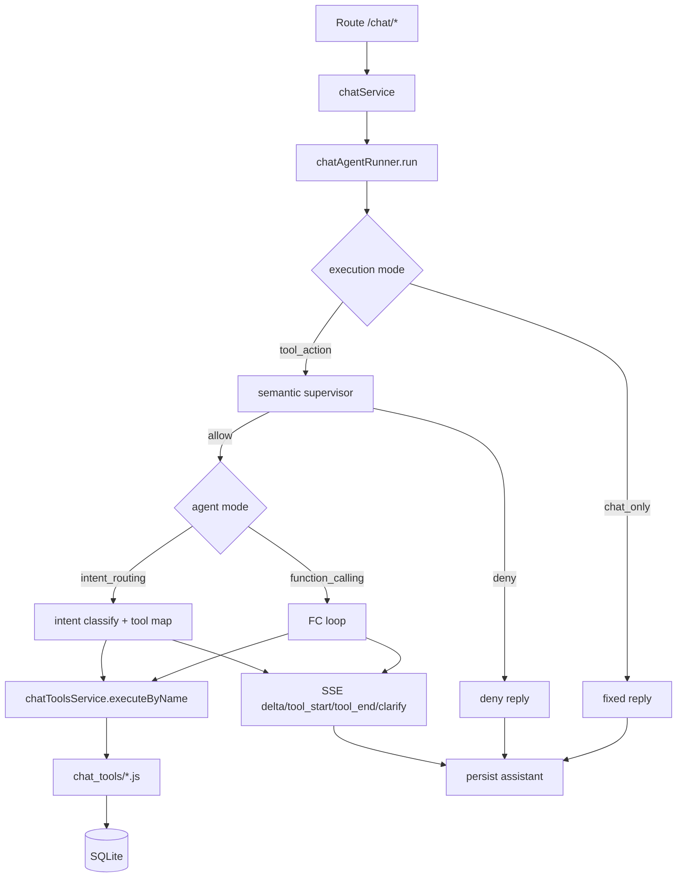
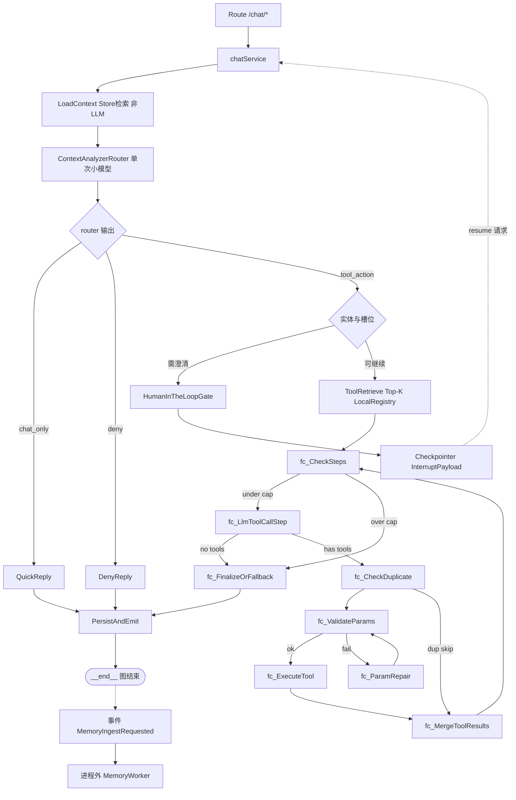
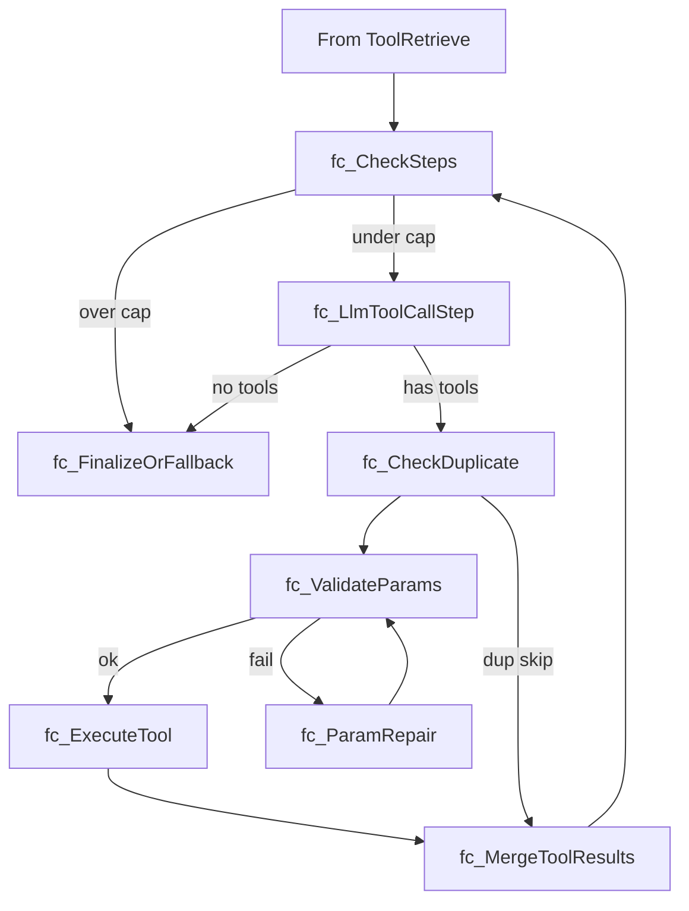

# 附件 A：As-Is vs To-Be 架构对照

**适用范围**: Executive Chat（后端编排层与工具层）

---

## A1. As-Is（当前实现）



关键事实：

- 默认主路径是 `function_calling`。
- 同时存在 `intent_routing` 兜底路径。
- 消歧（clarify）目前强依赖于手工构造历史消息写入 DB 来实现“恢复”。
- SSE 推送与大模型流式生成高度耦合。

---

## A2. To-Be（LangGraph 目标：**物理拍平**的单层 StateGraph）

**PoC / V1 实现策略**：**不使用** LangGraph Subgraph API 做多层嵌套（避免 TS 状态映射与父子 Checkpoint 地狱）。全链路在 **一个 `StateGraph`** 内完成；节点名用前缀表达逻辑分组（如 `fc_` = FC 循环内步骤）。**逻辑上的**「Master / Executive / FcLoop」仅用于文档分层或注释，不对应运行时嵌套子图。

**多 Agent（远期）**：通过 **独立图实例** 或 **独立入口 Node**（不同 `compile()` 产物）隔离，而非在同一 Executive 图内再套一层 MasterGraph。

**前置合并（Prompt Consolidation）**：原串行 **`GlobalGuardrails` → `IntentDispatcher` → `ClassifyExecutionMode` → `ExecutiveSemanticSupervisor` → `NerCanonicalize`** 在 PoC 中合并为 **`ContextAnalyzerRouter`**：**一次**高速小模型调用（如 GPT-4o-mini / DeepSeek 轻量档），结构化输出 `mode`（`chat_only` / `tool_action` / `deny`）、`global_safety_decision`、`intent`、**标准化实体（NER）** 等。失败时可规则降级或第二次轻量调用（实现细节见代码）。

**`LoadContext`（可选）**：**非 LLM**，仅从 Store 做语义检索，将 Top-K 记忆片段写入 state，供 `ContextAnalyzerRouter` 与用户消息一并作为上下文；建议紧挨在 Router 之前以降低 TTFT（仅一次 Store 读 + 一次 Router 调模）。

**唯一执行引擎**：**强化版 FC 循环**（§A11，`fc_*` 前缀节点）。**不实现 Plan-Execute 分支**（PoC/V1 砍掉双引擎）；Plan 模式见 **§A12（远期）**。

**记忆清洗**：**不在主图内**挂载 `AsyncMemoryExtract` Node。**`PersistAndEmit` 为图唯一出口 `__end__`**；落盘并发送 SSE `done` 后，在应用层 **发布事件**（Event Emitter / Redis 队列 / MQ），由 **独立 Worker** 异步萃取、矛盾检测、写回 Store（适配 Serverless 与连接关闭）。



设计要点：

1. **单图拍平**：Checkpoint、HITL resume、reducer 只针对 **一层** `ExecChatGraphState`，调试成本显著低于父子子图嵌套。
2. **TTFT**：前置为 **1 次 Store 读（可选）+ 1 次 Router LLM**，避免五连独立模型调用。
3. **工具隔离**：`ToolRetrieve` / `fc_ExecuteTool` 仍只使用 **Executive Local Tool Registry**（`tool_namespace`，见 A10.2）。
4. **护栏**：Router 输出 **不替代** 工具层 **确定性** 权限校验（`regionScope`、`national_only` 等仍在 `fc_ExecuteTool` 前硬校验）。
5. **HITL**：`HumanInTheLoopGate` + `InterruptPayload`；恢复后从 **`ContextAnalyzerRouter` 或 `fc_CheckSteps`** 续跑（按 A7）。
6. **记忆**：主图止于 **`PersistAndEmit`**；长期记忆写入由 **Worker** 完成，主请求线程不挂孤儿异步 LLM。

---

## A3. Graph State 建议（**单层拍平**的 ExecChatGraphState）

**PoC / V1**：使用 **单一强类型** `ExecChatGraphState`，**所有字段在第一层**，避免 `base` / `executive` 嵌套带来的 deep merge、reducer 覆盖与序列化心智负担。跨 Agent 扩展时优先 **另一张图 + 另一套 State 类型**，或通过 **`agent_kind` + 前缀字段** 约定，而非深嵌套对象。

**字段命名约定**：HITL 相关建议 `hitl_*`；FC 循环辅助字段 `fc_*`；记忆注入 `memory_*`；与 LangGraph TS `Annotation`/reducer 对齐时在代码内集中定义。

### A3.1 InterruptPayload（HITL）

```ts
export type InterruptPayload = {
  type: "select" | "input" | "confirm";
  prompt: string;
  options?: Array<{ id: string; label: string; meta?: Record<string, unknown> }>;
  agent_id: string;
  resume_token?: string;
};
```

### A3.2 ExecChatGraphState（拍平示意）

```ts
import { BaseMessage } from "@langchain/core/messages";

export type HumanInTheLoopStatus =
  | "idle"
  | "pending_interrupt"
  | "resumed";

/** PoC：仅 executive_chat；远期其它 Agent 用独立 State 类型或独立图 */
export type ExecChatGraphState = {
  sessionId: string;
  userId: string;
  userMessage: string;
  messages: BaseMessage[];

  regionScope: { type: string; regions?: string[]; rtm?: string | null };
  tool_namespace: "executive_chat";

  /** ContextAnalyzerRouter 输出 */
  mode: "chat_only" | "tool_action" | "pending_clarification";
  global_safety_decision: "allow" | "deny" | "pending";
  intent: string;
  entities: Record<string, unknown>;
  entities_raw?: Record<string, unknown>;
  entities_confidence?: Record<string, number>;

  /** LoadContext 注入（非 LLM） */
  memory_snippets?: Array<{ text: string; score?: number }>;

  toolCalls: Array<Record<string, unknown>>;
  toolResults: Array<Record<string, unknown>>;
  fc_step_count: number;
  fc_super_step_count: number;
  calledTools: string[];

  human_in_the_loop_status: HumanInTheLoopStatus;
  interrupt_payload?: InterruptPayload;

  reply_markdown?: string;
  reply_structured?: Record<string, unknown>;

  meta_trace_id?: string;
  meta_routing_tier?: string;
  meta_fallback_count?: number;
};
```

---

## A4. 映射表（旧职责 -> 新节点）

| 现有职责 | 现有位置 | LangGraph 节点建议（单图、前缀可落地为 `fc_*`） |
|---|---|---|
| 模式判定 + 语义监工 + NER（前置合并） | `classifyExecutionMode` + `checkIntentSafety` + 意图侧实体 | **`ContextAnalyzerRouter`**（单次小模型；替代原多节点串行） |
| 全局护栏 / 分发（逻辑上） | 无直接对应 | **并入 `ContextAnalyzerRouter` 的 prompt 与输出 schema**；恶意注入类可额外保留轻量规则前置 |
| FC 主循环 | `runFunctionCalling` | **`fc_CheckSteps` → `fc_LlmToolCallStep` → …**（§A11，单图内边循环） |
| 工具执行守卫 | `chatToolsService.executeByName` | **`fc_ExecuteTool`**（内调原服务） |
| 消歧 / HITL | `buildDisambiguationReply` + 状态拼装 | **`HumanInTheLoopGate` + Checkpointer + `InterruptPayload`** |
| 记忆注入 | `chatMemoryService.getMemories` 等 | **`LoadContext`**（Store 读，非 LLM） |
| 记忆萃取 / 升级 | `chatMemoryService.extract` | **进程外 `MemoryWorker`**（由 `PersistAndEmit` 后事件触发，**非图节点**） |
| 多 Agent（远期） | （当前无） | **独立图实例或独立入口**，不嵌套 Subgraph |
| SSE 推送 | `streamFormatCallbacks.onDelta` | **`fc_LlmToolCallStep` 等**节点内 Side-effect |
| 持久化 | `chatService.storageContentFromAgentResult` | **`PersistAndEmit`**（图终点 `__end__`） |

---

## A5. 状态转移表（包含四层优化，**单图**）

> 全表在 **一个 StateGraph** 内成立。`HumanInTheLoopGate` 即原 `ClarificationGate` 的泛化。  
> **FC 细粒度循环**以 **§A11** 的 **`fc_*` 节点链** + `fc_CheckSteps` 条件边为准。

| 当前状态 | 触发条件 | 下一状态 | 关键动作 |
|---|---|---|---|
| `ReceiveInput` | 请求通过校验 | `LoadContext` | 可选；Store 语义检索写入 `memory_snippets` |
| `LoadContext` | 完成 | `ContextAnalyzerRouter` | **单次小模型**：安全 + 意图 + NER 等结构化输出 |
| `ContextAnalyzerRouter` | `chat_only` | `QuickReply` | 固定或模板回复 |
| `ContextAnalyzerRouter` | `deny` | `DenyReply` | 拒绝话术 |
| `ContextAnalyzerRouter` | `tool_action` 且槽位不足/低置信 | `HumanInTheLoopGate` | 下发 `InterruptPayload` |
| `ContextAnalyzerRouter` | `tool_action` 且槽位可接受 | `ToolRetrieve` | Local Registry Top-K |
| `ToolRetrieve` | 完成 | `fc_CheckSteps` | 进入唯一 FC 引擎（§A11） |
| `fc_*` 循环 | 需 HITL | `HumanInTheLoopGate` | 挂起 |
| `fc_*` 循环 | 成功产出 | `PersistAndEmit` | 落库 + SSE `done` |
| `QuickReply` / `DenyReply` | — | `PersistAndEmit` | 同上 |
| `HumanInTheLoopGate` | 等待用户 | `Checkpointer` | interrupt |
| `Checkpointer` | resume | `ContextAnalyzerRouter` 或 `fc_CheckSteps` | 意图漂移须重跑 Router（A7） |
| `PersistAndEmit` | 完成 | **`__end__`** | 图结束；**发布 `MemoryIngestRequested`**，无图内记忆 Node |

---

## A6. 关键参数与监控口径

### A6.1 运行参数（建议默认值）

- `ner_confidence_threshold = 0.85`
- `tool_top_k = 3`
- `tool_expand_once = true`
- `tool_expand_to_k = 5`
- `max_param_repair_attempts = 2`
- `max_iterations_per_turn = 4`

### A6.2 监控指标（Langfuse）

- `tool_select_accuracy`
- `param_accuracy`
- `first_pass_success_rate`
- `clarify_rate`
- `fallback_rate`

为避免口径混淆，`param_accuracy` 拆分为三项：

- `param_schema_pass_rate`：参数通过 JSON Schema 的比例
- `param_business_pass_rate`：参数通过业务规则（scope/跨字段）校验的比例
- `execution_success_rate`：工具实际执行成功比例（不等同参数质量）

### A6.3 告警门槛（建议）

- 全局：`param_schema_pass_rate < 0.90` 或 `param_business_pass_rate < 0.90` 告警
- 分工具：按 intent/tool 独立阈值（如 `drill_down = 0.85`, `analytics_query = 0.92`）

---

## A7. Clarification 恢复安全规则

恢复路径分两类：

1. **槽位补全型恢复**：用户仅补充门店/区域/任务等实体信息，可从 **`fc_CheckSteps`**（若已在 FC 内）或再次进入 **`ContextAnalyzerRouter`**（重跑 NER/槽位）恢复。
2. **意图变更型恢复**：用户补充文本包含新动作请求或意图漂移，**必须重新经过 `ContextAnalyzerRouter`**（必要时连同 `LoadContext`），防止绕过 Router 内的安全与意图门控；**不得**仅从 `fc_*` 中间节点“硬续”。

建议在恢复请求中记录：

- `resume_type = slot_fill | intent_shift`
- `resume_entry_node`（如 `ContextAnalyzerRouter` / `fc_CheckSteps`）
- `safety_recheck_required`

---

## A8. RoutingPolicy 决策表（请求级动态路由）

### A8.1 决策输入

- `cache_hit`：是否命中会话或签名缓存
- `intent_confidence`：轻量意图判定置信度
- `entity_completeness`：关键槽位完整度
- `complexity_score`：复杂度分值（多实体/多约束/多目标）
- `risk_flags`：是否命中安全高风险或越权特征
- `fallback_count`：当前请求已升级次数

### A8.2 路由决策（建议）

| 条件 | 路由档位 | 说明 |
|---|---|---|
| `cache_hit = true` 且缓存未过期 | `L1_cache_hit` | 直接返回缓存结果 |
| `cache_hit = false` 且 `complexity_score` 低、`intent_confidence` 高、`entity_completeness` 高 | `L2_intent_fastpath` | 快路径优先 |
| `L2` 失败或参数多次不合法 | `L3_fc_guarded` | 进入受约束 FC（默认步数/Top-K） |
| `complexity_score` 高 或 `L3` 多次失败 | `L4_heavy_fc` | **加预算 / 加约束下的多轮 FC**（PoC/V1 **无 Plan**；见 A9.4） |

### A8.3 升降档规则

升级规则：

1. `L2 -> L3`：满足任一条件即可升级  
   - 意图置信度低于阈值  
   - 参数修复超过上限  
   - 工具候选 Top-K 命中弱
2. `L3 -> L4`：满足任一条件即可升级（**仍为 FC**，非 Plan）  
   - 多工具依赖明显，需更多 super-step  
   - 标准 `L3` 步数预算不足  
   - 连续失败达到阈值

降档规则：

1. 当前请求一旦升级，不在同轮中降档，防止振荡。
2. 下一请求可根据历史成功模式直接尝试更低档（例如连续命中缓存）。

边界保护：

1. `max_fallback_count_per_request = 2`
2. 触发安全风险时不进入更高自由度档位，直接拒绝或澄清。

### A8.4 观测指标（按档位）

每一档都应记录：

- `selected_tier`
- `tier_latency_ms`
- `tier_cost_tokens`
- `tier_success_rate`
- `tier_fallback_to_next_rate`

用于评估“简单请求是否真的停留在低档”和“复杂请求是否升级及时”。

### A8.5 默认阈值（可直接实现）

```ts
export const routingPolicyDefaults = {
  intent_confidence_threshold: 0.80,
  entity_completeness_threshold: 0.85,
  complexity_score_l2_max: 0.35,
  complexity_score_l4_min: 0.70,
  topk_min_score_threshold: 0.60,
  max_fallback_count_per_request: 2,
  max_iterations_per_turn: 4,
};
```

补充说明：

1. `complexity_score` 建议归一化到 `[0,1]`。
2. 若 `complexity_score` 介于 `(0.35, 0.70)`，默认走 `L3_fc_guarded`。
3. `complexity_score >= complexity_score_l4_min` 时走 **`L4_heavy_fc`**（提高 FC 预算等），**不是** Plan-Execute（§A12）。
4. 若命中安全风险特征（`risk_flags=true`），不升到更高自由度档位，转拒绝或澄清。

---

## A9. complexity_score 可解释打分公式（Baseline）

### A9.1 设计目标

1. 评分区间固定在 `[0,1]`，便于与路由阈值对接。
2. 分数可解释，可回放到具体特征项。
3. 保守策略：宁可高估复杂度，也不低估导致误走快路径。

### A9.2 特征项与权重（首版）

| 特征项 | 记号 | 归一化方式 | 权重 |
|---|---|---|---|
| 实体数量复杂度（region/store/task/metric/time） | `f_entities` | `min(entity_count / 5, 1)` | `0.25` |
| 约束数量复杂度（筛选条件、排序、TopN） | `f_constraints` | `min(constraint_count / 4, 1)` | `0.20` |
| 目标数量复杂度（单目标 vs 多目标） | `f_objectives` | `0`(单目标) / `1`(多目标) | `0.15` |
| 推理深度需求（对比/归因/预测等） | `f_reasoning` | `0`(查询) / `0.5`(对比) / `1`(归因或预测) | `0.20` |
| 工具链潜在长度（预计工具步数） | `f_tool_depth` | `min(estimated_steps / 3, 1)` | `0.10` |
| 历史失败信号（同会话近 N 轮失败/修参） | `f_failure_history` | `0`(无) / `0.5`(轻微) / `1`(明显) | `0.10` |

### A9.3 公式定义

```ts
const complexity_score =
  0.25 * f_entities +
  0.20 * f_constraints +
  0.15 * f_objectives +
  0.20 * f_reasoning +
  0.10 * f_tool_depth +
  0.10 * f_failure_history;
```

实现建议：

1. 计算后执行 `Math.max(0, Math.min(1, score))` 做边界钳制。
2. 同步记录每个特征项分值，形成 `complexity_breakdown` 便于调参。
3. 对无法判定的特征项使用保守默认值（建议 `0.5`）。

### A9.4 路由映射

- `complexity_score <= 0.35`：优先 `L2_intent_fastpath`
- `0.35 < complexity_score < 0.70`：默认 `L3_fc_guarded`
- `complexity_score >= 0.70`：直达 `L4_heavy_fc`（提高 `max_iterations_per_turn` / 必要时放宽 Top-K 一次等，**不**引入 Plan 子图）

### A9.5 示例

示例请求：  
“对比华东和华南本月新品培训完成率，找出低于 60% 的门店，并解释可能原因”

- `f_entities = 0.8`（多个实体）
- `f_constraints = 0.75`（时间 + 阈值 + 区域）
- `f_objectives = 1.0`（对比 + 筛选 + 解释）
- `f_reasoning = 1.0`（包含归因）
- `f_tool_depth = 0.67`（预计 >=2 步）
- `f_failure_history = 0.0`（无历史失败）

计算结果：

`score = 0.25*0.8 + 0.20*0.75 + 0.15*1 + 0.20*1 + 0.10*0.67 + 0.10*0`

约等于 `0.77`，应路由到 `L4_heavy_fc`（多轮 FC + 更高步数预算；**非** Plan-Execute）。

---

## A10. Multi-Agent 地基（**独立图**、工具命名空间、HITL、护栏）

本节落实「PoC 只实现 Executive Chat **单图**，远期 Multi-Agent **不嵌套子图**」的工程约定。

### A10.1 Graph State：单层 `ExecChatGraphState`

- PoC/V1 使用 **拍平的** `ExecChatGraphState`（§A3），**不**采用 `base` / `executive` 嵌套。
- 新增 Agent（远期）：**新 `compile()` 产物 + 新 State 类型**（或独立入口服务），共享基础设施（Checkpointer 工厂、Store、Langfuse）即可；**禁止**在 Executive 图内再套一层「Master 子图」以免 Checkpoint 复杂度倍增。

### A10.2 Tool Registry：命名空间与按需加载

- Executive 图维护 **Local Tool Registry**（`tool_namespace: executive_chat`），注册名建议 **`namespace.tool_name` 或元数据带 `namespace`**。
- **`ToolRetrieve`（Top-K）仅在该 Registry 内检索**。
- **`fc_ExecuteTool` 仅执行当前图白名单**，与 legacy `chat_tools` 可映射为 `executive_chat::*`。

### A10.3 HumanInTheLoopGate 与 InterruptPayload

- **`HumanInTheLoopGate`** + **`InterruptPayload`**（§A3.1）。
- `agent_id` 用于审计与多 Agent 远期路由；PoC 可固定为 `executive_chat`。
- **前端只渲染协议**；恢复由 Checkpointer 唤醒，入口按 A7 决定 **`ContextAnalyzerRouter` 或 `fc_CheckSteps`**。
- **兼容期**：可与 SSE `phase: clarify` 映射或双写（对外契约变化时同步 `04-API-SPEC.md`）。

### A10.4 护栏分层（逻辑上，非嵌套图）

| 层级 | 典型内容 | 放置位置（PoC） |
|---|---|---|
| **路由级** | 注入防护大类、恶意指令拒答、意图级 allow/deny | **`ContextAnalyzerRouter`** 的 prompt + schema；可辅以轻量规则前置 |
| **工具级** | `regionScope` / national_only、业务越权 | **`fc_ExecuteTool`** 前硬校验 + 工具内 guard |

**原则**：Router 输出 **不替代** 工具层确定性权限校验。

### A10.5 PoC 边界与演进

- **PoC**：单张 Executive **`StateGraph`**；无 Master 嵌套、无 Plan 分支。
- **演进**：新 Agent = **新图** + 新 Registry；HTTP/API 层可做「网关分发」，**不必**用 LangGraph Subgraph 表达。

### A10.6 记忆写入：图外 Worker

- 主图在 **`PersistAndEmit` → `__end__`** 结束；**异步萃取 / 矛盾检测 / Store 写回** 由 **`MemoryWorker`**（队列/事件）完成，与 §A2 一致。

---

## A11. FC 循环：**单图内** `fc_*` 节点链与 Checkpoint

本节落实：**FC 每一步对应一个 Node**（**非** LangGraph Subgraph API）；**步数硬性上限**、**重复调用拦截**、**参数校验与修参**均为独立 Node；**Checkpointer** 在 Node 边界持久化。

### A11.1 与粗粒度「AgentStep 大包」的区别

- **粗粒度**：单 Node 内 while 循环多次 LLM + 工具，Checkpoint 粗，难恢复。
- **细粒度（PoC 冻结）**：在 **同一 `StateGraph`** 内使用 **`fc_*` 前缀节点**，每轮迭代：**`fc_CheckSteps` → `fc_LlmToolCallStep` → `fc_CheckDuplicate` → `fc_ValidateParams` ↔ `fc_ParamRepair` → `fc_ExecuteTool` → `fc_MergeToolResults` → `fc_CheckSteps`**。

**PoC/V1**：`ToolRetrieve` 之后 **唯一** 进入本链；**无** `RouteExecutionPath`、**无** Plan 分支。高复杂度由 **`L4_heavy_fc`** 提高预算（§A8/A9），仍走本链。

### A11.2 Node 职责

| Node | 职责 |
|---|---|
| `fc_CheckSteps` | 读取 `fc_step_count` / `fc_super_step_count`（或 §A3 同义字段），与 `max_steps` 比较；未超限 → `fc_LlmToolCallStep`，超限 → **`fc_FinalizeOrFallback`**。 |
| `fc_LlmToolCallStep` | **单次** LLM，仅产出本轮 `tool_calls` 或纯文本结束；**无** Node 内循环。 |
| `fc_CheckDuplicate` | 基于 `tool_call_id` / `(tool_name, normalized_args_hash, round_id)` 等去重；可跳过 `fc_ExecuteTool` 或复用 `toolResults`。 |
| `fc_ValidateParams` | JSON Schema + 业务规则（与 **`ParamValidate`** 同义）。 |
| `fc_ParamRepair` | 将 `violations` 回传 LLM 修参，回到 `fc_ValidateParams`；受 `max_param_repair_attempts` 限制。 |
| `fc_ExecuteTool` | 白名单 + 超时 + 权限；内调 legacy `chatToolsService` 或等价层。 |
| `fc_MergeToolResults` | 追加 **`messages` / `toolResults` / `calledTools`** 等**拍平字段**；成功即一次 **super-step** 提交（A11.3）。 |

### A11.3 Super-step 与崩溃恢复（不变量）

**Super-step**：两次成功 **`fc_MergeToolResults`** 之间。Checkpointer 在 **Node 完成后** 写入（以所用实现与 `thread_id` 为准）。

**不变量**：

1. **`fc_MergeToolResults` 前**崩溃：恢复后从上一 super-step 或 `fc_CheckSteps` 继续（`fc_CheckDuplicate` 须幂等）。
2. **`fc_MergeToolResults` 后**崩溃：`toolResults` 等必须在 snapshot 中。
3. **`fc_LlmToolCallStep` 流式**中途崩溃：策略为「最后成功 super-step + 重试本轮 LLM」。

### A11.4 流程图（`fc_*` 链）



### A11.5 与 A5 的关系

- A5 中 **`fc_*` 循环**即本节；**`HumanInTheLoopGate`** 可在 `fc_ExecuteTool` 返回需澄清时触发；恢复按 **A7**。

---

## A12. Plan-Execute（**V2 远期**，不在 PoC/V1）

PoC/V1 **不实现**「计划一次 + 确定性执行 + 汇总」的第二套引擎，以避免 **双路径维护** 与 **TTFT/成本** 劣化。若上线后证明 **`L4_heavy_fc`** 在极复杂编排上仍不足，可在 **V2** 评估：

- **可选子图或可选节点组**：`PlanOnce` → `PlanValidate` → `ExecutePlan` → `SummarizeOnce`（目标 2 次主路径 LLM），与 FC **互斥**、失败 **降级回 `fc_*`**；
- **独立 Checkpoint 策略** 与 **评测集** 需单独立项（附件 D 中 Plan 相关 case 届时再启用）。

**当前评审基线**：附件 B/C/D 中 **不以 Plan 为交付假设**；风险与里程碑以 **单图 + `fc_*` + `ContextAnalyzerRouter` + MemoryWorker** 为准。