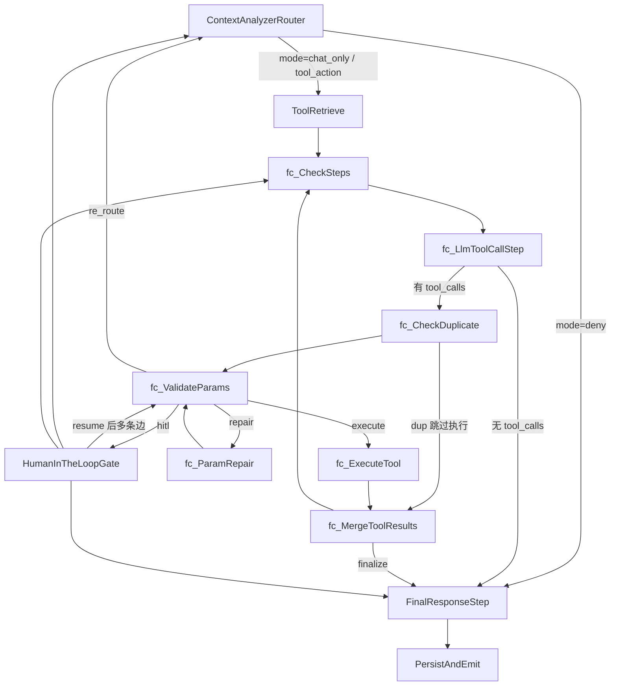

# Executive Chat — Agent 工程技术说明

> 面向外部 AI / Agent 工程师的**自给自足版**架构评审材料。

| 项目 | 内容 |
|------|------|
| 读者 | 外部 AI / Agent 工程师（架构评审与设计评估） |
| 范围 | 编排架构、状态模型、意图与工具映射、请求工作流、SSE / HITL 契约、风险与落地缺口 |
| 实现真值 | 以 `TOT_backend/server` 下代码为准；与本文冲突时以可复现代码行为为准 |
| 校对日期 | 2026-05-11 (v4.1) |
| 校对范围 | `routes/chat.js`、`services/chatService.js`、`agent/graph/{graph,nodes,state,intents}.js` |

> **版本提示**　仓库内部分历史规格文档仍写「LangGraph 未接主链 / 默认 `chatAgentRunner`」，与**当前默认流式路由**不符。以本文 §2 为权威叙述。

---

## 目录

1. [产品能力边界](#1-产品能力边界)
2. [运行时链路事实（必读）](#2-运行时链路事实必读)
3. [HTTP API](#3-http-api)
4. [SSE 契约](#4-sse-契约)
5. [单请求全流程](#5-单请求全流程)
6. [状态：`ExecChatGraphState`](#6-状态execchatgraphstate)
7. [状态传播机制与规则](#6a-状态传播机制与规则)
8. [状态迁移表](#7-状态迁移表)
9. [节点落地成熟度](#8-节点落地成熟度)
10. [InterruptPayload / ResumePayload](#9-interruptpayload--resumepayload)
11. [意图：`INTENT_ALIAS_MAP` 与 Canonical](#10-意图intent_alias_map-与-canonical)
12. [`INTENT_TOOL_MAP`](#11-intent_tool_map静态候选绑定)
13. [已注册工具一览](#12-已注册工具一览)
14. [`runAnalytics` 的 `analysisType`](#13-runanalytics-的-analysistype)
15. [风险台账](#14-风险台账executive-chat--langgraph)
16. [发布冻结门槛](#15-发布冻结门槛t0)
17. [前端落地现状](#16-前端落地现状)
18. [Legacy / 双路径对比](#17-legacy--双路径对比)
19. [扩展能力最小清单](#18-扩展能力最小清单)
20. [源码索引](#19-源码索引)

---

## 1. 产品能力边界

Executive Chat（以下简称 E-Chat）面向高管，承担**自然语言驱动的培训治理数据问答**，核心能力分三类：

- **多维 SQL 类查询**　矩阵 / 进度 / 任务清单 / 预警 / 大区·门店下钻。
- **统计分析**　分位数、分布、相关性、方差、预测、截尾均值等，经 `runAnalytics` 统一入口。
- **Markdown + 可视化块**　以 Markdown 返回，围栏代码块语言标签为 `echarts`、`suggestions` 时触发前端渲染。

**刻意不做**：代发邮件、写业务数据等副作用动作。超出范围的请求应拒绝并给出可执行替代路径。

**权限与辖区裁剪**：会话创建时写入 `roleScope`（`national` / `regional` / `rtm`）与 `regions` / `rtm`；工具执行时必须携带 `regionScope`。禁止「空结果装作成功」的越权返回。

---

## 2. 运行时链路事实（必读）

前端 Executive 默认 `stream: true`。后端 `server/routes/chat.js` 按 `stream` 字段分发：

| 入参条件 | Service 入口 | 编排引擎 |
|---|---|---|
| `stream === true` 或 `stream === 'langgraph'` | `sendMessageStreamLangGraph` | LangGraph `buildGraph()` |
| `stream === 'legacy_stream'` | `sendMessageStream` | `chatAgentRunner.run` |
| 未传 `stream`（非流式） | `sendMessage` | `chatAgentRunner.run` |
| `POST .../sessions/:id/resume` + `stream` 为 `true` / `'langgraph'` | `resumeMessageStreamLangGraph` | LangGraph `Command({ resume })` |
| Regenerate + `stream` 为 `true` / `'langgraph'` | `regenerateLastAssistantStreamLangGraph` | LangGraph |

**其他说明**

- **总部看板机器人**与 Executive 共用同一套 `chatService` 与数据表；路径把 `executive` 换成 `dashboard`，角色为 `central` / `admin`，SSE 约定与行为一致。
- 非流式 / Legacy 路径下，Agent 可通过环境变量 `CHAT_AGENT_MODE` 在 `intent_routing` 与 `function_calling` 之间切换。**LangGraph 路径不依赖此开关**。

---

## 3. HTTP API

- API 挂载前缀：`/api/v1`（下文路径均相对该前缀）。
- Executive 前缀：`/chat/executive`；Dashboard 前缀：`/chat/dashboard`（结构与 Executive 一一对应）。

| 方法 | 路径模式 | 作用 |
|---|---|---|
| POST | `/chat/executive/sessions` | 创建会话（body：`roleScope`、`regions` / `rtm`） |
| POST | `/chat/executive/sessions/{sessionId}/messages` | 发消息；`stream: true` → SSE |
| POST | `/chat/executive/sessions/{sessionId}/resume` | HITL 恢复；LangGraph 要求 `stream` 为 `true` / `'langgraph'`，否则 400 |
| GET | `/chat/executive/sessions/{sessionId}/history` | 分页历史 |
| DELETE | `/chat/executive/sessions/{sessionId}` | 硬删会话及消息 |
| POST | `.../messages/{messageId}/feedback` | 点赞 / 差评 |
| POST | `.../messages/{messageId}/regenerate` | 重生成 |

**发送消息 body（提要）**

- `messageId`　前端生成，用于幂等。
- `content`　用户消息文本。
- `executiveId` / `contextId`　高管身份与上下文。
- `stream`（可选）　参见 §2。
- `clarificationResponse`（可选）　消歧回包，需带 `toolCallId` + `result`，且与最近一次工具调用 ID 对齐。

**成功后对外正文**　LangGraph / FC 路径以 `markdownContent` 为主；`replyContent` 为兼容字段，通常为 `null`（不承载新的结构化卡片）。

---

## 4. SSE 契约

以当前 `utils/sseResponse.js` + `chatService` 实现为准。响应头：`Content-Type: text/event-stream; charset=utf-8`。

### 4.1 事件名

除 `sseResponse.js` 默认的 `delta` / `done` / `error` 之外，LangGraph 路径新增 `clarify`：

| `event:` | `data` 形状（提要） | 触发场景 |
|---|---|---|
| `delta` | `{ text, phase, toolName?, status?, reasoningLevel? }` | LLM token、工具起止 |
| `clarify` | `{ code: 202, message, data: { …interruptPayload…, resumeToken, payload }, requestId }` | LangGraph `interrupt` 后（HITL 挂起）<br/>**注意：不是 `event: delta` + `phase: clarify`** |
| `done` | `{ code, message, data, requestId }` | 正常结束；若紧跟 `clarify`，`code` 常为 `202`、`data.status === 'interrupted'`，内含 `interruptPayload` |
| `error` | 错误 JSON | 失败或 Abort 兜底 |

### 4.2 `phase` 取值（仅 `delta` 事件）

| `phase` | 含义 |
|---|---|
| `reasoning` | DeepSeek `reasoning_content` 拆分出的思维链摘要 |
| `content` | 对用户可见正文 |
| `tool_start` / `tool_end` | 工具边界；可同时带 `toolName` |

> **与规格文档的差异**　仓库内 `04-API-SPEC` 曾把 `clarify` 写成 `delta` 的一种 `phase`，但 LangGraph 路径实际使用**独立 SSE 事件** `clarify`。评审前端 / 协议时以本节为准。

工具名若只存在于 meta 而未并入 `text`，客户端可能收到空 `text`，属兼容性细节。

---

## 5. 单请求全流程

### 5.1 准备阶段（图外，`chatService`）

1. 鉴权与会话归属校验。
2. 由会话构建 `regionScope`（辖区护栏）。
3. **幂等**：重复 `messageId` → `409 CHAT_009`。
4. `handleIncomingMessage`：**用户消息**入库 `chat_messages`（`/history` 可见）；`loadFormattedHistory` 读出近期消息并入图。
5. 初始化 SSE：`writeSseHeaders` + `createSseSender`。
6. 编译图：`buildGraph().compile({ checkpointer: SqliteSaver })`。`SqliteSaver` 与工作 DB 同源，详见 `chatService.getDb()`。**Postgres checkpoint 仍为迁移目标口径**，当前未落地。

### 5.1a Checkpointer 与 `thread_id`（评审必看）

与「会话 = `thread_id`」的直觉不一致，普通发送与 resume 采用**不同的 thread 命名策略**：

| 路径 | `thread_id` | 说明 |
|---|---|---|
| `sendMessageStreamLangGraph` | `${sessionId}:${nanoid()}` | 每请求一个新 thread，避免上一轮 checkpoint 把 `fc_super_step_count` 等带进本轮；历史不靠 checkpoint 拼接，而是从 DB 拼 `messages`。 |
| `resumeMessageStreamLangGraph` | `sessionId`（无前缀、无 `nanoid` 后缀） | 专供 HITL `Command.resume`，必须命中 pause 时写入的 checkpoint。 |

> **一致性风险**　若以「同一 `thread_id` 上中断 → resume 唤醒」做端到端校验，需在代码层确认 pause 时写入的 `thread_id` 是否与 resume 使用的规则一致。按当前字面规则，两者**可能不匹配**，属高优先级审查项。

### 5.2 图编排设计原则

- **单张拍平 `StateGraph`**　不使用 LangGraph Subgraph 嵌套，避免父子 checkpoint / 深度 merge。
- **远期多 Agent**　走新图 / 新 compile 或网关分发；不在 Executive 图内再套 Supervisor 子图。
- **前置合并**　多条旧链路逻辑合并为单次 `ContextAnalyzerRouter` LLM（安全 + 规范意图 + 实体槽位）。
- **唯一执行引擎（V1）**　强化 `fc_*` function-calling 循环；不引入 Plan-Execute 双引擎。
- **记忆**　主图不写长期记忆节点；`PersistAndEmit` 后 `MemoryIngestRequested` → Worker（BullMQ）异步写入 `user_memories`。

### 5.3 目标形态拓扑



> 图中省略了 `START → LoadContext → ContextAnalyzerRouter`，以及 `fc_CheckSteps` 在步数耗尽、finalize、HumanInTheLoop 等情况下的大量条件出路。**完整真值以 `graph.js` 的条件边映射表为准**。
>
> 要点：
> - `chat_only` 与 `tool_action` 合并走 FC 循环，让 LLM 根据对话历史自行判断是否需要工具。仅 `deny` 直接进入 `FinalResponseStep`。
> - `HumanInTheLoopGate` 不作为 Router 的子分支，主要来自 `fc_ValidateParams` 的 `hitl`。
> - `fc_CheckDuplicate` 插在 LLM 与 Validate / Merge 之间。
> - `chat_only` 意图在 `ToolRetrieve` 节点中开放全部已注册工具（不限于 `INTENT_TOOL_MAP` 映射），以支持确认跟进场景（如用户回复"可以"确认上一轮助理的数据查询建议）。

### 5.4 主干节点语义

按叙述顺序列出 12 个节点。**字段所有权**：写入者 = 节点自身；其他节点只读（详见 §6）。

1. **`LoadContext`**　从 `chatMemoryService.getMemories()` 等取记忆，写入 `memory_snippets`（非 Router LLM）。

2. **`ContextAnalyzerRouter`**　单次 LLM（DeepSeek，`getRouterModel`），写入 `mode` / `intent` / 实体系列 `entities*` / `selected_tier`。
   - `mode` 为分流真值：`chat_only` / `tool_action` / `deny`；`risk_flags` 可将 `mode` 置为 `deny`。
   - 若 `mode === chat_only` 与非闲聊 `intent` 冲突，实现会把 `mode` 纠偏为 `tool_action`（见 `nodes.js`）。
   - **图路由（v4.1）**：`deny` 直接进入 `FinalResponseStep`（固定拒绝话术）；`chat_only` 与 `tool_action` 合并，统一走 FC 循环。FC LLM 根据对话历史自行判断是否需要调用工具——用户回复"可以""需要"等简短确认语时，LLM 可从上一轮对话中提取工具调用意图。不再为"纯聊天"预设独立捷径。
   - `intent` 经 `normalizeIntent`：`agent/graph/intents.js` 维护 `INTENT_ALIAS_MAP`，须与 `nodes.js` 的 `INTENT_TOOL_MAP` intent key 保持一致。

3. **`ToolRetrieve`**（已实现）　混合排序收窄工具 belt：
   - Prior：`INTENT_TOOL_MAP[state.intent]` 按列表顺序加权；
   - Likelihood：`BM25(userMessage)` 打分工具描述；
   - 合并排序 → Top-K（`routingPolicy.tiers[state.selected_tier].tool_top_k`）写入 `candidateTools`；
   - 模块加载时校验 `INTENT_TOOL_MAP` 所列工具必须在 `chatToolsService` 已注册。
   - **chat_only 特殊处理**：当 `intent === 'chat_only'` 时，不按 `INTENT_TOOL_MAP` 限缩，开放全部已注册工具。这是因为用户简短确认语（"可以""需要"）的意图隐藏在对话历史中，FC LLM 需要完整工具集才能根据上下文选择正确工具。

4. **`fc_CheckSteps`**　递增 `fc_super_step_count`；`routeAfterFcCheckSteps` 决定下一跳（LLM / Final / HITL / Repair / Validate / Execute / Merge），并含「刚 `ToolMessage` 合并后再给一轮 LLM 总结」特例。

5. **`fc_LlmToolCallStep`**　`.stream()` 消费 token（**切勿对该配置用 `invoke`**，否则会死锁）；`bindTools` 仅绑定 `candidateTools`；SSE 映射 `delta.phase` 为 `reasoning` / `content`；系统提示包含「并行 `tool_calls`、缺参勿死循环重试」等护栏。

6. **`fc_CheckDuplicate`**（已实现）　**三层签名去重**：
   - ① 同 `AIMessage` batch 内重复 `tool_call` 复用 ID；
   - ② 同图（本次 graph 调用）已成功的 `toolResults` 短路；
   - ③ Session 级 `chatSessionStateService.getLatestBySignature` 命中缓存。

   命中后只写 `toolResults` 进入 `fc_MergeToolResults`，**不走** `fc_ExecuteTool`。

7. **`fc_ValidateParams`**　Schema 与护栏校验。违规分支：
   - 可修 + 未撞 `max_repair_attempts`（按 tier，默认 fallback 2）→ `fc_repair_attempts += 1`、写 `repair_error_reason`、`fc_next_action = 'repair'`；
   - 仅缺参且达上限等特殊分支 → **不经过 repair，直接** `interrupt` + `fc_next_action = 'hitl'`；
   - 否则走 `finalize` 话术。
   - 通过 → `fc_next_action = 'execute'`。另有 `re_route → ContextAnalyzerRouter` 的分支。

8. **`fc_ParamRepair`**　解析 `repair_error_reason` 与 `entities`，改写 `pending_tool_calls` 参数，`fc_next_action = 'validate'` 回到第 7 步。

9. **`fc_ExecuteTool`**　`chatToolsService.executeByName(name, args, regionScope)`。

10. **`fc_MergeToolResults`**　写 `messages` 中的 `ToolMessage`；`routeAfterMerge` → `fc_CheckSteps` 或 `FinalResponseStep`。

11. **`FinalResponseStep`**
    - `mode === 'deny'` → 固定拒绝 Markdown；
    - 闲聊分支（`chat_only` / 对应 intent 且无 `toolResults` 条目）→ 再走一轮**无工具**流式 LLM；
    - 其他 → `renderToolResultsMarkdown`。

12. **`PersistAndEmit`**　assistant 行 SQLite `INSERT`、更新 `chat_sessions.last_active`、`publishMemoryIngestion`。**用户行的 `INSERT` 仅在** `chatService.handleIncomingMessage`（图外）。

### 5.5 HITL：挂起与恢复

- **触发**　主要由 `fc_ValidateParams` 将 `fc_next_action` 置为 `hitl`，随后 `humanInTheLoopGate` 调 `interrupt(payload)`。触发语义：低置信实体、缺参、`custom` 等。
- **SSE 序列**
  1. 先发 `event: clarify`（**不是** `delta.phase = 'clarify'`）。Payload 由 `buildClarifySsePayload` 构造：`code: 202`、`data.resumeToken`、展开的 `interrupt` 字段。
  2. 再发 `event: done`，`code` 仍为 `202`、`data.status === 'interrupted'`。
  3. Checkpointer 持久化休眠点（当前 `SqliteSaver`），本轮长连接正常结束。
- **恢复**　`resumeMessageStreamLangGraph` 调用 `graph.invoke(new Command({ resume: resumePayload }), { configurable: { thread_id } })`。`thread_id` 命名策略见 §5.1a。
- **Langfuse**　节点内 `getLangfuseCallback` **当前恒返回 `null`**（规避 `langfuse-langchain` 版本冲突）；顶层 trace 仍由 `tracer.js` 维护。

**Resume 类型（语义层）**

| `resume_type` | 含义 |
|---|---|
| `slot_fill` | 用户补足槽位 → 回填 `pending_tool_calls` → 重新进入 `fc_ValidateParams` |
| `intent_shift` | 用户改口 → 清待执行工具、注入新语义；实现上可能伪造 `ToolMessage` 闭合上一轮再回到 Router |
| `cancel` | 取消本轮 |

前端须回传 `toolCallId` 等与后端 `resume_token` / tool 调用 ID 对齐的字段，详见 §9。

### 5.6 图表决策：`decideChart`（v4.1 新增）

纯函数 `decideChart(toolResults, intent) → ChartData | null`。**零 LLM 参与**——给定相同的 toolResults + intent，永远输出相同的图表配置。杜绝图表幻觉。

默认覆盖 4 个意图：
- `query_metrics` / `progress_query`：柱状图（维度分组对比）
- `drill_down`：柱状图（完成率最低门店排名 + <30% 高亮）
- `warning_query`：柱状图（预警门店 + <30% 高亮）
- `analytics_query`：折线图（日期趋势）

ChartData 不直接追加到最终回复，而是作为 "AVAILABLE CHART DATA" 注入 FC LLM 的系统提示词。**LLM 自主决定是否使用、修改或忽略图表**——用户在对话中的指令（如"画个饼图"）会被 LLM 解释为对 ChartData 的覆写。若用户请求图表但意图模糊，LLM 应追问以明确维度和图表类型。

---

## 6. 状态：`ExecChatGraphState`

定义文件：`server/agent/graph/state.js`（LangGraph `Annotation`）。

**路由器写出的真值**：`mode`（`chat_only` / `tool_action` / `deny`）、`intent`、`entities` / `entities_raw` / `entities_confidence`、`selected_tier`、`meta_fallback_count`。

| 分组 | 字段 | Reducer / 语义（提要） |
|---|---|---|
| 入口上下文 | `sessionId`, `userId`, `userMessage` | 新值覆盖旧值 |
| 消息序列 | `messages` | `concat` 追加 |
| 权限 | `regionScope`, `tool_namespace` | 覆盖 |
| 记忆注入 | `memory_snippets` | 覆盖（数组整体替换） |
| 工具收窄 | `candidateTools` | 覆盖 |
| FC 循环 | `pending_tool_calls`, `fc_next_action`, `fc_super_step_count`, `fc_current_step`, `fc_repair_attempts`, `repair_error_reason` | 计数 / 指针覆盖 |
| 工具产物 | `toolResults`（object merge），`calledTools`（concat 数组） | — |
| HITL | `hitl_status`（`idle` / `pending_interrupt` / `resumed`）、`interrupt_payload`、`hitl_resume_payload` | — |
| 输出 | `finalResponse`, `reply_markdown`, `reply_structured`, `finalMessageId` | — |
| 观测 | `meta_trace_id`, `meta_routing_tier`, `meta_fallback_count` | — |

> 设计附录中的 TypeScript 仅为历史示意。**字段与 `state.js` 不一致时以代码为准。**

---

## 6a. 状态传播机制与规则

### 6a.1 写回模型（Partial-State Reducer）

LangGraph 中每个节点返回**局部状态**（只包含要改的字段），由 `Annotation` 定义的 reducer 合并进全局状态。节点**不直接修改** `state`，也**不需要**返回完整对象。

```js
// 伪代码：FC 节点的典型返回形状
const fc_CheckSteps = async (state) => {
  return {
    fc_super_step_count: (state.fc_super_step_count || 0) + 1,
    fc_next_action: '',
  };
};
```

合并规则由 `state.js` 中对应字段的 `reducer` 决定（§6 最右列）。**漏返回字段 = 保持旧值**，不会被清空；这是 FC 循环能在多节点间接力工作的基础。

### 6a.2 字段所有权矩阵（Writer 约定）

约定：**只有 Writer 节点写入该字段**；其它节点只读。违反会导致 reducer 合并歧义与调试困难。

| 字段 | Writer 节点 | 说明 |
|---|---|---|
| `sessionId` / `userId` / `userMessage` | 图入口（`chatService`） | 只在编译/调用前注入，图内不改 |
| `regionScope` / `tool_namespace` | 图入口（`chatService`） | 权限上下文，图内只读 |
| `messages` | `LoadContext`, `fc_LlmToolCallStep`, `fc_ParamRepair`, `fc_ExecuteTool`, `fc_MergeToolResults`, `HumanInTheLoopGate`, `FinalResponseStep` | 一律 `concat` 追加 |
| `memory_snippets` | `LoadContext` | 单写 |
| `mode` / `intent` / `entities*` / `selected_tier` / `meta_fallback_count` | `ContextAnalyzerRouter` | **路由决策唯一真值源** |
| `candidateTools` | `ToolRetrieve` | 单写 |
| `fc_super_step_count` | `fc_CheckSteps` | 每次循环 +1，**单调递增** |
| `fc_next_action` | 各 `fc_*` 节点 | 每节点写自己的"下一跳意图"（§6a.4） |
| `pending_tool_calls` | `fc_LlmToolCallStep`, `fc_CheckDuplicate`, `fc_ValidateParams`, `fc_ParamRepair`, `fc_ExecuteTool` | 生成 → 过滤 → 修参 → 消费 |
| `fc_repair_attempts` / `repair_error_reason` | `fc_ValidateParams`, `fc_ParamRepair` | 修参计数与原因 |
| `toolResults` | `fc_ExecuteTool`, `fc_CheckDuplicate`（命中缓存时） | object merge；key = `tool_call_id` |
| `calledTools` | `fc_ExecuteTool` | 数组 concat，用于审计与去重分析 |
| `hitl_status` / `interrupt_payload` | `fc_ValidateParams`（pause 时）、`HumanInTheLoopGate`（resume 后清空） | 状态机三态：`idle` / `pending_interrupt` / `resumed` |
| `hitl_resume_payload` | `HumanInTheLoopGate`（注入） | 由 `Command({ resume })` 携入 |
| `finalResponse` / `reply_markdown` / `reply_structured` | `FinalResponseStep` | 单写 |
| `finalMessageId` | `PersistAndEmit` | 落库后回填 |
| `meta_trace_id` / `meta_routing_tier` | 入口 / 中间件 | 观测链��使用 |

### 6a.3 Reducer 选型与理由

| Reducer | 适用字段 | 选型理由 |
|---|---|---|
| `(x, y) => y ?? x`（标量覆盖，`undefined` 不覆盖） | 绝大多数标量（`mode`, `intent`, `hitl_status`, `finalResponse` …） | 节点可以"不返回该字段"保持旧值；`null` 是合法清空，`undefined` 不是 |
| `(x, y) => (y !== undefined ? y : x)`（计数 / 指针覆盖） | `fc_super_step_count`, `fc_current_step`, `fc_repair_attempts`, `pending_tool_calls`, `fc_next_action`, `selected_tier`, `meta_fallback_count` | 允许写 `0` / `[]` 等 falsy 覆盖值；`??` 会被错误穿透 |
| `(x, y) => x.concat(y)`（数组追加） | `messages`, `calledTools` | 保留严格顺序（`System → Human → [AI → Tool]*`）；并行节点的产出可叠加 |
| `(x, y) => ({ ...x, ...y })`（object merge） | `toolResults` | key 是 `tool_call_id`，多工具并行填各自的 key，互不覆盖 |
| `default: () => <安全初值>` | 所有字段 | 节点首次执行前就有安全值（`""` / `[]` / `{}` / `'idle'` …），允许 `state.xxx || fallback` 安全兜底 |

**单调性约束**：`fc_super_step_count` / `fc_repair_attempts` / `meta_fallback_count` 在一次 graph invocation 内**只增不减**。这是 §5.1a 里"每请求新 `thread_id`"的**直接原因**——复用 thread 会把上一轮的计数带进本轮，直接把 FC 循环顶到超限分支。

### 6a.4 状态内嵌的路由协议

LangGraph 的条件边函数（`routeAfterXxx`）**读取 state 字段来决定下一跳**。这是"反控制流"的一种约定：节点通过写状态来指定下一步，而不是直接 return 目标节点名。

| 协议字段 | 写入者 | 读取者（条件边） | 可能取值 |
|---|---|---|---|
| `mode` | `ContextAnalyzerRouter` | Router 出边 | `chat_only` → `FinalResponseStep`；`deny` → `FinalResponseStep`（固定话术）；`tool_action` → `ToolRetrieve` |
| `fc_next_action` | 各 `fc_*` 节点 | `routeAfterFcCheckSteps` / `routeAfterValidate` / `routeAfterMerge` 等 | `''`, `'repair'`, `'validate'`, `'execute'`, `'hitl'`, `'re_route'`, `'finalize'` |
| `hitl_status` | `fc_ValidateParams`, `HumanInTheLoopGate` | HITL 网关 | `idle` / `pending_interrupt` / `resumed` |
| `pending_tool_calls.length` | FC 全链 | `fc_LlmToolCallStep` 出边 | `0` → 进入 `FinalResponseStep`；`>0` → 进入 `fc_CheckDuplicate` |

**规则 1 — `mode` 纠偏**　Router 的 `mode` 是分流真值，但若 LLM 返回 `mode === 'chat_only'` 与非闲聊 `intent`（`query_metrics` / `progress_query` / `drill_down` / `project_status` / `warning_query` / `analytics_query`）冲突，实现会**强制把 `mode` 改为 `tool_action`**（`nodes.js` Router 段 `⚠️ 纠正` 日志）。`risk_flags === true` 则强制 `deny`。

**规则 2 — `fc_next_action` 的短路语义**　每轮 `fc_CheckSteps` 会先把 `fc_next_action` 清为 `''`，避免"旧信号"污染本轮；各 FC 节点再按自己的判断写入新的目标。

**规则 3 — `pending_tool_calls` 的生命周期**
```
fc_LlmToolCallStep    →  生成（含 id/name/args）
fc_CheckDuplicate     →  命中缓存的条目直接写 toolResults，剩余保留
fc_ValidateParams     →  按 schema 校验；失败 → repair / hitl
fc_ParamRepair        →  改写 args（同 id），fc_next_action='validate' 回第 7 步
fc_ExecuteTool        →  消费并清空；产出落入 toolResults / calledTools
```

### 6a.5 HITL Freeze / Thaw 规则

| 阶段 | 状态变化 | 谁写 | 说明 |
|---|---|---|---|
| **Pause**（fc_ValidateParams 判定需消歧） | `fc_next_action = 'hitl'`、`interrupt_payload = <InterruptPayload>`、`hitl_status = 'pending_interrupt'` | `fc_ValidateParams` | 此时 `pending_tool_calls` 仍保留，不清空 |
| **Freeze**（`humanInTheLoopGate` 调 `interrupt()`） | 全部 state 写入 Checkpointer（当前 `SqliteSaver`），图挂起 | LangGraph 运行时 | `thread_id` 由 `resumeMessageStreamLangGraph` 使用的规则决定（§5.1a） |
| **SSE 侧通知** | 发 `event: clarify` → `event: done`（`code: 202`、`data.status === 'interrupted'`） | `chatService` | 本轮 HTTP 长连接结束，客户端保留 `resumeToken` |
| **Thaw**（`POST .../resume`） | `graph.invoke(new Command({ resume: <ResumePayload> }), { configurable: { thread_id } })` | `chatService` | Checkpointer 按 `thread_id` 还原 state |
| **注入与解冻**（恢复执行的第一个节点 `HumanInTheLoopGate`） | `hitl_resume_payload = <ResumePayload>`、`hitl_status = 'resumed'`、`interrupt_payload = null` | `HumanInTheLoopGate` | 按 `resume_type` 写回 `pending_tool_calls` / 切 intent / 取消 |
| **回路选择** | 条件边按 `resume_type` 决定下一跳：`slot_fill` → `fc_ValidateParams`；`intent_shift` → `ContextAnalyzerRouter`；`cancel` → `FinalResponseStep` | 条件边 | 见 §5.5 |

**不变量**
- Pause → Thaw 期间，`messages` 不追加（长连接已断，图冻结）。Resume 唤醒后由恢复节点写回。
- `fc_super_step_count` **跨 pause/thaw 保留**，不重置——这是避免"用 HITL 绕开步数预算"的显式约束。
- `interrupt_payload` 仅在 pending 时非空；`hitl_status === 'resumed'` 时必须已被清空。

### 6a.6 历史拼接的反向护栏

`fc_LlmToolCallStep` 组装 OpenAI 兼容历史时遵循 `System → Human → [AI → Tool]*` 的严苛顺序，且**最后一条必须是 `HumanMessage` 或 `ToolMessage`**。实现侧带两条状态层护栏：

1. **空历史兜底**：`safeHistory.length === 0` 时 push 一条 `new HumanMessage(state.userMessage)`，保证有起点。
2. **相邻重复 Human 去重**：若尾部两条都是 `HumanMessage` 且 `content` 相同（`loadContext` 可能重复 push），丢弃尾条。

> 修改 `LoadContext` 等前置节点时请对齐这条约束，避免触发 DeepSeek `Last message must be user`/`tool` 的 400 错误。

---

## 7. 状态迁移表

概念层。单图内成立；`HumanInTheLoopGate` 与 Checkpointer 配对。

| 自 | 条件 | 至 | 关键动作 |
|---|---|---|---|
| 请求 | 校验通过 | `LoadContext` | 可选记忆检索 |
| `LoadContext` | 完成 | `ContextAnalyzerRouter` | 单次路由 LLM |
| Router | `mode === 'chat_only'` | `ToolRetrieve`（全工具）→ `fc_CheckSteps` → FC 循环（LLM 据历史自判是否调工具）→ `FinalResponseStep` | 无独立 QuickReply 节点，确认语依赖 FC LLM 上下文理解 |
| Router | `mode === 'deny'` | `FinalResponseStep`（固定话术）→ `PersistAndEmit` | — |
| Router | `mode === 'tool_action'`（Router 不写 hitl） | `ToolRetrieve` → `fc_CheckSteps` → … | — |
| FC 链路 | 校验需消歧 | `HumanInTheLoopGate` → `interrupt` | 非 Router 直连 |
| `fc_*` | 须 HITL | `HumanInTheLoopGate` | — |
| `fc_*` | 成功可得答 | `PersistAndEmit` | SSE `done`；发记忆事件 |
| Checkpointer | resume | Router 或 `fc_CheckSteps` | 意图漂移需重跑 Router |

---

## 8. 节点落地成熟度

来自内部代码核对表（节选）。**已实现 ≠ 产品完备**。

| 节点 / 能力 | 成熟度 | 备注 |
|---|---|---|
| 路由分发 `chat.js` | 已接入 | 默认走 LangGraph 流式 |
| `sendMessageStreamLangGraph` | 已接入 | SSE；用户消息外层入库；assistant 在 `PersistAndEmit` 入库（成功路径）；**interrupt 一般不跑 `PersistAndEmit`** |
| `LoadContext` | 已实现 | — |
| `ContextAnalyzerRouter` | 已实现 | DeepSeek router |
| chat_only / deny 收口 | 已实现 | deny 直达 `FinalResponseStep`；chat_only 走 FC 循环（全工具），LLM 据历史自判 |
| `HumanInTheLoopGate` + `interrupt()` | 已实现（后端） | SSE 对应 `event: clarify` |
| `SqliteSaver` | 已实现 | `thread_id` 策略见 §5.1a |
| `ToolRetrieve` | 已实现 | `INTENT_TOOL_MAP` + BM25 + Top-K → `candidateTools` |
| `fc_CheckDuplicate` | 已实现 | 三层签名去重：同 batch / 同图 / Session 缓存 |
| `fc_CheckSteps` / `fc_LlmToolCallStep` | 已实现 | `.stream()` + `bindTools(candidateTools)` |
| `fc_ValidateParams` | 已实现 | schema 反射校验 + role/scope 授权 + entity 置信度 HITL 触发，已完整 |
| `fc_ParamRepair` | 已实现 | `max_repair_attempts` 按 tier |
| `fc_ExecuteTool` | 已实现 | — |
| `fc_MergeToolResults` | 已实现 | — |
| `PersistAndEmit` | 已实现（assistant） | SQLite `INSERT` + 队列 + Langfuse `trace.finish` |
| QuickReply（独立节点） | **无** | 设计稿称谓；收口在 `FinalResponseStep` |
| Memory Worker | 已实现 | `bullMqWorker` / `publishMemoryIngestion` |
| `decideChart`（v4.1） | 已实现 | 纯函数图表决策；ChartData 注入 FC LLM prompt，LLM 自主决定使用/修改/追问 |
| HITL 选项增强（v4.1） | 已实现 | 缺参时从 schema enum + 对话历史提取候选项；始终提供"其他"输入 |

> 消歧请以 `event: clarify`（§4）为准，不要用 `delta.phase = 'clarify'` 脑补。

---

## 9. InterruptPayload / ResumePayload

`event: clarify` 外层由 `buildClarifySsePayload` 包装（§4）。以下为 **interrupt 内核**常见字段（对外契约另见 `04-API-SPEC` §6；实现以 `interrupt()` 返回值为准）。

```json
{
  "type": "select" | "input" | "confirm",
  "reason": "low_confidence_entity" | "missing_required_param" | "custom",
  "prompt": "请选择您要查询的门店",
  "options": [
    { "id": "string", "label": "string", "value": "any", "meta": { "intent_shift": false } }
  ],
  "resume_token": "call_abc123",
  "context": { "missingFields": ["region"] }
}
```

**客户端恢复（ResumePayload，提要）**

```json
{
  "resume_type": "slot_fill" | "intent_shift" | "cancel",
  "value": "用户输入或选定原始值",
  "selected_option_id": "opt_1",
  "user_text": "用于 intent_shift 的自然语言",
  "toolCallId": "必须与 resume_token / 上一轮 tool id 对齐"
}
```

---

## 10. 意图：`INTENT_ALIAS_MAP` 与 Canonical

Graph 在 `ContextAnalyzerRouter` 之后调用 `normalizeIntent`（`agent/graph/intents.js`，内含 `INTENT_ALIAS_MAP`）。Legacy 编排仍走 `chatAgentRunner` / `chatIntentService` 的 `VALID_INTENTS` 与独立提示词。

> **双轨同步**　新增别名或 intent 时，Graph 与 Legacy 两侧都要改，否则落库 intent 会不一致。

**别名 → Canonical（节选）**

`matrix_query` → `query_metrics`　|　`task_status` → `project_status`　|　`store_warning` → `warning_query`　|　`analytics` → `analytics_query`　|　`unknown` → `chat_only`

**Canonical intent**

| Canonical | 语义 |
|---|---|
| `query_metrics` | 综合矩阵 / 多维指标 |
| `progress_query` | 进度与完成率概览 |
| `project_status` | 任务 / 培训项目状态清单 |
| `warning_query` | 预警与风险门店 |
| `drill_down` | 大区 / 门店下钻 |
| `analytics_query` | 高阶统计分析 |
| `chat_only` | 闲聊兜底，一般不绑工具 |

---

## 11. `INTENT_TOOL_MAP`（静态候选绑定）

与 `nodes.js` 中 `INTENT_TOOL_MAP` 常量一致。**服务器启动时会校验**所列工具必须在 `chatToolsService` 已注册，否则抛错。

| 规范 intent | 候选 tools |
|---|---|
| `query_metrics` | `queryExecutiveMetrics`, `getOverviewData`, `getRegionDetailData`, `searchEntities` |
| `progress_query` | `getOverviewData`, `queryExecutiveMetrics`, `searchEntities` |
| `project_status` | `getTaskListData`, `getOverviewData`, `queryExecutiveMetrics`, `searchEntities` |
| `warning_query` | `getWarningsData`, `queryExecutiveMetrics`, `getStoreDetailData`, `searchEntities` |
| `drill_down` | `getRegionDetailData`, `getStoreDetailData`, `queryExecutiveMetrics`, `searchEntities` |
| `analytics_query` | `runAnalytics`, `queryExecutiveMetrics`, `fetchRawDataset`, `executeCode`, `searchEntities` |
| 兜底 Fallback | `queryExecutiveMetrics`, `getOverviewData`, `getTaskListData`, `searchEntities` |

**运行时绑定**　`fc_LlmToolCallStep` 调 `getLlmWithTools(state.candidateTools)`，仅以 `candidateTools`（由上一步 `ToolRetrieve` 填满）收窄工具 belt。

---

## 12. 已注册工具一览

`chatToolsService` 动态扫描 `server/chat_tools/*.js` 完成注册。

| tool name | 源码（相对 `server/`） | 用途摘要 |
|---|---|---|
| `getOverviewData` | `chat_tools/tool_getProgressMetrics.js` | 权限内 assignment 聚合：进度、完成率、按时率、耗时等 |
| `queryExecutiveMetrics` | `chat_tools/tool_queryExecutiveMetrics.js` + `services/executiveMetricsQueryService.js` | 统一矩阵入口：多维度 × 多度量、过滤排序 |
| `getTaskListData` | `chat_tools/tool_getProjectStatus.js` | 已下发任务列表与分项完成率 |
| `getWarningsData` | `chat_tools/tool_getWarnings.js` | 低完成门店等预警链（可多级降级话术 / 数据溯源） |
| `getRegionDetailData` | `chat_tools/tool_getRegionDetailData.js` | 必填大区汇总 + top / bottom 门店 |
| `getStoreDetailData` | `chat_tools/tool_getDrillDownMetrics.js` | 门店粒度；名称模糊可多候选 |
| `runAnalytics` | `chat_tools/tool_runAnalytics.js` + `services/chatAnalyticsService.js` | 统计分析（见 §13） |
| `fetchRawDataset` | `chat_tools/tool_fetchRawDataset.js` | 拉取底层数据集（`analytics_query` 候补） |
| `executeCode` | `chat_tools/tool_executeCode.js` | 代码解释器（需环境 Key） |
| `searchEntities` (v4.1) | `chat_tools/tool_searchEntities.js` | 名称→ID 消歧：task/store/region/channel_l3/channel_l4 五类实体模糊匹配 |

**`queryExecutiveMetrics` 参数契约（核心字段）**

| 字段 | 必填 | 说明 |
|---|---|---|
| `metrics` | 是 | 如 `completion_rate`, `completed_count`, `total_count`, `avg_completion_time_hours`, `read_rate`, `start_delay_rate`, `crisis_p0_rate` … |
| `dimensions` | 否 | `channel_l3`（大区）, `channel_l4`, `dealer`, `store` |
| `taskName` / `productName` | 二选一 | 业务语义互斥 |
| `filters`, `sort` | 否 | 收窄与排序 |

---

## 13. `runAnalytics` 的 `analysisType`

| `analysisType` | 说明 |
|---|---|
| `quantile_duration` | 分位数 / 极值（如 P90） |
| `completion_time_distribution` | 耗时分布，常为图表 |
| `metric_correlation` | Pearson 相关 |
| `progress_variance_by_channel` | 渠道离散度 |
| `completion_rate_forecast` | 趋势预测 |
| `trimmed_mean_duration` | 截尾均值 |

**可视化**　服务端 / 模型常在 Markdown 中输出语言标识为 `echarts` 的围栏代码块；缺失时实现可对 `toolResult` 补偿生成图表载荷（参见各工具与 `renderers.js`）。

---

## 14. 风险台账（Executive Chat × LangGraph）

### High

- **Checkpointer clarify / resume 持久化与时序 bug**（v4.1：thread_id 一致性已修复，多实例仍需 Postgres）。
- **权限**：工具层 `regionScope` 漏校验会导致越权（v4.1：`scopePolicy` 强制声明 + `regional_scoped` 分支已实现）。
- **SSE 粒度与前端协议兼容性**：卡顿、phase 错位（v4.1：SSE keepalive 15s 已加入）。

### Medium

- 依赖升级的 Breaking 变更。
- Heavy tier 过早收口（v4.1：`recursionLimit: 60` + 消息截断已缓解部分）。
- 大规模并发下 SqliteSaver 竞争（P1 迁移至 Postgres Checkpointer）。

### 已缓解（v4.1）

- ~~`fc_*` 循环缺硬顶~~ → `recursionLimit: 60` 防整图递归超限；`max_super_steps` 按 tier 限制 LLM 调用步数。
- ~~`messages` / 上下文膨胀~~ → `FC_HISTORY_MAX_MESSAGES` 截断末尾最近 N 条消息。
- ~~LangGraph LLM Span 不完整~~ → Router / FC LLM / 闲聊 LLM 三处全部 `endGeneration` 接入 Langfuse。
- ~~异步记忆 Worker 哈希冲突~~ → 两条管道统一 SHA-256。

---

## 15. 发布冻结门槛（T0）

| 指标 | 目标 |
|---|---|
| TTFT（P95） | < 2.5 s |
| 端到端（P95） | < 12 s |
| 错误率（5 min 滑动） | < 1 % |
| Clarify / Resume 失败率（发布后 24 h） | < 2 % |

**评测脚本**　`server/scripts/evaluate_langgraph.js`（批量跑图，可接入 CI）。

---

## 16. 前端落地现状

**已大致支持**

- 登录 / 守卫、会话 CRUD。
- `stream: true`、`reasoning` / `content`、`tool_*` 事件、eCharts / suggestions 渲染、`Abort`。

**缺口**

- `SSE event: clarify` + `done` / `code: 202` 的专用交互封装。
- `/resume` API 的请求侧封装。
- 选项卡点击 → `resumePayload` 的闭环。

> **注意**　不要用仅监听 `delta.phase` 的方式接 HITL（见 §4）。

---

## 17. Legacy / 双路径对比

| 特性 | LangGraph（默认流式） | `chatAgentRunner` |
|---|---|---|
| 循环模型 | Graph 节点 + `fc_*` | 自写 while / 模式分流 |
| HITL | `interrupt` + Checkpointer | 历史拼装 / 会话状态（较弱） |
| 工具收窄 | `ToolRetrieve`：`INTENT_TOOL_MAP` 先验 + BM25 → `candidateTools` → `bindTools` | `intent_routing` 显式 `toolMap`；FC 常暴露更大工具 belt |

---

## 18. 扩展能力最小清单

**新增意图 / 新增工具的最短路径**

1. `chatIntentService` / prompts：补合法 intent、`VALID_INTENTS`、样例正反例。
2. Graph 路径：同步 `agent/graph/intents.js`（`INTENT_ALIAS_MAP`）与 `nodes.js` 的 `INTENT_TOOL_MAP`（缺失工具名会在**进程启动时**报错）。
3. Legacy 路径：同步 `chatIntentService.VALID_INTENTS` 与 `chatAgentRunner` 的 `toolMap` / `deriveIntentType`。
4. 新工具文件 `server/chat_tools/tool_<name>.js`：提供 `schema`（含 `function.name`）、`meta`（超时 / 角色 / `scopePolicy`）、`handler(args, regionScope)`。**所有查询强制辖区过滤**。
5. `chatToolsService` 自动拾取注册；Legacy 侧对齐 intent → tool、`deriveIntentType`。
6. 回归：幂等、`queryExecutiveMetrics` task 上下文、越权必须为错误语义。
7. 若对外 HTTP / 产品层可见变更，同步本文 §3。

**常见坑**

- 只加工具文件、不入映射。
- 不补 `deriveIntentType`，落库 intent 失真。
- 忽略 `regionScope`。
- 矩阵类未抽取 `taskName` / `productName`。

---

## 19. 源码索引

```
server/routes/chat.js
server/services/chatService.js
server/agent/graph/graph.js
server/agent/graph/nodes.js
server/agent/graph/state.js
server/agent/graph/routingPolicy.js
server/services/chatToolsService.js
server/chat_tools/
server/agent/queue/
server/agent/graph/decideChart.js
server/utils/sseResponse.js
server/scripts/evaluate_langgraph.js
```

---

## 修订说明

| 字段 | 内容 |
|---|---|
| 校对日期 | 2026-05-11 (v4.1) |
| 核对范围 | `routes/chat.js`、`chatService`（`sendMessageStreamLangGraph` / `resume*`）、`agent/graph/`（`graph.js` / `nodes.js` / `state.js` / `intents.js` / `decideChart.js` / `routingPolicy.js` / `renderers.js`） |
| v4.1 关键变更 | ① `chat_only` 不再直达 `FinalResponseStep`，统一走 FC 循环（LLM 据历史自判）；② `ToolRetrieve` BM25 注入对话上下文 + seedSet 过滤 + chat_only 平坦 prior；③ `decideChart` 纯函数图表决策，ChartData 注入 FC LLM prompt 供其自由选择；④ Router 注入对话历史以理解"可以""需要"等确认语；⑤ HITL 缺参选项支持 schema enum + 对话历史提取；⑥ `recursionLimit: 60`；⑦ SSE keepalive 15s；⑧ FC 消息上下文截断（`FC_HISTORY_MAX_MESSAGES`） |
| SSE 真源参考 | `utils/sseResponse.js` |

