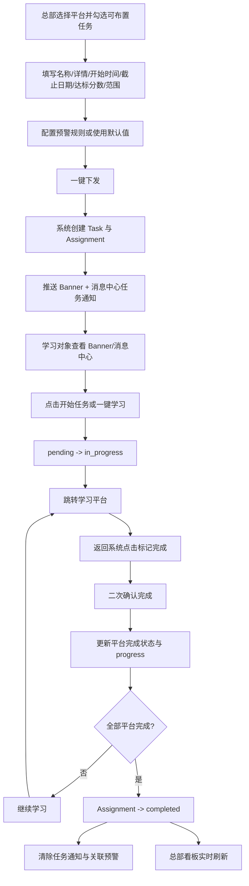
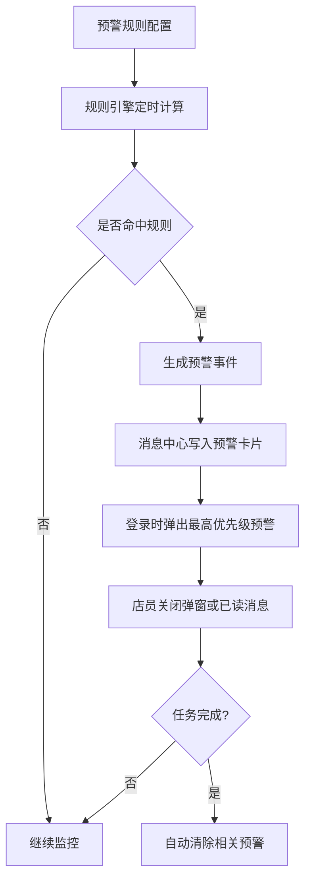
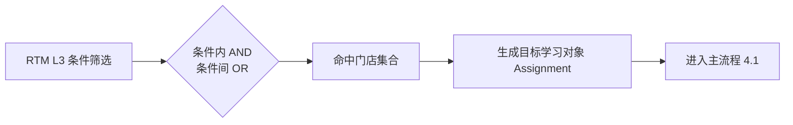
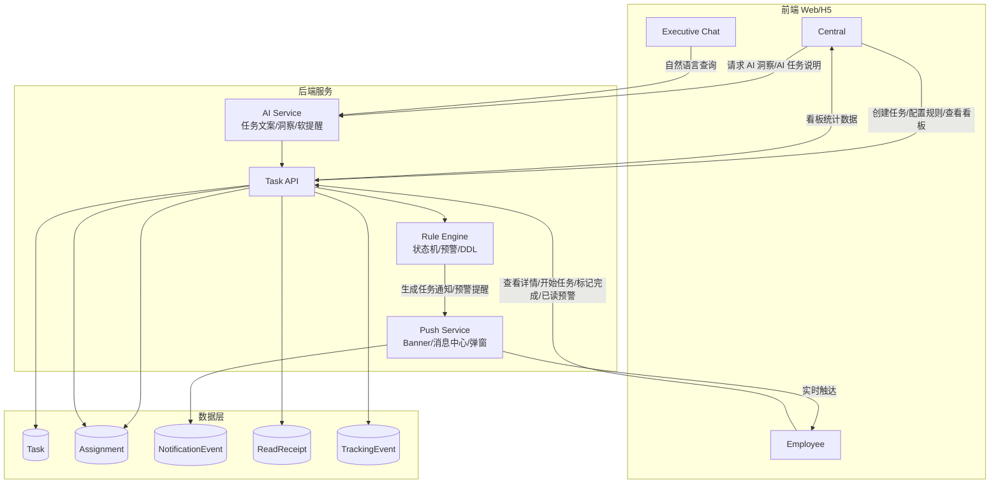
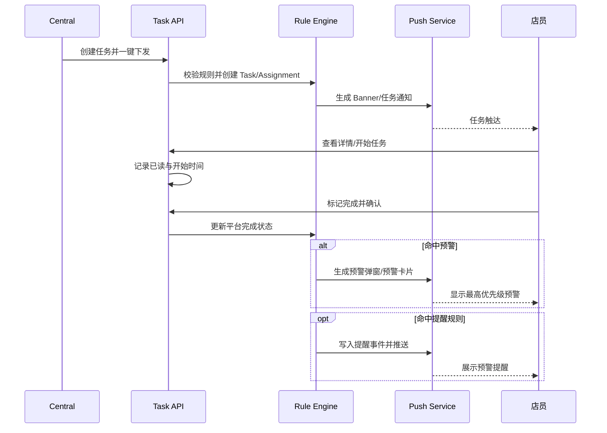
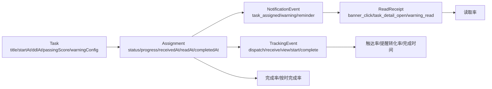

# 产品需求文档（PRD，整合版）

文档版本：4.0.4
发布日期：2026-04-09
产品经理：Product Team
文档状态：Spec-ready（可直接驱动 specs 与开发）
适用范围：MVP（仅限当前版本范围，不含未来扩展）

---

## 0. TL;DR

本期 MVP 以两个核心并行驱动：**任务管理闭环**（总部下发培训任务 → 店员接收执行 → 系统规则触发预警提醒）和 **Executive Chat**（高管用自然语言查询全网培训状态，5秒内得到结构化回答）。系统以 `Task` 和 `Assignment` 为核心对象，通过明确状态机（`pending -> in_progress -> completed`）、平台完成规则（`MyPAL` 优先对接判定、不可用时可降级手动）和预警提醒规则，保证任务可执行、可追踪、可验收。Executive Chat 作为 P1 功能，在任务管理闭环跑通后实现。**当前工程实现**为前端 **Vue 3 + Vite**、后端 **Node.js（REST `/api/v1`）**，细节见**附录 F**。

---

## 1. 产品概览与背景

### 1.1 产品定位

一个面向企业零售培训场景的任务执行与经营洞察平台，采用**规则引擎 + AI 增强**的双能力架构：

1. **规则引擎驱动的培训闭环（P0）**：总部按学习平台选择可布置任务，配置开始时间、截止日期、达标分数、下发范围与预警规则后批量下发；学习对象在 Banner 和消息中心接收任务、开始学习、标记完成；系统基于规则自动触发预警提醒，总部实时跟踪完成进度与预警结果。店长不设独立管理端，但可作为学习对象被下发任务，并与店员共用同一学习端体验。
2. **数据看板与预警运营（P0）**：围绕完成率、按时完成率、人均完成时间、链路转化与预警率形成总部经营看板，支持按 RTM L4 渠道查看差异，并回看已布置任务、任务详情与预警规则。
3. **AI 提效与决策支持（P1）**：通过 Executive Chat、AI 任务说明生成、AI 一句话洞察、智能软提醒等能力，降低总部写任务和分析数据的成本，同时提升一线提醒的转化效果。

系统以独立 H5 Web App 交付，用户在局域网内通过 URL 或扫码访问，无需安装；**当前仓库**采用 **Vue 3 + Vite** 实现多角色前端页面，与「浏览器访问、不依赖应用商店安装」一致，技术细节见**附录 F**。

### 1.2 产品愿景

让总部从“人工布置和追人”转向“规则化下发与数据化管理”，让店员在明确、轻量、可提醒的体验中完成培训，并让高管随时用自然语言获取关键经营结论。

### 1.3 业务场景

- 新品上市培训：总部快速面向全国门店批量布置与新品相关的学习任务，并配置时效和达标标准。
- 培训过程运营：通过预警规则识别掉队、起步异常和 deadline 危机场景，及时智能干预。
- 数据看板运营：总部通过数据看板持续监控整体完成率、按时完成率、人均完成时间、链路转化和预警率，并按 RTM L4、门店、个人等维度定位问题任务与风险人群。
- 终端学习触达：店员通过 Banner、消息中心和弹窗接收任务与预警，快速进入学习动作。
- 高管洞察与 AI 决策支持：Executive 或总部运营通过 AI 获取结构化结论、追问下钻和可视化辅助理解。

### 1.4 当前痛点

- 总部布置培训任务依赖手工整理内容，任务字段和说明不标准，创建效率低。
- 任务下发后缺少统一的 Banner、消息中心和预警触点，店员容易错过紧急任务。
- 总部无法系统化配置预警规则，只能事后人工排查掉队人员和 deadline 风险。
- 现有数据视图更偏结果统计，缺少触达、已读、开始学习、提醒转化等链路指标，难以定位问题发生在哪一环。
- 总部难以同时按 `RTM L3` 范围和 `RTM L4` 渠道维度快速看清完成效率差异，也缺少任务详情与预警规则的回看入口。
- 高管和业务负责人仍依赖人工汇总解读数据，难以快速得到“现在最该关注什么”的结论。

### 1.5 MVP 目标

- 总部可基于学习平台快速选择可布置任务，完成标准化任务创建、预警配置与一键下发。
- 总部可通过统一看板掌握完成率、按时完成率、人均完成时间、链路数据和预警数据，并支持查看已布置任务详情。
- 店员可通过 Banner、消息中心和任务详情低门槛开始学习、跳转学习平台并完成任务确认。
- 系统可输出可追踪、可判定、可触达、可自动提醒的培训闭环结果。
- （P1）AI 能辅助总部生成任务说明、输出一句话业务洞察，生成智能提醒文案，并支持 Executive 通过自然语言查询培训状态。

---

## 2. 目标用户与角色定义

### 2.1 目标用户规模（MVP mock）

| 用户角色 | 数量 | 主要行为 | 核心需求 |
| --------- | ----- | -------------- | --------- |
| 总部运营 | 1 人 | 创建任务、配置预警、下发、查看数据 | 低成本布置任务、快速定位风险、全局掌握 |
| 学习对象（含店员与店长学习对象） | 300 人 | 接收任务、开始学习、标记完成、查看预警 | 触达及时、操作简单、提醒明确 |
| Executive | 若干 | 自然语言查询培训进度数据 | 实时数据、秒级响应、可持续追问 |

### 2.2 角色定义

#### 总部（Central）

- 创建任务时先选择学习平台，并从平台对应任务池中勾选可布置任务
- 配置任务名称、详情描述、开始时间、截止日期、倒计时、达标分数与下发范围
- 配置三类预警规则：进度掉队、起步异常、deadline 危机；未配置时使用默认规则
- 查看总部实时看板，跟踪整体完成率、按时完成率、人均完成时间、RTM L4 渠道差异、链路转化和预警率
- 查看已布置任务列表，并进入单任务详情和预警规则回看页面
- 配置规则并查看系统自动触发的预警提醒结果
- （P1）使用 AI 辅助生成标准化任务说明与一句话业务洞察

#### 店员（Employee）

- 通过 Banner 区、消息中心和弹窗接收新任务与预警提醒
- 在任务卡片中查看任务名称、截止时间/倒计时、达标分数、学习平台等关键信息
- 点击“开始任务”进入对应学习平台，点击“标记完成”并确认完成状态
- 查看任务详情，完成任务后自动清除相关任务通知与预警信息
- 通过“查看详情”或“去完成”动作触发任务已读
- MVP 不提供反馈/需要帮助入口
- （P1）接收基于时间紧迫度和个人习惯生成的智能软提醒文案

#### 店长（作为学习对象）

- 店长不设独立管理端、监管能力或单独页面
- 当总部在下发范围中选择“店长”时，店长作为学习对象接收任务
- 店长与店员共用同一学习端：Banner、消息中心、任务详情、标记完成、预警提醒规则一致
- 店长仅可见本人被下发的任务、本人进度与本人提醒，不具备额外管理权限

#### Executive（P1）

- VP：查看全国维度培训进度数据
- 区域总监：查看本辖区维度培训进度数据
- 通过独立H5页面，用自然语言提问，获取结构化回答
- 支持多轮追问，从全国下钻到区域、门店、个人
- 具备短期记忆机制保持上下文，部分查询支持数据可视化

---

## 3. 范围定义与优先级

### 3.1 本期必须实现（P0）

- 任务创建字段完整化：任务名称、任务详情、开始时间、截止日期、倒计时、学习平台、达标分数、下发范围
- 平台优先的任务布置流程：先选择学习平台，再加载该平台下可布置任务，并支持复选框勾选任务
- `MyPAL` 开始时间同步：开始时间需同步到 `MyPAL` 侧“任务周学习开始时间”字段
- 下发范围选择：支持全部、`RTM L3`、店长等目标范围配置；其中“全部”包含店员与店长学习对象，`RTM L3` 口径包含 `Multibrand`、`Monobrand`、`Education`
- 一键下发并生成分配记录（`Assignment`）
- 学习对象任务执行与查看（店员与店长学习对象共用同一前端）
- 店员 Banner 区任务触达：总部下发后自动生成不可关闭的任务 Banner，展示任务名称与倒计时，并支持“一键学习”
- 店员消息中心任务系统：任务卡片展示任务名称、截止时间/倒计时、达标分数、学习平台；支持“开始任务”“标记完成”“查看详情”
- 任务已读规则：点击“查看详情”、任务卡片去完成入口或 Banner 区去完成入口均记为已读
- 任务完成交互：点击“标记完成”后需二次确认；任务完成后相关任务通知与对应预警自动消失
- Assignment 状态机流转（`pending -> in_progress -> completed`）
- 平台完成判定与任务完成判定（`MyPAL` 优先对接判定、不可用时可降级手动；其余平台按手动确认完成）
- 总部任务级预警规则配置：支持进度掉队、起步异常、deadline 危机三类规则；未配置时启用默认阈值
- 店员预警通知系统：消息中心可查看预警，支持“已读”关闭；登录时按优先级弹出最紧急预警
- 预警排序与提醒规则：`deadline危机P0 > deadline危机P1 > 起步异常 > 进度掉队`；弹窗可关闭，但消息中心保留记录
- 总部实时看板：整体完成率、人均完成时间、整体按时完成率、RTM L4 渠道完成率/人均完成时间、按天/小时完成趋势
- 链路数据看板：任务触达率、任务读取率、提醒转化率
- 预警数据看板：起步异常预警率、进度危机预警率（P1/P0）
- 已布置任务管理：支持查看已布置任务列表，并进入“查看任务详情”“查看预警规则”
- 埋点采集：记录总部下发时间、终端接收任务、用户查看任务、开始学习、点击完成任务等关键事件
- 预警通知触达与持续显示（任务完成前持续、完成后自动消失）
- 预警事实记录（完整事件记录）
- 权限与可见性隔离（总部全量、店员仅本人）
- 独立 H5 Web App，用户在局域网内通过 URL 访问，无需安装

### 3.2 可选/后续实现（P1）

- **Executive Chat**：高管自然语言查询培训进度，支持全国/区域/门店/个人下钻，≤5秒结构化回答，支持至少3轮追问，VP看全国，区域总监看辖区
- Executive Chat 短期记忆：保持连续对话上下文，支持追问链路
- Executive Chat 数据可视化：部分查询返回图表化结果辅助理解
- AI 辅助生成标准任务说明：总部输入核心关键词后自动生成结构化任务详情文案，并复用已填写字段
- AI 一句话智能业务分析：基于当前看板数据生成 1-2 句管理层可直接理解的业务洞察
- 智能软提醒：根据剩余时间、历史习惯、预计完成时间、门店整体进度等变量动态生成提醒文案
- 下发预览
- 下发历史查询
- 预警提醒记录查询增强（筛选/统计视图）
- 报表导出

### 3.3 后续版本（P2）

- AI Agent 自动化能力（自动扫描/预警提醒/统计/情报）
- Executive Chat 主动推送（CE-006）
- RAG Chatbot（EA-007）
- 基于答题时间偏好的智能推送编排
- 更复杂的预警策略自动优化与个性化推荐
- 高级分析与推荐

### 3.4 本期明确不做

- 多语言支持
- 第三方系统深度集成（如 HR 系统）
- 跨地域访问能力
- 复杂预警升级操作界面
- 全量自动化 AI 决策闭环（仅保留人工确认或后续版本规划）

---

## 4. 核心业务流程

### 4.1 主流程（总部建任务 -> 店员接收学习 -> 系统触发预警提醒闭环）

1. 总部进入任务创建页，先选择学习平台。
2. 系统依据所选学习平台加载当前可布置的任务清单，总部通过复选框选择目标学习任务。
3. 总部填写任务名称、详情描述、开始时间、截止日期、倒计时、达标分数和下发范围；下发范围支持全员、`RTM L3` 门店范围以及仅店长范围，其中“全员”包含店员与店长学习对象；任务详情区域位于名称、平台、时间和分数字段下方，便于统一信息提取。
4. 总部在任务创建页下方配置预警规则；若未配置，系统自动使用默认预警阈值。
5. 总部点击“一键下发”，系统创建 `Task` 并按目标范围生成 `Assignment`；若范围选择“店长”，则仅为目标门店的店长生成学习任务。
6. 若平台包含 `MyPAL`，系统将任务开始时间同步到 `MyPAL` 侧“任务周学习开始时间”字段。
7. 系统向目标学习对象推送任务 Banner 和消息中心任务通知，同时记录“总部下发时间”和“终端成功接收指定任务”等埋点事件。
8. 学习对象登录 H5 后看到不可关闭的任务 Banner 和消息中心任务卡片；Banner 展示任务名称与倒计时，并提供“一键学习”入口。
9. 学习对象点击 Banner 的“一键学习”按钮或消息中心“开始任务”按钮后，系统将对应 `Assignment` 从 `pending` 更新为 `in_progress`，同时跳转至对应学习平台。
10. 学习对象返回系统后点击“标记完成”，系统弹出二次确认弹窗；用户确认后，系统按平台规则更新完成状态和进度。
11. 当所有配置平台均满足完成条件时，系统将 `Assignment` 更新为 `completed`，记录完成时间，并自动清除该任务在消息中心中的任务通知及相关预警信息。
12. 总部数据看板实时刷新整体完成率、按时完成率、人均完成时间、链路指标和预警指标。
13. 若系统命中预警规则，系统自动向对应学习对象下发预警提醒；提醒在任务完成前持续显示。

### 4.2 预警生成与通知流程

1. 总部为任务配置预警规则，支持进度掉队、起步异常、deadline 危机三类规则。
2. 系统基于 `Assignment` 进度、门店内排名、任务剩余时间等数据定时计算预警命中结果；若任务下发给店长，则店长学习对象与店员按同一门店共同排名并参与对应规则计算。
3. 若未配置自定义阈值，则系统采用默认规则：
   - 进度掉队（仅 `Monobrand`）：`mono-LF` 取门店最后 3 位，`mono-mono` 取门店最后 1 位
   - 起步异常：任务期限过半但进度为 0
   - deadline 危机：距离 deadline `<24h` 且未完成为 `P0`，距离 deadline `<48h` 且未完成为 `P1`
4. 系统在消息中心生成对应预警卡片，支持学习对象点击“已读”关闭该条预警。
5. 学习对象登录时，系统按优先级弹出最紧急的预警消息，排序规则为：`deadline危机P0 > deadline危机P1 > 起步异常 > 进度掉队`。
6. 预警弹窗采用强提醒样式和灯箱效果，可关闭；关闭后消息中心仍保留对应预警信息，直至已读或任务完成。
7. 当任务完成时，系统自动移除该任务关联的预警提示。

### 4.3 数据看板与任务回看流程

1. 总部进入数据看板页，默认查看北极星指标：整体完成率和人均完成时间。
2. 系统同步展示整体按时完成率、RTM L4 渠道完成率和人均完成时间差异。
3. 完成人数趋势支持按天和按小时查看：
   - 按天：折线图展示累计完成人数，柱状图展示当日新增完成人数
   - 按小时：默认展示当日分小时数据，并支持切换其他日期
4. 总部在链路区域查看任务触达率、任务读取率和提醒转化率，在预警区域查看起步异常预警率、进度危机预警率（P1/P0）。
5. 总部点击右上角“已布置的任务”按钮，进入已布置任务列表。
6. 在已布置任务列表中，总部可查看任务基础信息，并进入“查看任务详情”或“查看预警规则”页进行回看。

### 4.4 业务流程图（供 AI 理解）

### 4.5 AI 友好数据流图（Task/Assignment/Notification）

---

### 4.6 工程字段建议（可直接实现）

建议在不改变业务口径前提下，优先落以下关键字段（用于任务布置、预警计算、消息触达、已读统计与埋点分析）：

- `Task`：`taskId`, `title`, `detail`, `platforms[]`, `selectedContentIds[]`, `startAt`, `ddlAt`, `countdownText`, `passingScore`, `scope`, `warningConfig`, `status`
- `Assignment`：`assignmentId`, `taskId`, `userId`, `storeId`, `status`, `progress`, `receivedAt`, `readAt`, `startedAt`, `completedAt`, `mypalCompleted`, `smartSellCompleted`, `aiDemoCompleted`, `liveBroadcastCompleted`, `updatedAt`
- `NotificationEvent`：`eventId`, `taskId`, `assignmentId?`, `targetUserId`, `eventType`, `severity?`, `source`, `popupVisible`, `dedupeKey`, `createdAt`
- `ReadReceipt`：`receiptId`, `eventId`, `userId`, `readAt`, `source`（`banner_click` / `task_detail_open` / `start_task_click` / `warning_read`）
- `TrackingEvent`：`eventId`, `taskId`, `userId`, `eventType`, `eventAt`, `payload`

字段口径提示：

- `eventType` 建议枚举：`task_assigned`, `task_warning_p0`, `task_warning_p1`, `task_warning_start_anomaly`, `task_warning_lagging`, `task_reminder`, `task_completed`
- `source` 用于区分 `banner`、`message_center`、`popup` 等触达入口
- `dedupeKey` 用于任务类通知与预警消息幂等；提醒事件每次触发需生成新 `eventId`

> **⚙️  工程注释（字段迁移参考）**
>
> **已有字段映射（无需新增，仅 PRD 重命名）：**
> - `Task.detail` → 现有 DB 字段 `description`
> - `Task.passingScore` → 现有 DB 字段 `pass_score`
> - `Task.warningConfig` → 现有 DB 字段 `auto_nudge_rules`
> - `Task.startAt` → 现有 DB 字段 `start_at`
> - `Assignment.receivedAt / startedAt / completedAt` → 现有 DB 字段 `received_at / started_at / completed_at`
>
> **需新增字段（ADD COLUMN，nullable，不破坏现有代码）：**
> - `tasks`：`countdown_text`、`selected_content_ids`（JSON）
> - `task_assignments`：`read_at`
> - `notification_events`：`source`、`popup_visible`（默认 0）
> - 新建表 `tracking_events`
>
> **⚠️  需迁移（涉及枚举变更）：**
> - `notification_events.event_type`：现有枚举含 `nudge_yellow`、`nudge_red`，新口径改为 `task_warning_*` 系列；建议新旧枚举值并行，待旧接口下线后统一迁移
> - `read_receipts.source`：扩展新值 `banner_click`、`start_task_click`、`warning_read`，新旧并存
>
> **待废弃表：**
> - `nudge_records`：人工催办架构下的催办记录表，新架构中不再写入；暂保留，待相关接口下线后删除
- `TrackingEvent.eventType` 建议至少覆盖：`task_dispatched`, `task_received`, `task_viewed`, `task_started`, `task_completed`

---

## 5. 功能需求（按业务能力分组）

### 5.1 总部任务创建与下发

- 创建任务时需填写：任务名称、详情描述、开始时间、截止日期、倒计时、学习平台、达标分数、下发范围
- 创建任务时采用“先选学习平台，再加载可布置任务”的交互方式
- 系统需根据不同学习平台动态调取可布置任务清单，支持复选框勾选多个任务
- 任务详情区域位于任务名称、学习平台、开始时间、截止日期、倒计时和达标分数字段下方，便于统一提取结构化信息
- 若平台包含 `MyPAL`，开始时间需自动同步至 `MyPAL` 端“任务周学习开始时间”字段
- 下发范围支持全部、`RTM L3`、店长等目标范围筛选，其中 `RTM L3` 包含 `Multibrand`、`Monobrand`、`Education`
- 提供“一键下发”按钮，点击后批量下发给符合条件对象
- 下发时需记录总部下发时间，并更新任务总数等统计信息

### 5.2 总部预警规则设计

- 预警规则配置区作为任务创建页下方的独立任务框展示
- 支持三类预警规则配置：
  - 进度掉队（仅针对 `Monobrand`）
  - 起步异常
  - deadline 危机
- 进度掉队支持配置：
  - 个人任务完成率处于门店最后 `X` 位（`mono-LF`）
  - 个人任务完成率处于门店最后 `X` 位（`mono-mono`）
- 起步异常支持配置：期限达到 `X%` 但进度为 0
- deadline 危机支持配置：
  - 距离 deadline `<XXh` 且未完成课程（P0）
  - 距离 deadline `<XXh` 且未完成课程（P1）
- 若总部未手动配置，则系统启用默认规则：
  - `mono-LF` 默认门店最后 3 位
  - `mono-mono` 默认门店最后 1 位
  - 起步异常默认“期限过半但进度为 0”
  - deadline 危机默认 `P0=<24h`、`P1=<48h`
- 已布置任务列表中需支持“查看预警规则”入口

### 5.3 总部数据看板与任务回看

- 北极星指标需将“整体完成率 / 人均完成时间”明显居中置顶展示
- 展示整体任务按时完成率：`Deadline 前完成人数 / 应完成总人数`
- 展示人均完成时间：从任务下发到标记完成的平均耗时
- 支持按 `RTM L4` 展示完成率和人均完成时间，具体渠道包括：`Education`、`Lifestyle`、`Mass Merchant`、`Mono`、`OTC`
- 完成人数趋势图支持按天 / 按小时切换
- 按天展示时：
  - 折线图展示累计新增完成人数
  - 条形图展示当日新增完成人数
- 按小时展示时：
  - 默认展示当日分小时数据
  - 支持切换查看其他日期的分小时数据
- 链路数据需展示：
  - 任务触达率：成功收到任务的人员数 / 总人员数
  - 任务读取率：已读任务消息占总任务消息比重
  - 提醒转化率：点击开始学习任务数 / 总任务数
- 预警数据需展示：
  - 起步异常预警率
  - 进度危机预警率（P1）
  - 进度危机预警率（P0）
- 看板右上角置顶“已布置的任务”按钮，点击可查看已布置任务
- 已布置任务列表中，每条任务需提供“查看任务详情”“查看预警规则”两个按钮
- 点击“查看任务详情”后可查看任务详细信息
- 点击“查看预警规则”后可查看任务对应的预警规则
- （P1）数据看板提供“AI 洞察”按钮，基于当前统计数据输出 1-2 句业务洞察

### 5.4 学习对象 Banner 与消息中心

- 当总部下发一个任务时，Banner 区自动创建一个任务 Banner，带“一键学习”按钮，且不可关闭
- Banner 内容仅包含任务名称和倒计时
- 点击 Banner 上“一键学习”之外的区域时，自动跳转到消息中心中该任务对应通知
- 动态倒计时仅在 Banner 区的待完成紧急任务卡片中显示
- 消息中心任务卡片列表展示：任务名称、截止时间和倒计时、达标分数、学习平台
- 任务卡片提供“开始任务”按钮，点击后跳转到对应学习平台进行学习
- 任务卡片提供“标记完成”按钮，点击后弹出“请您确认是否完成”的确认弹窗；点击“确认完成”后记为完成
- 任务完成后，消息中心中的任务通知和相关预警需自动消失
- 用户点击卡片上除按钮外的其他区域时，进入任务详情
- 任务详情需包含：任务名称、倒计时、学习平台、达标分数、任务详情
- 任务信息不可手动关闭
- 左上角展示欢迎文案：`hi！XXX（用户昵称）`、`XXXX店（店铺名称）`
- 店长学习对象与店员共用同一 Banner、消息中心、任务详情与完成交互，不新增独立店长端页面

### 5.5 学习对象预警通知与自动提醒

- 消息中心需承载预警系统，预警消息支持“已读”按钮，点击后关闭该条预警
- 登录后系统需弹出当前最紧急的预警消息
- 预警消息排序规则为：`deadline危机P0 > deadline危机P1 > 起步异常 > 进度掉队`
- 预警通知采用视觉强干预样式，可使用轻微闪烁等微动效
- 预警弹窗样式与消息中心消息卡片保持一致，并带灯箱效果
- 预警弹窗可关闭；关闭后消息中心仍需保留相关信息
- 系统基于预警规则自动触发提醒，无需总部人工发起
- 同一任务允许在不同命中时点重复触发提醒，且每次都需记录完整事实
- 提醒提示在任务完成前持续显示，任务完成后自动结束
- （P1）预警消息可根据员工历史答题时间偏好，在更合适的时间段进行推送

### 5.6 任务已读与埋点采集

- 当用户点击消息中心中的“查看详情”按钮，视为已读任务
- 当用户点击消息中心中的“去完成”按钮，视为已读任务
- 当用户点击 Banner 区的“去完成 / 一键学习”按钮，视为已读任务
- 需记录用户点击完成任务的时间
- 需记录总部下发任务时间，并同步更新任务总数
- 需记录终端成功接收指定任务
- 需记录用户点击查看任务的行为
- 需记录用户点击学习任务的时间及开始任务数

### 5.7 Executive Chat（P1）

- 独立 H5 页面，扫码或点链接直接打开，自动识别身份和数据权限
- 支持四类查询意图：
  - 培训进度查询（“Q1 新品培训完成率？”）
  - 项目状态查询（“Trade-in 准备到哪一步了？”）
  - 预警查询（“现在有什么问题需要关注？”）
  - 区域 / 门店下钻（“华东区怎么样？”“最差的 5 家门店是哪些？”）
- 统一回答格式：状态概览 → 关键数字 → 需关注事项 → 追问引导
- 支持多轮对话，需具备短期记忆机制保持上下文
- 部分查询支持数据可视化

### 5.8 AI 辅助能力（P1）

- 在“创建任务”页面提供“AI 一键创建任务”按钮
- 总部只需输入核心关键词，AI 自动扩写为结构清晰、带激励性质的标准化任务卡片文案
- AI 生成结果至少包含：学习目标、核心知识点、预计耗时提示
- AI 按钮位于任务详情框内，生成时需提取已填写字段（如名称、日期、平台、达标分数等）并以结构化参数传入模型
- AI 生成的任务描述应包括预计完成时间、学习重难点，并以结构化形式输出
- 数据看板中的 AI 洞察需基于北极星指标、P0/P1 预警率、链路漏斗、RTM L4 差异和时序数据输出最值得关注的 1 个核心结论
- （P1）智能软提醒可基于剩余时间、历史完成习惯、预计完成时间、个人当前进度、门店整体进度和个人进度排名，动态生成提醒文案
- 智能软提醒需遵循：
  - 剩余时间越短，语气越紧急，但必须通过“预计完成时间”降低畏难情绪
  - 对积极型用户以“肯定与激励”为主，对拖延型用户以“降负与陪伴”为主
  - 严禁直接输出“倒数第一”“掉队”等负面施压表述，需转化为目标差距和团队荣誉表达

---

## 6. 关键规则（系统口径）

### 6.1 `Task` 创建与下发规则

- 创建任务时必填字段为：`title`、`detail`、`startAt`、`ddlAt`、`countdownText`、`platforms[]`、`passingScore`、`scope`
- 创建流程必须遵循“**先选学习平台，再加载可布置任务**”的交互顺序；总部仅可从当前平台对应的可布置任务池中通过复选框选择任务内容
- 每个 `Task` 至少配置 1 个学习平台；若平台支持内容布置，则至少勾选 1 个有效任务内容
- 任务详情展示位置固定在任务名称、学习平台、开始时间、截止日期、倒计时和达标分数字段之下，便于字段提取与 AI 生成
- 当 `platforms[]` 包含 `MyPAL` 时，`startAt` 必须自动同步至 `MyPAL` 侧“任务周学习开始时间”字段
- 下发范围在 P0 支持：`全部`、`RTM L3`、店长，其中 `RTM L3` 包含 `Multibrand`、`Monobrand`、`Education`
- `Task` 状态机为：`draft -> dispatched`；MVP 不支持撤回，`dispatched` 为终态
- 下发后系统按目标范围生成 `Assignment`；同一学习对象（店员或店长学习对象）对同一任务仅生成 1 条 `Assignment`，重复下发需保持幂等

### 6.2 `Assignment` 状态机与已读规则

- `Assignment` 是任务执行、进度判定、预警命中与提醒触达的最小单位
- 初始状态为 `pending`
- 学习对象点击 Banner 的“一键学习”按钮、消息中心“开始任务”按钮或等价开始入口后，状态变更为 `in_progress`
- 当所有配置平台均满足完成条件后，状态变更为 `completed`
- `completed` 为终态，不允许回退到 `pending` 或 `in_progress`
- `pending` 状态下禁止标记平台完成
- 以下行为视为任务已读：
  - 点击消息中心“查看详情”
  - 点击消息中心“去完成 / 开始任务”
  - 点击 Banner 区“一键学习 / 去完成”
- 任务完成后，消息中心中的任务通知和该任务关联的预警提醒自动消失
- 店长学习对象与店员共用相同的已读、开始、完成和提醒规则

### 6.3 平台完成与任务完成规则

- 平台集合固定为：`MyPAL`、`SmartSell`、`AI Demo`、`Live Broadcast`
- 平台完成规则：
  - `MyPAL`：优先由对接数据判定完成；若对接不可用，允许降级为店员手动标记完成
  - `SmartSell` / `AI Demo` / `Live Broadcast`：店员在系统内点击“标记完成”并确认后视为完成
- 标记完成必须经过二次确认弹窗；未确认不得写入完成态
- 进度计算规则：`progress = 已完成平台数 / 配置平台总数 * 100`
- 任务完成规则：某 `Assignment` 的全部配置平台均完成后，系统写入 `completedAt`，并将状态更新为 `completed`
- 人均完成时间口径：`completedAt - dispatchedAt`
- 按时完成口径：`completedAt <= ddlAt`

### 6.4 预警规则与默认值

- P0 仅支持三类预警规则：
  - 进度掉队（仅针对 `Monobrand`）
  - 起步异常
  - deadline 危机
- 进度掉队支持两类可配置口径：
  - `mono-LF`：个人任务完成率处于门店最后 `X` 位
  - `mono-mono`：个人任务完成率处于门店最后 `X` 位
- 起步异常配置口径：任务期限达到 `X%` 但进度为 0
- deadline 危机配置口径：
  - `P0`：距离 deadline `< XXh` 且未完成课程
  - `P1`：距离 deadline `< XXh` 且未完成课程
- 若总部未配置自定义阈值，系统使用默认值：
  - `mono-LF = 门店最后 3 位`
  - `mono-mono = 门店最后 1 位`
  - 起步异常 = `任务期限过半且进度为 0`
  - deadline 危机 `P0 = <24h`，`P1 = <48h`
- 预警优先级固定为：`deadline危机P0 > deadline危机P1 > 起步异常 > 进度掉队`

### 6.5 预警提醒触达规则

- 提醒仅支持基于规则的系统自动触发，不支持总部人工发起
- 同一任务在不同命中时点允许重复触发提醒，并保留完整事件记录
- 预警弹窗在店员登录后默认展示当前最高优先级提醒
- 预警弹窗可关闭；关闭后消息中心仍需保留对应预警消息
- 预警消息支持“已读”动作；点击已读后关闭该条预警消息
- 任务未完成时，提醒持续显示；任务完成后自动移除关联提醒
- P1 支持根据员工历史答题时间偏好，在更合适的时间段触发提醒
- P1 支持基于员工习惯与上下文生成 AI 软提醒文案，但不得使用“倒数第一”“掉队”等直接负面表达

### 6.6 总部看板口径规则

- 北极星指标固定为：`整体完成率`、`人均完成时间`
- 整体按时完成率口径：`Deadline 前完成人数 / 应完成总人数`
- `RTM L4` 渠道看板固定展示：`Education`、`Lifestyle`、`Mass Merchant`、`Mono`、`OTC`
- 完成人数趋势图规则：
  - 按天：折线图展示累计完成人数，条形图展示当日新增完成人数
  - 按小时：默认展示当日分小时数据，支持切换其他日期
- 链路数据口径：
  - 任务触达率 = `成功收到任务人数 / 总目标人数`
  - 任务读取率 = `已读任务消息人数 / 成功收到任务人数`
  - 提醒转化率 = `点击开始学习任务数 / 总任务数`
- 预警数据口径：
  - 起步异常预警率 = `起步异常人数 / 总员工数`
  - 进度危机预警率（P1）= `距离 deadline < 48h 且未完成人数 / 总员工数`
  - 进度危机预警率（P0）= `距离 deadline < 24h 且未完成人数 / 总员工数`
- 看板右上角固定提供“已布置的任务”入口；每个任务需支持查看任务详情和查看预警规则

### 6.7 可见性与体验规则

- 总部可见全量任务、全量看板与全量预警结果
- 学习对象（店员或店长学习对象）仅可见本人任务、本人进度、本人预警提醒
- 店员侧不提供“反馈 / 需要帮助”入口
- 左上角欢迎文案固定为：`hi！XXX（用户昵称）`、`XXXX店（店铺名称）`

### 6.8 RTM L3 筛选规则（MVP）

- P0 的下发范围筛选以 `RTM L3` 为准，用于筛选命中门店集合
- `RTM L3` 固定口径包含：`Multibrand`、`Monobrand`、`Education`
- 多个 `RTM L3` 条件之间为 `OR` 关系，任一命中即可纳入下发范围
- 选择“店长”范围时，系统应按命中门店生成店长学习对象 `Assignment`；若与 `RTM L3` 组合使用，则仅命中对应 `RTM L3` 范围内门店的店长
- 当筛选结果为 0 时，允许展示 0 结果并阻止误下发，需明确提示“当前筛选无门店命中”
- 门店 `RTM L3` 字段需在导入前完成数据清洗；系统建议同时做大小写不敏感匹配兜底

---

## 7. 平台口径与数据落库

### 7.1 平台集合与任务内容落库

- 固定平台集合包含：`MyPAL`、`SmartSell`、`AI Demo`、`Live Broadcast`
- 创建任务时，需落库以下核心字段：
  - `taskId`, `title`, `detail`, `platforms[]`, `selectedContentIds[]`, `startAt`, `ddlAt`, `countdownText`, `passingScore`, `scope`, `warningConfig`, `status`
- 若任务包含平台级可布置内容，`selectedContentIds[]` 必须保存总部勾选的实际任务内容
- 若任务包含 `MyPAL`，需同时记录同步状态或同步结果，便于排查开始时间同步异常

### 7.2 `Assignment` 与平台完成落库动作

- 下发成功时，为每个目标学习对象写入一条 `Assignment`
- `Assignment` 建议核心字段：
  - `assignmentId`, `taskId`, `userId`, `storeId`, `status`, `progress`, `receivedAt`, `readAt`, `startedAt`, `completedAt`, `updatedAt`
- 平台完成字段建议独立存储：
  - `mypalCompleted`
  - `smartSellCompleted`
  - `aiDemoCompleted`
  - `liveBroadcastCompleted`
- 平台完成落库动作：
  - `MyPAL`：优先由对接同步/查询成功后写入 `mypalCompleted=true`；若走降级路径，则由店员确认完成后写入
  - `SmartSell`：店员确认完成后写入 `smartSellCompleted=true`
  - `AI Demo`：店员确认完成后写入 `aiDemoCompleted=true`
  - `Live Broadcast`：店员确认完成后写入 `liveBroadcastCompleted=true`
- 当任一阅读、开始、完成动作发生时，需同步更新 `readAt`、`startedAt`、`completedAt` 等时间字段

### 7.3 预警提醒落库动作（MVP 口径）

- 系统命中预警规则并触发提醒时，需要落库提醒历史
- `NotificationEvent` 建议包含：
  - `eventId`, `taskId`, `assignmentId`, `targetUserId`, `eventType`, `severity`, `source`, `popupVisible`, `dedupeKey`, `createdAt`
- `eventType` 建议覆盖：
  - `task_assigned`
  - `task_warning_lagging`
  - `task_warning_start_anomaly`
  - `task_warning_p1`
  - `task_warning_p0`
  - `task_reminder`
  - `task_completed`
- 对应 `Assignment` / 学习对象可记录 `reminderCount + 1`
- 提示显示与消失以 `Assignment.completed` 为准自动结束

### 7.4 已读与埋点落库动作

- `ReadReceipt` 建议包含：
  - `receiptId`, `eventId`, `userId`, `readAt`, `source`
- `source` 建议覆盖：
  - `banner_click`
  - `task_detail_open`
  - `start_task_click`
  - `warning_read`
- `TrackingEvent` 建议覆盖以下埋点：
  - `task_dispatched`
  - `task_received`
  - `task_viewed`
  - `task_started`
  - `task_completed`
- 需记录以下关键业务事件：
  - 总部下发任务时间
  - 终端成功接收指定任务
  - 用户点击查看任务
  - 用户点击开始学习
  - 用户点击确认完成

---

## 8. 页面与模块结构

### 8.1 总部端任务发布页

- 顶部为任务基础信息区：
  - 学习平台选择
  - 可布置任务复选框列表
  - 任务名称
  - 开始时间
  - 截止日期
  - 倒计时
  - 达标分数
  - 下发范围（`全部` / `RTM L3`/店长，其中 `RTM L3` 包含 `Multibrand`、`Monobrand`、`Education`）
- 任务详情框位于上述字段下方，支持手工录入或 AI 生成
- 页面下方为预警规则配置区，作为独立任务框展示
- 页面底部提供“一键下发”主按钮

### 8.2 总部端数据看板与任务回看页

- 看板顶部居中展示北极星指标：整体完成率、人均完成时间
- 看板主体区域包括：
  - 整体按时完成率
  - `RTM L4` 完成率与人均完成时间下钻（`Education`、`Lifestyle`、`Mass Merchant`、`Mono`、`OTC`）
  - 按天 / 按小时完成人数趋势图
  - 任务触达率、任务读取率、提醒转化率
  - 起步异常预警率、进度危机预警率（P1/P0）
- 右上角固定展示“已布置的任务”入口
- 已布置任务列表页中，每个任务需提供：
  - “查看任务详情”
  - “查看预警规则”
- 任务详情页需展示任务完整基础信息与任务详情
- 预警规则页需展示当前任务的规则配置与默认值回退情况
- （P1）看板页提供“AI 洞察”按钮

### 8.3 学习对象端 Banner 区与消息中心

- Banner 区：
  - 总部下发任务后自动生成任务 Banner
  - Banner 不可关闭
  - Banner 仅展示任务名称和倒计时
  - Banner 提供“一键学习”按钮
  - 点击 Banner 非按钮区域时，跳转到消息中心对应任务通知
- 消息中心任务系统：
  - 任务卡片展示任务名称、截止时间和倒计时、达标分数、学习平台
  - 提供“开始任务”按钮，跳转到对应学习平台
  - 提供“标记完成”按钮，点击后弹出二次确认弹窗
  - 点击卡片非按钮区域时进入任务详情
- 任务详情页：
  - 展示任务名称、倒计时、学习平台、达标分数、任务详情
  - 任务信息不可手动关闭

### 8.4 学习对象端预警提醒体验

- 顶部铃铛按钮显示未读预警提醒数
- 点击铃铛后展开提醒列表，可直达未完成任务
- 登录后自动弹出当前最高优先级预警提醒
- 预警弹窗样式与消息中心消息卡片一致，并带灯箱效果
- 预警消息支持“已读”关闭
- 任务完成后，相关任务通知与预警提醒自动消失

### 8.5 Executive Chat 端（P1）

- 独立 H5 页面，通过局域网 URL 直接打开，自动识别身份
- 极简对话界面：一个对话框，首屏展示示例问题引导
- 支持多轮追问，保持上下文
- 部分查询支持数据可视化

---

## 9. 异常与边界场景

### 9.1 重复操作（幂等）

- 重复点击“开始任务”：保持 `in_progress`，不重复创建状态变更
- 重复标记同一平台完成：不重复累计进度
- 重复打开同一任务详情：允许，已读状态保持幂等，不重复累计已读人数
- 同一规则在不同时间窗重复命中：允许再次生成提醒事件，新增提醒事实记录
- 同一提醒消息重复点击“已读”：仅首次生效，后续点击不重复写入已读结果

### 9.2 网络失败

- 提交失败（开始任务/完成平台/预警已读）必须返回失败结果
- 前端提示失败并允许重试
- MVP 不提供离线暂存；网络恢复后需重试
- 未成功提交前，系统状态不得变化
- `MyPAL` 开始时间同步失败时，不阻塞任务创建草稿保存；下发前需明确提示同步异常并允许重试
- 任务下发过程中若部分对象写入失败，已成功对象保持生效，失败对象进入错误清单待重试

### 9.3 数据延迟

- 汇总视图延迟时保持最近一次有效数据
- **看板顶部显示最近更新时间**，避免误判
- 数据最终以服务端最新状态为准
- 预警计算延迟时，消息中心优先展示最近一次已成功生成的提醒结果
- Banner、任务通知、提醒弹窗若非同时到达，以服务端事件时间排序为准，不因前端渲染顺序改变优先级

### 9.4 非法操作

- 未开始任务不得标记平台完成（`pending` 下禁止完成平台）
- 非法越权操作必须拒绝，返回通用错误提示（不暴露权限细节）
- 非法状态跳转（如直接 `pending -> completed`）必须拒绝；前端收到此类错误后 **Toast 提示 3 秒 + 刷新当前状态**
- `completed` 后回退状态必须拒绝
- 店员不得操作不属于自己任务分配或任务平台集合的对象
- 总部不得在 `dispatched` 后修改任务核心范围、已布置内容和规则口径；如需调整，仅允许通过新任务重新下发
- 当 `RTM L3` 筛选结果为 0 时，系统必须阻止下发并明确提示“当前筛选无门店命中”

---

## 10. 验收标准

### 10.1 功能与流程验收

- 总部可按“先选平台、再选可布置任务、再补充任务信息与规则”的流程完成任务创建与一键下发
- 创建任务时可填写任务名称、详情描述、开始时间、截止日期、倒计时、学习平台、达标分数和下发范围，且“全部”范围包含店员与店长学习对象
- 若任务包含 `MyPAL`，开始时间可成功同步至 `MyPAL` 端“任务周学习开始时间”字段
- 系统可根据 `RTM L3`、店长范围或全量范围生成正确的目标学习对象 `Assignment`
- 店员可通过 Banner、消息中心、任务详情完成从 `pending` 到 `in_progress` 再到 `completed` 的闭环
- 若下发范围选择“店长”，店长学习对象可与店员共用同一学习流程完成任务
- 平台与任务完成判定严格按规则执行：`MyPAL` 优先对接、失败时降级手动，其余平台走确认完成路径
- 预警规则可按三大类完成配置，未配置时自动采用默认规则
- 系统可按优先级触发预警提醒，店员可在消息中心已读或关闭弹窗，任务完成后相关提醒自动消失
- 总部可查看北极星指标、RTM L4 差异、按天/按小时趋势、链路指标、预警指标和已布置任务回看结果
- 埋点、已读、提醒事件和完成时间可完整落库，角色权限隔离正确

### 10.2 Demo 验收标准

- 全程 Demo 剧本（6 个 Scene）可流畅跑通，无中断
- 总部在任务发布页可完整演示：平台选择、任务勾选、规则配置、一键下发
- 总部发布任务后，学习对象端 Banner 与消息中心任务卡片可在分钟级到达
- 系统命中预警规则后，店员登录可看到最高优先级弹窗提醒，且铃铛消息同步可见
- 看板数据实时刷新，与后台数据一致，可展示北极星指标、RTM L4、趋势、链路和预警结果
- “已布置的任务”列表可打开任务详情和预警规则页
- （P1）Executive Chat 提问后 ≤5秒返回结构化回答
- （P1）Chat 回答数字与后台数据一致
- （P1）支持至少3轮追问，上下文连贯
- （P1）不同权限账号查询结果正确隔离
- （P1）AI 洞察按钮可输出 1-2 句业务结论
- （P1）AI 一键创建任务可生成结构化任务说明文案

### 10.3 性能与体验验收

- 下发 300 名学习对象可在 30 秒内完成（**端到端**：从点击下发到全部 Assignment 写库完成）
- 总部下发操作步数不超过 3 步
- 总部关键页面加载 < 2 秒
- 店员任务列表加载 < 1 秒
- 店员进度提交后汇总视图刷新延迟 ≤ 5 秒
- 店员从进入任务到完成一个平台不超过 10 秒
- 店员登录后最高优先级预警弹窗展示延迟目标 ≤ 3 秒
- 看板切换按天 / 按小时趋势时，图表刷新时间 ≤ 2 秒
- Banner 到达、消息中心通知生成和提醒触达在正常网络下应保持秒级到分钟级可感知一致性

### 10.4 易用性与满意度目标

- 学习对象端操作清晰简洁，无需额外培训即可使用
- 用户满意度目标：总部/学习对象均 >= 4.5/5
- 总部可在单页内完成任务创建与规则配置，不依赖额外培训材料
- 店员面对提醒文案时不应感受到明显负面施压

---

## 11. 非功能需求、约束、假设、风险

### 11.1 非功能需求

- 安全：基于角色的数据权限隔离
- 可用性：MVP 重点是业务闭环跑通，不要求 99.5% 可用性
- 浏览器兼容：Chrome、Safari（含 iPhone/iPad）；**不限制浏览器版本**，以 Demo 环境实际使用浏览器为准
- 终端形态：**总部使用 PC**，**学习对象使用手机**（iPhone 为主）；响应式设计，支持 PC/Pad/iPhone 浏览器
- 触达方式：独立H5 Web App，通过局域网 URL 直接访问，用户无需安装任何App
- **架构**：前后端分离，前端按角色拆分（总部/学习对象/Executive Chat 各自独立页面）
- **MyPAL 例外**：MyPAL 为唯一外部系统对接，其余平台均为手动标记，不依赖外部接口
- 预警计算：需支持基于时间、进度、门店排名的规则判断，结果可被前端稳定消费
- 埋点采集：需确保 `task_dispatched`、`task_received`、`task_viewed`、`task_started`、`task_completed` 全链路埋点可用
- **风险**：Executive Chat 技术方案（AI 推理层）为 POC 验证阶段，存在延迟超标与上下文管理不稳定风险，上线前需完成 POC

### 11.2 产品约束

- 上市时间：MVP 阶段无硬性截止（mock）
- 用户规模：1 总部 + 300 名学习对象（含店员与店长学习对象） + 若干 Executive（mock）
- 网络环境：局域网，不支持跨地域访问
- 数据条件：MVP 使用 mock 数据，不接入 HR 系统
- 目标客户：Apple 公司店员培训系统
- 范围约束：P0 不做人工催办、店员反馈、复杂频控、深度外部系统集成
- 平台约束：仅 `MyPAL` 需要外部同步，其余平台按内部确认完成处理

### 11.3 开发原则

- 缩小规模，避免过度设计
- 快速迭代，优先跑通业务流程
- 架构分离，支持并行开发
- 文档同步维护
- 规则优先，先保证 P0 规则引擎闭环可解释、可复现，再扩展 AI 体验层

### 11.4 业务假设

- 学习对象有智能手机或 iPad 且可访问系统
- 公司网络稳定
- 店员愿意主动标记学习完成
- 总部可基于数据快速调整预警规则与判断风险
- 门店基础数据、`RTM L3`（`Multibrand`、`Monobrand`、`Education`）与 `RTM L4`（`Education`、`Lifestyle`、`Mass Merchant`、`Mono`、`OTC`）标签可用于筛选与聚合分析
- 学习对象可接受 Banner、消息中心、弹窗等多触点提醒方式

### 11.5 依赖与风险

- 外部依赖：局域网稳定、IT 协助部署与监控
- 主要风险与应对：
  - `MyPAL` 同步失败 -> 保留降级手动路径 + 记录同步结果便于追查
  - RTM 数据质量差 -> 下发前清洗 + 系统大小写不敏感匹配兜底
  - 店员不愿标记完成 -> 软件提醒 + 规则优化 + AI 软提醒降低压迫感
  - 局域网不稳定 -> 断线重连 + 服务端状态兜底
  - 大规模并发 -> 数据库优化 + 缓存策略
  - 提醒过多引发疲劳 -> 控制默认阈值 + 后续版本优化提醒时机

---

## 12. 后续版本规划

### 12.1 P1 增强功能（下一里程碑）

- **任务撤回/关闭**：总部可撤销已下发任务；相关通知触达店员
- **提醒撤回**：支持撤回已发出的预警提醒
- **按地区规则增强**：支持按地区配置更细粒度的提醒规则
- **AI 一键创建任务**：基于关键词与已填字段自动生成标准化任务详情
- **AI 洞察**：基于看板数据输出 1-2 句高可读业务结论
- **智能软提醒**：基于剩余时间、历史习惯、预计完成时间与门店进度生成个性化提醒文案
- **提醒时机优化**：按员工历史答题时间偏好触发预警消息
- **Executive Chat 权限隔离**：VP 查全国、区域总监查本辖区
- **通知中心增强**：消息已读确认、历史归档、筛选
- 其他增强：下发预览历史、接收确认、报表导出

### 12.2 P2 优化（远期规划）

- 时间线趋势、地区榜单、多语言支持
- 规则可视化编排与提醒频控策略
- 更细颗粒度的渠道 / 区域 / 门店对比分析
- HR 系统集成（自动同步店员花名册）
- 移动端 App

### 12.3 AI Agent 规划（非本期）

- **扫描 Agent**：自动巡检任务执行状态
- **提醒 Agent**：基于规则自动触发提醒
- **预警 Agent**：结合历史数据给出预警优先级与 AI 建议（MVP §5.2 已含模板版）
- **统计 Agent**：自动生成周期性报告
- **情报 Agent**：跨任务跨时段的洞察与趋势分析（保留，不在本期）

---

## 13. 附录 A：术语表

- `Task`：总部创建的培训任务
- `Assignment`：某学习对象对应某任务的执行单元
- `progress`：Assignment 当前完成百分比
- `mypalCompleted`：MyPAL 平台完成状态（优先由对接写入；对接不可用时可由降级手动路径写入）
- `pending / in_progress / completed`：Assignment 三态状态机
- `passingScore`：任务达标分数
- `countdownText`：任务在前端显示的倒计时文案或倒计时配置
- `warningConfig`：任务级预警规则配置
- `RTM L3`：P0 下发范围筛选维度，包含 `Multibrand`、`Monobrand`、`Education`
- `RTM L4`：总部看板渠道分析维度，包含 `Education`、`Lifestyle`、`Mass Merchant`、`Mono`、`OTC`
- `店长学习对象`：被总部定向下发任务的店长用户，不设独立管理端，与店员共用学习端体验
- `recipientType`：学习对象类型，建议枚举为 `employee` / `store_manager_learner`
- `NotificationEvent`：任务通知、预警提醒、完成通知等消息事件
- `ReadReceipt`：用户对任务或预警消息的已读记录
- `TrackingEvent`：记录下发、接收、查看、开始、完成等关键埋点的行为事件

---

## 14. 附录 B：用户故事

### 14.1 总部创建并下发培训任务

1. 总部通过局域网 URL 登录系统，进入任务发布页。
2. 先选择学习平台，系统加载该平台下可布置任务清单。
3. 总部勾选目标任务内容，填写任务名称、开始时间、截止日期、倒计时、达标分数和下发范围；下发范围可选全部、`RTM L3` 或仅店长。
4. 在任务详情框中补充任务说明，并在下方配置预警规则。
5. 点击“一键下发”，系统完成任务创建、`MyPAL` 开始时间同步和 `Assignment` 生成。
6. 总部在看板页看到任务已进入统计范围。

### 14.2 店员接收任务并完成学习

1. 店员打开 H5 页面，Banner 区与消息中心出现新任务。
2. 点击 Banner 的“一键学习”或消息中心“开始任务”，系统将 `Assignment` 更新为 `in_progress`。
3. 店员跳转到学习平台完成学习后，回到系统点击“标记完成”。
4. 系统弹出确认弹窗；店员确认后写入平台完成状态。
5. 当全部平台完成后，系统自动将 `Assignment` 更新为 `completed`。

### 14.3 店长作为学习对象接收任务

1. 总部在下发范围中选择“店长”，或选择 `RTM L3 + 店长` 组合范围。
2. 系统仅为命中门店的店长生成学习任务，不生成独立监管任务。
3. 店长通过与店员相同的 Banner、消息中心和任务详情入口开始学习。
4. 店长完成后，状态流转、提醒规则和完成判定与店员一致。

### 14.4 系统自动生成预警提醒

1. 总部在创建任务时配置进度掉队、起步异常、deadline 危机规则。
2. 系统定时计算门店排名、任务进度和剩余时间。
3. 当店员命中规则时，系统生成对应预警提醒事件。
4. 店员登录后首先看到最高优先级弹窗，并可在消息中心查看完整提醒列表。
5. 店员完成任务后，相关提醒自动消失。

### 14.5 总部查看看板与回看任务

1. 总部进入数据看板页，查看整体完成率、人均完成时间和整体按时完成率。
2. 查看 `RTM L4` 渠道差异、按天 / 按小时趋势、链路数据和预警数据。
3. 点击“已布置的任务”进入任务列表。
4. 打开“查看任务详情”或“查看预警规则”，回看任务信息与规则配置。

### 14.6 Executive Chat 查询流程（P1）

1. Executive 通过局域网 URL 打开独立 H5 Chat 页面，系统自动识别身份与权限。
2. 首屏展示示例问题，Executive 自由提问（如“Q1 培训现在什么情况？”）。
3. 系统在 5 秒内返回结构化回答：状态概览 -> 关键数字 -> 需关注事项 -> 追问引导。
4. Executive 继续追问下钻（如“华东区呢？”“最差的 5 家门店是哪几家？”）。
5. 系统保持上下文，支持至少 3 轮连续追问。

### 14.7 AI 辅助任务生成与看板洞察（P1）

1. 总部在任务详情框点击“AI 一键创建任务”。
2. 系统读取已填写的名称、日期、平台、达标分数等字段，并补全结构化任务说明。
3. 总部在数据看板点击“AI 洞察”按钮。
4. 系统基于北极星指标、预警率、链路数据和渠道差异生成 1-2 句核心业务结论。

## 15. 附录 C：历史口径冲突与保留说明（不删减）

为满足“不可私自删减简化”的要求，以下历史冲突口径均保留：

1. 任务平台最小数量存在两套历史口径：
  - 口径 A：至少 1 个平台（不强制包含 `Sales Coach`）  
  - 口径 B：至少包含 `Sales Coach` + 1 个其他平台（`n>=2`）
2. `RTM` 在历史资料中同时被用于下发筛选与看板分析，存在层级差异。
  - 本整合文档将 `RTM L3` 用于下发筛选，固定口径为 `Multibrand`、`Monobrand`、`Education`  
  - `RTM L4` 仅用于看板渠道分析，固定口径为 `Education`、`Lifestyle`、`Mass Merchant`、`Mono`、`OTC`
3. “实时通知与消息”在历史版本中既被写为 P0，也被写为 P1。
  - 本整合文档将“预警提醒触达与持续显示”保留为 P0（闭环刚需）  
  - “更完整的消息中心能力”保留在 P1/P2 演进
4. 历史材料中的“催办转化率”在当前口径中已不再表示人工动作。
  - 本整合文档统一改写为“提醒转化率”  
  - 其统计定义为“点击开始学习任务数 / 总任务数”
5. 店员任务列表状态历史上出现“待接收”与“pending”两套表达。
  - 本文统一系统状态机为 `pending/in_progress/completed`  
  - “待接收”保留为前端文案候选，不改变后端状态定义
6. 部分历史内容包含较强示例属性（如品类差异分析、具体展示节奏、路线图日期）。
  - 这些内容已在“后续规划/决策支持/验收目标”中保留，不作为本期强约束。

---

## 16. 附录 D：Demo 场景剧本

本剧本为向 Executive 演示的完整体验流程，约 10 分钟，MVP 所有开发工作服务于此剧本能流畅跑通。

**Scene 1（30秒）—— 总部发布任务**
打开 Central Admin 任务发布页，选择学习平台并勾选可布置任务，创建“Q1 新品知识认证”培训任务，配置开始时间、截止日期、达标分数和预警规则后点击发布。屏幕提示“已推送至 300 人”。

**Scene 2（30秒）—— 店员收到任务**
切换到 Employee H5 页面。展示 Banner 与消息中心任务卡片已到达：任务名称、达标标准、倒计时、“开始任务”按钮。从发布到收到，链路清晰可见。

**Scene 3（1分钟）—— 系统识别风险并提醒**
切换到 Employee H5 页面并模拟登录。系统根据规则命中逾期场景，自动弹出最高优先级提醒；铃铛通知同步亮起，点击后可直达未完成任务。

**Scene 4（1分钟）—— 看板实时可见**
切换到 Central Admin 看板页。展示整体完成率、人均完成时间、RTM L4 差异、按天趋势、链路指标和预警列表。总部对全网状态一目了然。

**Scene 5（3-5分钟）—— Executive 亲自体验（高潮，P1）**
把手机递给 Executive，打开 Executive Chat。引导 Executive 自由提问：

- "Q1 培训现在什么情况？" → 系统返回全公司概览
- "哪个区域有问题？" → 返回落后区域及预警数
- "最差的门店是哪几家？" → 返回 Bottom 5 门店名单和逾期详情
Executive 自由追问，体验"问什么答什么，秒级响应"的感觉。

**Scene 6（30秒）—— 收尾**
总结：从任务创建、规则配置、店员接收、自动提醒到高管查询，全程自动化，总部不需要人盯人，高管打开手机问一句话就知道全网状况。

---

## 17. 附录 E：数据准备策略

MVP 演示效果高度依赖数据的真实感。需准备以下种子数据：

- 按 50 家门店、300 名学习对象的规模生成模拟数据，包含门店名称、区域归属、`RTM L3`、`RTM L4`、店员信息与店长学习对象信息
- 创建 2-3 个培训任务（如“Q1 新品知识认证”“Trade-in 产品培训”），并为每个任务准备对应的平台内容集合
- 每个任务需包含真实的开始时间、截止时间、倒计时、达标分数、预警规则配置
- 为每个任务生成不同完成状态的学习进度数据，分布合理：整体完成率约 72%，区域间有差异，并覆盖起步异常、P1、P0 等场景
- 预生成 10-15 条提醒事件与预警数据，确保消息中心、铃铛和预警列表均有内容可展示
- 生成任务触达、已读、开始、完成等埋点数据，保证链路指标可被完整计算
- 为 P1 准备员工历史完成习惯、历史答题时间偏好和预计完成时间字段，用于智能软提醒演示
- Trade-in 项目数据按四阶段设计，当前处于“准备期”，80% 门店完成准备
- 所有数据要经得起多角度查询：从全公司到区域到门店到个人，每一层都有合理数据
- 看板中 `RTM L4` 五个渠道 `Education`、`Lifestyle`、`Mass Merchant`、`Mono`、`OTC` 必须均有样本数据，且完成率、人均完成时间存在明显差异

---

## 附录 F：工程实现快照（与代码对齐，非需求变更）

> **说明：** 本节仅描述截至 **2026-04-09** 前后端仓库的**实现与联调现状**，便于区分「产品需求」与「当前工程」；**验收与范围仍以正文 §3、§10 及上文附录为准**。更细的联调清单见仓库根目录 `README.md`，接口与数据见 `TOT_backend/docs/specs/`。

### F.1 技术形态

- **前端：** Vue 3 + Vite（目录 `TOT_frontend`），按角色拆分路由与页面；通过浏览器访问，符合「独立 H5 Web App、无需安装」的定位。
- **后端：** Node.js（Express）+ SQLite（`better-sqlite3` 同步读写），HTTP API 统一前缀 **`/api/v1`**（见 `TOT_backend/server/app.js`）。
- **主分支：** 团队联调主线 **`dev_joint`**（以仓库实际分支为准）。

### F.2 与核心对象相关的实现要点

- **Task / Assignment：** 任务创建、下发（`draft → dispatched`）与学习端执行（`pending → in_progress → completed`）已在后端落地；学习端对单条 Assignment 的状态与平台完成通过 **`PUT /api/v1/assignments/:id/status`**，请求体使用 `operationType`：`start_task` / `complete_platform` / `complete_task`（与 specs 中 Assignment 状态机一致）。
- **MyPAL：** 内网联调阶段可使用 **`MYPAL_MOCK=1`** 与 **`GET /api/v1/mypal/mock/learning`** 等 Mock 路径；与 MyPal 真实 HTTP 同步（如 **`POST /api/v1/mypal/sync`**）待对方凭证与联调窗口就绪后接入，符合 PRD「优先对接、不可用可降级手动」的工程节奏。
- **规则预警：** 服务端在进程启动后默认启用 **自动预警定时扫描**（`autoNudgeScheduler`，可通过环境变量关闭或调整间隔），对已下发且配置了预警规则的任务周期性评估并写入通知事件，与正文「规则自动触发预警」一致。
- **WebSocket：** 连接路径 **`/ws?token=<JWT>`**；当前实现要求 Token 载荷中含 **`employeeId`** 的学习端账号方可建立连接；总部 / Executive 等账号通常走 REST 轮询，与「多端触达、实时性可分层实现」不矛盾。

### F.3 产品边界与代码并存能力

- 正文 **§11.2** 明确 MVP **不做人工催办**；若代码中仍暴露总部主动触达类接口（如历史「催办」命名），**不作为 P0 产品必选能力验收项**，以规则预警与链路闭环为准。

### F.4 已知联调缺口（摘录，以根 README 为准）

- 店员端部分预警展示、总部看板部分图表仍可能与后端聚合**未完全对接**或存在 Mock；全链路实时预警推送与生产级 MyPal 回写需按联调计划逐项收口。

---

## 18. 文档维护

| 版本    | 日期         | 变更                                                                                                                                                                                              | 作者           |
| ----- | ---------- | ----------------------------------------------------------------------------------------------------------------------------------------------------------------------------------------------- | ------------ |
| 1.0   | 2026-03-18 | 初版 - 需求确认完成                                                                                                                                                                                     | Skyler |
| 1.1   | 2026-03-19 | 更新定位、场景、学习平台与提醒流程                                                                                                                                                                               | Skyler |
| 2.0   | 2026-03-19 | Spec-ready 结构化版本                                                                                                                                                                                | Skyler |
| 2.1   | 2026-03-19 | 多阶段 PRD 全量整合去重，保留历史冲突口径                                                                                                                                                                         | Skyler |
| 3.0   | 2026-03-19 | 重定义版：双核心定位、新增Executive角色、H5触达、总部端重构、店员端简化、新增Demo剧本与数据策略                                                                                                                                         | Skyler |
| 3.2.1 | 2026-03-23 | 逻辑修复：Task 状态机补充（draft→dispatched）；§6.10 筛选 OR/AND 双层规则澄清；MyPAL mypalCompleted 写入边界明确（不依赖 Assignment 状态）；总部门店行正常期颜色补全；§8.3/§9.4 移除 P1 撤回引用；门店级提醒文案按学习者类型分支；§10.2 EC 权限隔离验收改为 MVP 范围；§3.1 乱码修复 | Skyler |
| 3.2.7 | 2026-03-23 | 口径统一：MyPAL 采用“优先对接、不可用可降级手动”；提醒机制统一为规则自动触发；移除帮助/反馈流程；重绘 §4.4 业务流程图并与正文一致                                                                                                                        | Product Team |
| 3.2.2 | 2026-03-23 | 新增 §4.4 业务流程图（主闭环流程 + RTM 筛选流），用于 AI 与工程快速理解端到端逻辑                                                                                                                                               | Skyler |
| 4.0.0 | 2026-04-07 | 按最新 P0 demo 口径重写 §9-§18：补充异常边界、验收标准、非功能约束、路线图、术语表、用户故事、Demo 剧本、数据准备策略，并统一提醒、RTM、看板、AI 与落库口径                                                                 | pipi |
| 4.0.1 | 2026-04-07 | 全文统一 RTM 口径：下发范围固定为 `RTM L3`（`Multibrand`、`Monobrand`、`Education`）；看板下钻固定为 `RTM L4`（`Education`、`Lifestyle`、`Mass Merchant`、`Mono`、`OTC`） | pipi |
| 4.0.2 | 2026-04-07 | 统一学习对象口径：明确“全部”范围包含店长学习对象、300 人规模已包含店长学习对象、店长与店员共用同一学习端、进度掉队按同店混排、提醒转化率统一为“点击开始学习任务数 / 总任务数” | pipi |
| 4.0.3 | 2026-04-09 | 新增附录 F「工程实现快照」：与当前仓库（Vue3+Vite 前端、`/api/v1`、Assignment `PUT .../status`、MyPAL Mock、自动预警调度、WS 连接条件）对齐；明确人工催办类能力与 §11.2 边界；联调缺口指向根 README | Product Team |
| 4.0.4 | 2026-04-09 | §0 TL;DR 与 §1.1 补充当前工程为 Vue 3 + Vite + Node REST，并指向附录 F | Product Team |

维护规则：每当有功能上线或需求口径更新，需同步更新文档。    
文档所有者：Product Team。