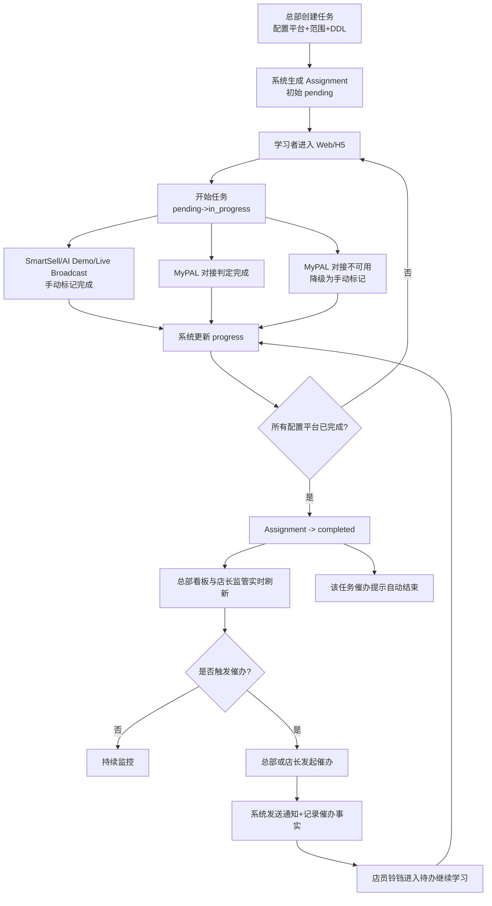
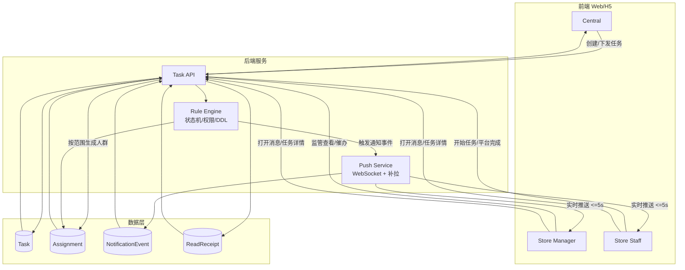
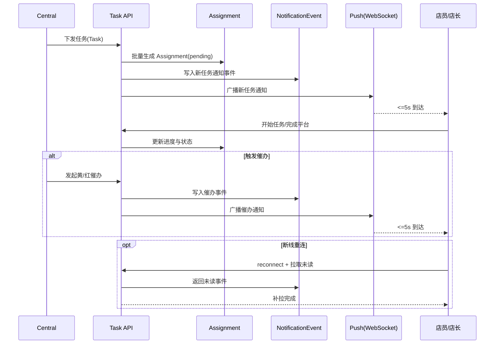

# 产品需求文档（PRD，整合版）

文档版本：3.2.9
发布日期：2026-03-23
产品经理：Product Team
文档状态：Spec-ready（可直接驱动 specs 与开发）
适用范围：MVP（仅当前版本范围，不含未来扩展）

---

## 0. TL;DR

本期 MVP 以两个核心并行驱动：**任务管理闭环**（总部下发培训任务 → 店长监管 → 店员完成 → 汇总催办）和 **Executive Chat**（高管用自然语言查询全网培训状态，5秒内得到结构化回答）。系统以 `Task` 和 `Assignment` 为核心对象，通过明确状态机（`pending -> in_progress -> completed`）、平台完成规则（`MyPAL` 优先对接判定、不可用时可降级手动）和催办规则，保证任务可执行、可追踪、可验收。Executive Chat 作为 P1 功能，在任务管理闭环跑通后实现。

---

## 1. 产品概览与背景

### 1.1 产品定位

一个为企业零售管理层和一线店员服务的培训管理平台，具备两个核心能力：

1. **任务管理闭环**：总部快速下发培训任务，店长监管店员进度，店员完成任务，总部实时掌握全网状态并催办。
2. **Executive Chat**（P1）：高管通过独立H5页面，用自然语言查询任意维度的培训进度数据，5秒内得到结构化回答，支持多轮追问下钻。

系统通过独立H5 Web App交付，用户在局域网内通过 URL 访问，无需安装。

### 1.2 产品愿景

赋能总部快速下发、赋能店长高效管理、赋能店员主动学习、赋能高管实时掌握全网状态。

### 1.3 业务场景

- 新品上市培训（快速培训 50 个门店、300 名店员）
- 情报收集（后续版本能力）
- 任务催办（追踪任务完成情况，及时催促落后店员）
- 高管数据查询（Executive 随时查询全国/区域/门店/个人维度培训进度）

### 1.4 当前痛点

- 总部无法快速将培训任务下发到全国门店
- 店长无法有效跟踪每个店员学习进度
- 无法通过数据看清地区、门店、个人差异
- 店员学习进度缺乏统一追踪入口
- 事后难以评估培训效果
- 高管无法实时获取培训进度数据，依赖人工汇报

### 1.5 MVP 目标

- 总部可快速创建并下发任务，实时掌握完成情况
- 店长可在本店范围内监管店员进度，并执行催办
- 店员可低门槛完成任务
- 系统可输出可追踪、可判定、可催办的闭环结果
- （P1）Executive 可通过自然语言对话，随时查询任意维度的培训数据

---

## 2. 目标用户与角色定义

### 2.1 目标用户规模（MVP mock）


| 用户角色      | 数量    | 主要行为           | 核心需求      |
| --------- | ----- | -------------- | --------- |
| 总部运营      | 1 人   | 创建任务、下发、查看数据   | 快速下发、全面掌握 |
| 店长        | 50 人  | 接收任务、管理店员、汇报进展 | 清晰可见、易于管理 |
| 店员        | 300 人 | 学习、提交进度        | 简单易用、有指导  |
| Executive | 若干    | 自然语言查询培训进度数据   | 实时数据、秒级响应 |


### 2.2 角色定义

#### 总部（Central）

- 创建任务并选择学习平台与下发范围
- 查看全公司/门店/地区/个人维度任务进度（实时看板）
- 对店员/门店/地区发起催办
- 查看预警列表，识别风险门店

#### 店长（Store Manager）

- 查看本店店员任务进度
- 对本店低进度店员发起催办
- 当任务下发到店长学习范围时，店长作为学习者完成任务（判定规则与店员一致）

#### 店员（Employee）

- 查看并执行被分配任务
- 点击开始任务并逐个平台标记完成
- MVP 不提供反馈/需要帮助入口
- 通过顶部铃铛通知接收催办通知，点击直达未完成任务

#### Executive（P1）

- VP：查看全国维度培训进度数据
- 区域总监：查看本辖区维度培训进度数据
- 通过独立H5页面，用自然语言提问，获取结构化回答
- 支持多轮追问，从全国下钻到区域、门店、个人

---

## 3. 范围定义与优先级

### 3.1 本期必须实现（P0）

- 任务创建（名称、描述、截止时间）
- 学习平台选择（固定平台集合中选择）
- 下发范围选择（全部/特定地区店员/特定地区店长，支持组合）
- 一键下发并生成分配记录（Assignment）
- 三角色任务执行与查看（总部、店长、店员）
- Assignment 状态机流转（`pending -> in_progress -> completed`）
- 平台完成判定与任务完成判定（`MyPAL` 优先对接判定、不可用时可降级手动；`SmartSell`/`AI Demo`/`Live Broadcast` 手动标记即完成）
- 总部实时看板（整体完成率、区域热力图、Top/Bottom 5门店、完成趋势）
- 总部预警列表（P1/P2预警展示，含触发原因和AI建议，仅展示不做操作界面）
- 店长本店监管视图（进度）
- 催办功能（总部可催店员/门店/地区；店长可催本店店员，人工触发）
- 催办通知触达与持续显示（任务完成前持续、完成后自动消失）
- 催办事实记录（完整事件记录）
- 权限与可见性隔离（总部全量、店长本店、店员仅本人）
- 独立H5 Web App，用户在局域网内通过 URL 访问，无需安装

### 3.2 可选/后续实现（P1）

- **Executive Chat**：高管自然语言查询培训进度，支持全国/区域/门店/个人下钻，≤5秒结构化回答，支持至少3轮追问，VP看全国，区域总监看辖区
- 下发预览
- 下发历史查询
- 店员接收确认
- 店长上报能力增强
- 催办记录查询增强（筛选/统计视图）
- 报表导出
- 完成时间线、趋势分析、地区更细化对标

### 3.3 后续版本（P2）

- AI Agent 自动化能力（自动扫描/预警/催办/统计/情报）
- Executive Chat 主动推送（CE-006）
- RAG Chatbot（EA-007）
- 话术推送
- 四平台跳转集成
- 高级分析与推荐

### 3.4 本期明确不做

- 多语言支持
- 第三方系统深度集成（如 HR 系统）
- 跨地域访问能力
- 复杂预警升级操作界面

---

## 4. 核心业务流程

### 4.1 主流程（总部下发 -> 店长监管 -> 店员完成 -> 汇总催办闭环）

1. 总部提交任务创建请求。
2. 系统创建 `Task`（状态：`draft`，包含平台集合与下发配置）。
3. 总部发起下发。
4. 系统按下发范围为每个目标对象生成 `Assignment`（初始状态：`pending`）。
5. 目标对象（店员或店长学习者）通过局域网 URL 进入系统，查看任务并点击”开始任务”。
6. 系统将该 `Assignment` 状态更新为 `in_progress`。
7. 学习者在系统界面逐个平台标记完成（不跳转外部平台）。
8. 系统按平台规则更新平台完成状态与 `progress`。
9. 当所有配置平台均满足完成条件时，系统将 `Assignment` 更新为 `completed`。
10. 系统实时更新总部看板与店长监管视图。
11. 总部或店长对低进度对象发起催办（人工触发）。
12. 系统发送催办通知并记录催办事实。
13. 被催对象通过铃铛通知入口进入未完成任务继续执行；任务未完成时催办提示持续显示。
14. 当该任务对应 `Assignment` 进入 `completed`，系统自动结束该任务的催办提示。

### 4.2 催办流程（独立系统流程）

1. 总部/店长识别低进度对象。
2. 发起催办。
3. 系统校验权限与任务状态。
4. 系统写入催办事实记录并发送催办通知。
5. 店员点击通知进入未完成任务继续执行。
6. 任务完成前催办提示持续显示；完成后自动消失。

### 4.4 业务流程图（供 AI 理解）




```mermaid
flowchart LR
    R1[RTM 多条件筛选] --> R2{条件内 AND
条件间 OR}
    R2 --> R3[命中门店集合]
    R3 --> R4[生成目标人群 Assignment
(店员/店长学习者)]
    R4 --> R5[进入主流程 4.1]
```


### 4.5 AI 友好数据流图（Task/Assignment/Notification）







---

### 4.6 工程字段建议（可直接实现）

建议在不改变业务口径前提下，优先落以下关键字段（用于幂等、推送、已读统计与追踪）：

- `Task`：`taskId`, `title`, `platforms[]`, `scope`, `ddlAt`, `status`
- `Assignment`：`assignmentId`, `taskId`, `userId`, `role`, `storeId`, `status`, `progress`, `mypalCompleted`, `smartSellCompleted`, `aiDemoCompleted`, `liveBroadcastCompleted`, `updatedAt`
- `NotificationEvent`：`eventId`, `taskId`, `assignmentId?`, `targetUserId`, `targetRole`, `eventType`, `severity?`, `dedupeKey`, `createdAt`
- `ReadReceipt`：`receiptId`, `eventId`, `userId`, `readAt`, `source`（`notification_click` / `task_detail_open`）

```mermaid
flowchart LR
    T[Task
(taskId, ddlAt, scope)] --> A[Assignment
(assignmentId, taskId, userId, status, progress)]
    A --> N[NotificationEvent
(eventId, eventType, severity, dedupeKey)]
    N --> R[ReadReceipt
(eventId, userId, readAt)]

    N --> K1[推送人数统计
按 targetUserId 去重]
    R --> K2[分角色已读统计
店员/店长]
    A --> K3[完成率与预警
progress + status + ddlAt]
```


字段口径提示：

- `eventType` 建议枚举：`task_assigned`, `nudge_yellow`, `nudge_red`, `task_updated`
- `severity` 仅催办事件必填（`yellow` / `red`）
- `dedupeKey` 用于任务类消息幂等；催办事件每次触发需生成新 `eventId`

---

## 5. 功能需求（按业务能力分组）

### 5.1 任务创建与下发

- 创建任务：输入任务名称、描述、截止日期
- 选择学习平台：任务平台从固定平台集合中选择
- 灵活选择下发范围：支持全部/特定地区店员/特定地区店长组合
- 下发到店长学习任务：当包含店长范围时，店长本人收到学习任务
- 一键下发：确认范围后批量下发给符合条件对象
- （P1）下发预览：显示将影响门店数/人数
- （P1）下发历史：查看历史下发与结果

### 5.2 总部实时看板与预警

- 整体完成率大数字展示
- 区域热力图：各区域完成率可视化 Top/Bottom 5 门店排行
- 完成趋势折线图
- 预警列表：展示当前 P1/P2 预警，每条显示触发原因和 AI 建议（仅展示，不做操作界面）
- 个人明细：按门店查看店员进度
- 实时更新：店员提交后总部端延迟目标 ≤ 5 秒

### 5.3 店员学习

- 任务卡片列表：任务名称、达标标准、倒计时、状态清晰可见
- “开始任务”前置动作：进入 `in_progress` 后可进行平台完成操作
- 在系统界面逐个平台标记完成（不跳转外部平台）
- 自动进度更新
- MVP 不提供反馈/需要帮助入口
- 顶部铃铛通知按钮：接收催办通知，点击直达未完成任务

### 5.4 店长监管与现场管理

- 本店店员进度表格：店员、进度、状态
- 本店汇总：完成率、平均进度、滞后提示
- 店长催办动作：对本店低进度店员发起催办
- （P1）店长上报：向总部上报门店困难/进展

### 5.5 催办系统

- 总部可催办对象：店员/门店/地区
- 店长可催办对象：仅本店店员
- 催办允许重复触发（人工触发）
- 催办提示在任务完成前持续显示，完成后自动结束
- 每次催办必须写入完整事实记录（发起人、目标对象、目标任务、时间、次数）

### 5.6 Executive Chat（P1）

- 独立H5页面，扫码或点链接直接打开，自动识别身份和数据权限
- 支持四类查询意图：
  - 培训进度查询（”Q1 新品培训完成率？”）
  - 项目状态查询（”Trade-in 准备到哪一步了？”）
  - 预警查询（”现在有什么问题需要关注？”）
  - 区域/门店下钻（”华东区怎么样？””最差的5家门店是哪些？”）
- 统一回答格式：状态概览 → 关键数字 → 需关注事项 → 追问引导
- 支持至少3轮连续追问，保持上下文
- 权限隔离：VP看全国，区域总监看辖区
- 回答数字与后台数据实时一致，响应时间 ≤5秒

---

## 6. 关键规则（系统口径）

### 6.1 `Task` 与 `Assignment` 规则

- **Task 状态机**：`draft`（创建后，可编辑）→ `dispatched`（下发后，仅 DDL 可修改）；MVP 无任务撤回，`dispatched` 为终态
- 每个 `Task` 至少配置 1 个学习平台，支持从四个固定平台中任意组合选择
- 下发后按目标对象生成 `Assignment`；**同一学习者对同一任务只生成一条 Assignment，重复下发时跳过已存在的 Assignment，保持幂等**
- 下发操作不要求原子性：已成功生成的 Assignment 保留生效；失败的对象记录错误日志，总部可在下发结果页查看失败名单并选择重新下发
- `Assignment` 是执行与判定的最小单位
- 任务目标包含店长时，店长作为学习者拥有自己的 `Assignment`

### 6.2 状态机规则（Assignment）

- 初始状态：`pending`
- 触发“开始任务”后：`pending -> in_progress`
- 满足完成条件后：`in_progress -> completed`
- `completed` 为终态，不允许回退到 `pending/in_progress`
- `pending` 下禁止标记平台完成

### 6.3 平台完成与任务完成规则

- 平台完成规则：
  - `MyPAL`：优先以对接数据判定完成（服务端写入 `mypalCompleted=true`）；若对接不可用，允许降级为店员手动标记完成
  - `SmartSell` / `AI Demo` / `Live Broadcast`：店员在系统内手动标记即完成
- 进度计算规则：`progress = 已完成平台数 / 配置平台总数 * 100`
- 任务完成规则：该 `Assignment` 的所有配置平台均完成后，状态可达 `completed`

### 6.4 催办规则

- 权限规则：
  - 总部可催办：店员/门店/地区
  - 店长可催办：仅本店店员
- 重复催办：允许
- 已完成任务催办：不允许（系统拒绝）
- 催办限制（MVP）：不设复杂频控与智能策略
- 催办记录：每次催办必须保存完整事实记录
- 催办提示生命周期：
  - 任务未完成：提示持续显示
  - 任务完成：提示自动消失

### 6.5 可见性与权限规则

- 总部：可见全量任务与汇总数据
- 店长：仅可见本店店员任务数据与本店相关催办
- 店员：仅可见本人任务、本人进度、本人催办提示

### 6.6 反馈规则（MVP）

- MVP 不提供店员反馈与“需要帮助”标记
- 店长帮助流程不在本期范围

### 6.7 落队等级规则（历史口径中明确提出）

- 快完成：`>= 80%`
- 中等：`50% ~ 79%`
- 严重落队：`< 50%`

### 6.10 总部发布任务 RTM 筛选规则（MVP）

- 筛选路径固定为：`RTM -> Sub-RTM -> 业态值`，用于筛选可下发任务的**门店集合**
- **筛选逻辑分两个层次**：
  - **条件之间（OR）**：总部选择多个叶子节点（如同时勾选 MONO 和 Education），满足**任一**叶子节点的门店均命中
  - **条件内父子级（AND）**：每个叶子节点代表一条完整路径（如 `RTM=Monobrand & Sub-RTM=Monobrand & 业态=MONO`），门店须**同时满足**该路径上所有层级的值才算命中该条件
- 支持值：
  - `Monobrand`：`MONO`、`Lifestyle`（其中 `MONO` 显示值映射到门店表原值 `Mono`）
  - `Multibrand`：`Mass Merchant`、`OTC`、`Township`、`Duty Free`
  - `Carrier`：当前门店表暂无可匹配数据
  - `Education`：`Education`
  - `Enterprise`：当前门店表暂无可匹配数据
- 空结果规则：当筛选到 `Carrier` / `Enterprise`（或其他无匹配组合）导致结果为 0 时，允许展示 0 结果并阻止误下发（需明确提示"当前筛选无门店命中"）
- 下发生成：对命中门店内符合身份条件的对象生成 `Assignment`（店员与/或店长学习者，按任务配置）
- **数据质量**：门店表业态字段需在导入前完成数据清洗，确保值与 RTM 规则定义一致（如 `Mono` 统一大小写）；建议系统层同时做大小写不敏感匹配作为兜底

### 6.11 总部看板维度口径（MVP）

- 总部看板支持并列维度：**门店**、**经销商**、**地区**、**个人**
- "经销商"与"地区"为并列分析维度：任一维度的筛选与汇总不要求另一维度先选中
- 经销商维度聚合口径：按经销商名下门店集合聚合该任务下相关 `Assignment` 的完成率、完成人数与逾期人数
- 门店维度与店员维度的黄/红规则维持 §5.4 与 §6.9，不因新增经销商维度改变

### 6.12 总部看板 KPI 口径（MVP）

- 推送人数：在任务范围内，系统成功写入并触发通知事件的人数（去重到用户）
- 送达：MVP 不作为 KPI 展示（仅保留内部事件状态，不进入看板指标）
- 已读人数（任务真实已读）：
  - 店员已读：店员打开该任务详情页记为已读
  - 店长已读：店长打开该任务监管页中对应任务详情/入口记为已读
  - 看板中店员已读与店长已读分开展示，同时可给出合计
- 任务真实发放率：`打开任务详情人数 / 目标应发人数`
  - "打开任务详情人数"按用户去重，统计店员与店长学习者在任务维度的详情打开事件
  - "目标应发人数"为该任务按下发范围应收到任务的总人数
- 区域预警：按区域聚合 §5.4 黄/红规则，展示黄警区域数与红警区域数（红覆盖黄）
- MVP 不做"送达"指标（无送达人数/送达率 KPI）

---

## 7. 平台口径与数据落库

### 7.1 平台集合（MVP 口径）

固定平台集合包含：`MyPAL`、`SmartSell`、`AI Demo`、`Live Broadcast`。

### 7.2 平台完成落库动作（MVP 口径）

- `MyPAL`：优先由对接同步/查询判定完成后写入 `mypalCompleted=true`；若对接不可用，启用手动标记路径并写入同口径完成态
- `SmartSell`：手动标记完成时写入 `smartSellCompleted=true`
- `AI Demo`：手动标记完成时写入 `aiDemoCompleted=true`
- `Live Broadcast`：手动标记完成时写入 `liveBroadcastCompleted=true`

### 7.3 催办落库动作（MVP 口径）

- 总部点击催办时，需要落库催办历史
- 对应 `Assignment`/店员可记录 `nudgeCount + 1`
- 提示显示与消失以 `Assignment.completed` 为准自动结束

---

## 8. 页面与模块结构

### 8.1 总部端

- 任务发布页：创建任务、选择平台、选择下发范围、发起下发
- 实时看板页：整体完成率大数字、区域热力图、Top/Bottom 5门店排行、完成趋势折线图、个人明细下钻
- 预警列表页：P1/P2预警展示，含触发原因和AI建议
- 催办操作入口：对目标对象发起催办并查看结果

### 8.2 店长端

- 本店任务监管页：店员列表、进度、状态、本店汇总（无帮助入口）
- 催办操作入口：对低进度店员发起催办

### 8.3 店员端

- 我的任务页（单页）：
  - 顶部铃铛通知按钮（显示未读催办通知数，点击展开通知列表，可直达未完成任务）
  - 任务卡片列表（任务名、达标标准、倒计时、状态、"开始任务"/"继续"按钮）
  - 任务详情内嵌：逐个平台标记完成（MyPAL/SmartSell/AI Demo/Live Broadcast；MyPAL 优先对接判定）

### 8.4 Executive Chat 端（P1）

- 独立H5页面，通过局域网 URL 直接打开，自动识别身份
- 极简对话界面：一个对话框，首屏展示示例问题引导（具体数量与内容待定）
- 支持多轮追问，保持上下文

---

## 9. 异常与边界场景

### 9.1 重复操作（幂等）

- 重复点击“开始任务”：保持 `in_progress`，不重复创建状态变更
- 重复标记同一平台完成：不重复累计进度
- 重复催办：允许，新增催办事实记录

### 9.2 网络失败

- 提交失败（开始任务/完成平台/催办）必须返回失败结果
- 前端提示失败并允许重试
- MVP 不提供离线暂存；网络恢复后需重试
- 未成功提交前，系统状态不得变化

### 9.3 数据延迟

- 汇总视图延迟时保持最近一次有效数据
- **看板顶部显示最近更新时间**，避免误判
- 数据最终以服务端最新状态为准

### 9.4 非法操作

- 未开始任务不得标记平台完成（`pending` 下禁止完成平台）
- 非法越权操作必须拒绝，返回通用错误提示（不暴露权限细节）
- 非法状态跳转（如直接 `pending -> completed`）必须拒绝；前端收到此类错误后 **Toast 提示 3 秒 + 刷新当前状态**
- `completed` 后回退状态必须拒绝
- 店员不得操作不属于自己任务分配或任务平台集合的对象

---

## 10. 验收标准

### 10.1 功能与流程验收

- 总部可成功创建任务并下发到目标对象，且生成对应 `Assignment`
- 店员与店长学习者可从 `pending` 启动并推进到 `completed`
- 平台与任务完成判定严格按规则执行（按 MyPAL 对接/降级与其余三平台手动规则执行）
- 店长可对本店低进度店员发起催办
- 总部可查看实时看板（完成率、热力图、Top/Bottom 5门店）并发起催办
- 总部可查看预警列表（P1/P2预警、触发原因、AI建议）
- 催办通知可触达店员（铃铛通知），任务未完成前持续显示，完成后自动消失
- 每次催办均有完整事实记录
- 角色权限隔离正确

### 10.2 Demo 验收标准

- 总部发布任务后，店员端任务卡片分钟级到达
- 全程 Demo 剧本（6个Scene）可流畅跑通，无中断
- 看板数据实时刷新，与后台数据一致
- （P1）Executive Chat 提问后 ≤5秒返回结构化回答
- （P1）Chat 回答数字与后台数据一致
- （P1）支持至少3轮追问，上下文连贯
- （P1）不同权限账号查询结果正确隔离

### 10.3 性能与体验验收

- 下发 300 人可在 30 秒内完成（**端到端**：从点击下发到全部 Assignment 写库完成）
- 总部下发操作步数不超过 3 步
- 总部关键页面加载 < 2 秒
- 店长店员进度表格加载 < 1 秒
- 店员进度提交后汇总视图刷新延迟 ≤ 5 秒
- 店员从进入任务到完成一个平台不超过 10 秒

### 10.4 易用性与满意度目标

- 店员端操作清晰简洁，无需额外培训即可使用
- 用户满意度目标：总部/店长/店员均 >= 4.5/5

---

## 11. 非功能需求、约束、假设、风险

### 11.1 非功能需求

- 安全：基于角色的数据权限隔离
- 可用性：MVP 重点是业务闭环跑通，不要求 99.5% 可用性
- 浏览器兼容：Chrome、Safari（含 iPhone/iPad）；**不限制浏览器版本**，以 Demo 环境实际使用浏览器为准
- 终端形态：**总部使用 PC**，**店长与店员使用手机**（iPhone 为主）；响应式设计，支持 PC/Pad/iPhone 浏览器
- 触达方式：独立H5 Web App，通过局域网 URL 直接访问，用户无需安装任何App
- **架构**：前后端分离，前端按角色拆分（总部/店长/店员/Executive Chat 各自独立页面）
- **MyPAL 例外**：MyPAL 为唯一外部系统对接，其余平台均为手动标记，不依赖外部接口
- **风险**：Executive Chat 技术方案（AI 推理层）为 POC 验证阶段，存在延迟超标与上下文管理不稳定风险，上线前需完成 POC

### 11.2 产品约束

- 上市时间：MVP 阶段无硬性截止（mock）
- 用户规模：1 总部 + 50 店长 + 300 店员 + 若干 Executive（mock）
- 网络环境：局域网，不支持跨地域访问
- 数据条件：MVP 使用 mock 数据，不接入 HR 系统
- 目标客户：Apple 公司店员培训系统

### 11.3 开发原则

- 缩小规模，避免过度设计
- 快速迭代，优先跑通业务流程
- 架构分离，支持并行开发
- 文档同步维护

### 11.4 业务假设

- 店员有智能手机或 iPad 且可访问系统
- 公司网络稳定
- 店员愿意主动标记学习完成
- 店长会及时关注系统提醒
- 总部可基于数据快速催办决策

### 11.5 依赖与风险

- 外部依赖：局域网稳定、IT 协助部署与监控
- 主要风险与应对：
  - 店员不愿标记完成 -> 软件提醒 + 店长催促
  - 店长不用系统 -> PM 跟进 + 提醒机制
  - 局域网不稳定 -> 断线重连（历史口径含本地缓存建议）
  - 大规模并发 -> 数据库优化 + 缓存策略

---

## 12. 后续版本规划

### 12.1 P1 增强功能（下一里程碑）

- **任务撤回/关闭**：总部可撤销已下发任务；相关通知触达店长/店员
- **催办撤回**：总部可撤回已发出的催办通知
- **店长发起催办**：店长可对本店落后店员发起催办（含黄/红档位）
- **按地区批量催办**：总部可对整个地区所有门店发起催办
- **Executive Chat 权限隔离**：VP 查全国、区域总监查本辖区
- **通知中心增强**：消息已读确认、历史归档、筛选
- 其他增强：下发预览历史、接收确认、报表导出

### 12.2 P2 优化（远期规划）

- 时间线趋势、地区榜单、多语言支持
- HR 系统集成（自动同步店员花名册）
- 移动端 App

### 12.3 AI Agent 规划（非本期）

- **扫描 Agent**：自动巡检任务执行状态
- **催办 Agent**：基于规则自动触发催办
- **预警 Agent**：结合历史数据给出预警优先级与 AI 建议（MVP §5.2 已含模板版）
- **统计 Agent**：自动生成周期性报告
- **情报 Agent**：跨任务跨时段的洞察与趋势分析（保留，不在本期）

---

## 13. 附录 A：术语表

- `Task`：总部创建的培训任务
- `Assignment`：某学习者对应某任务的执行单元
- `progress`：Assignment 当前完成百分比
- `mypalCompleted`：MyPAL 平台完成状态（优先由对接写入；对接不可用时可由降级手动路径写入）
- `pending / in_progress / completed`：Assignment 三态状态机

---

## 14. 附录 B：用户故事

### 14.1 总部快速下发（含学习平台选择）

1. 总部通过局域网 URL 登录系统，进入任务发布页。
2. 输入任务名称与描述，选择学习平台（从固定平台集合中选择）。
3. 选择下发范围（全部/特定地区店员/特定地区店长，支持组合）。
4. 总部确认下发，系统一键批量下发。
5. 系统在 30 秒内完成下发，生成对应 Assignment 记录。
6. 总部在实时看板页看到任务已下发，完成率开始更新。

### 14.2 店长监管流程（无帮助能力）

1. 店长通过局域网 URL 进入本店监管页，查看店员进度表格。
2. 查看本店店员任务进度与状态。
3. 识别低进度店员。
4. 店长可发起催办。
5. 店员继续完成未完成平台。

### 14.3 店长催办流程（与帮助分开）

1. 店长在监管页识别低进度店员（进度 < 50%，严重落队）。
2. 点击催办按钮发起催办，系统记录催办事实。
3. 店员铃铛通知出现未读提示，点击后直达未完成任务。
4. 催办提示在任务未完成前持续显示。
5. 任务完成后催办提示自动消失。

### 14.4 店员学习完成流程

1. 店员通过局域网 URL 打开H5页面，查看任务卡片列表。
2. 点击任务卡片，点击"开始任务"，Assignment 状态变为 `in_progress`。
3. 在系统界面逐个平台标记完成（MyPAL 由对接判定完成；对接不可用时可降级手动标记完成）。
4. 所有平台完成后，系统自动将 Assignment 更新为 `completed`。
5. 店员完成所有平台后任务完成。

### 14.5 总部看板与催办流程

1. 总部进入实时看板页，查看整体完成率、区域热力图、Top/Bottom 5 门店。
2. 进入预警列表，查看 P1/P2 预警及 AI 建议。
3. 识别落后对象（门店/地区/个人），发起催办，系统记录催办事实。
4. 观察催办后进度变化，看板数据实时刷新。

### 14.6 店员接收催办通知流程

1. 店员打开H5页面，顶部铃铛显示未读通知数。
2. 点击铃铛展开通知列表，看到催办提示。
3. 点击通知直达未完成任务，继续执行。
4. 任务完成后，催办提示自动从通知列表消失。

### 14.7 Executive Chat 查询流程（P1）

1. Executive 通过局域网 URL 打开独立H5 Chat页面，系统自动识别身份与权限。
2. 首屏展示3个示例问题，Executive 自由提问（如"Q1培训现在什么情况？"）。
3. 系统在 5 秒内返回结构化回答：状态概览 -> 关键数字 -> 需关注事项 -> 追问引导。
4. Executive 继续追问下钻（如"华东区呢？""最差的5家门店是哪几家？"）。
5. 系统保持上下文，支持至少3轮连续追问。
6. VP 可查看全国数据，区域总监仅可查看本辖区数据。

## 15. 附录 C：历史口径冲突与保留说明（不删减）

为满足“不可私自删减简化”的要求，以下历史冲突口径均保留：

1. 任务平台最小数量存在两套历史口径：
  - 口径 A：至少 1 个平台（不强制包含 `Sales Coach`）  
  - 口径 B：至少包含 `Sales Coach` + 1 个其他平台（`n>=2`）
2. “实时通知与消息”在历史版本中既被写为 P0，也被写为 P1。
  - 本整合文档将“催办通知触达与持续显示”保留为 P0（闭环刚需）  
  - “更完整的消息中心能力”保留在 P1/P2 演进
3. 店员任务列表状态历史上出现“待接收”与“pending”两套表达。
  - 本文统一系统状态机为 `pending/in_progress/completed`  
  - “待接收”保留为前端文案候选，不改变后端状态定义
4. 部分历史内容包含较强示例属性（如品类差异分析、具体展示节奏、路线图日期）。
  - 这些内容已在“后续规划/决策支持/验收目标”中保留，不作为本期强约束。

---

## 16. 附录 D：Demo 场景剧本

本剧本为向 Executive 演示的完整体验流程，约 10 分钟，MVP 所有开发工作服务于此剧本能流畅跑通。

**Scene 1（30秒）—— 总部发布任务**
打开 Central Admin 任务发布页，创建"Q1 新品知识认证"培训任务，目标范围选择全部门店，点击发布。屏幕提示"已推送至 300 人"。

**Scene 2（30秒）—— 店员收到任务**
切换到 Employee H5 页面。展示任务卡片已到达：任务名称、达标标准、倒计时、"开始任务"按钮。从发布到收到——分钟级，零信息衰减。

**Scene 3（1分钟）—— 店长看到团队情况**
切换到 Store Manager H5 页面。展示 6 人团队进度：3 人已完成（绿）、2 人进行中（黄）、1 人逾期（红）。店长对逾期店员发起催办，店员铃铛通知亮起。

**Scene 4（1分钟）—— 看板实时可见**
切换到 Central Admin 看板页。展示全国完成率、区域热力图、Top/Bottom 5 门店、预警列表。总部对全网状态一目了然。

**Scene 5（3-5分钟）—— Executive 亲自体验（高潮，P1）**
把手机递给 Executive，打开 Executive Chat。引导 Executive 自由提问：

- "Q1 培训现在什么情况？" → 系统返回全公司概览
- "哪个区域有问题？" → 返回落后区域及预警数
- "最差的门店是哪几家？" → 返回 Bottom 5 门店名单和逾期详情
Executive 自由追问，体验"问什么答什么，秒级响应"的感觉。

**Scene 6（30秒）—— 收尾**
总结：从发布到追踪到催办到高管查询，全程自动化，总部不需要人盯人，高管打开手机问一句话就知道全网状况。

---

## 17. 附录 E：数据准备策略

MVP 演示效果高度依赖数据的真实感。需准备以下种子数据：

- 按 50 家门店、300 名店员的规模生成模拟数据，包含门店名称、区域归属、店长信息、店员信息
- 创建 2-3 个培训任务（如"Q1 新品知识认证""Trade-in 产品培训"）
- 为每个任务生成不同完成状态的学习进度数据，分布合理（整体完成率约 72%，区域间有差异，有逾期和预警场景）
- 预生成 10-15 条 P1/P2 预警数据，确保预警列表有内容可展示
- Trade-in 项目数据按四阶段设计，当前处于"准备期"，80% 门店完成准备
- 所有数据要经得起多角度查询——从全公司到区域到门店到个人，每一层都有合理数据

---

## 18. 文档维护


| 版本    | 日期         | 变更                                                                                                                                                                                              | 作者           |
| ----- | ---------- | ----------------------------------------------------------------------------------------------------------------------------------------------------------------------------------------------- | ------------ |
| 1.0   | 2026-03-18 | 初版 - 需求确认完成                                                                                                                                                                                     | Product Team |
| 1.1   | 2026-03-19 | 更新定位、场景、学习平台与催办流程                                                                                                                                                                               | Product Team |
| 2.0   | 2026-03-19 | Spec-ready 结构化版本                                                                                                                                                                                | Product Team |
| 2.1   | 2026-03-19 | 多阶段 PRD 全量整合去重，保留历史冲突口径                                                                                                                                                                         | Product Team |
| 3.0   | 2026-03-19 | 重定义版：双核心定位、新增Executive角色、H5触达、总部端重构、店员端简化、新增Demo剧本与数据策略                                                                                                                                         | Product Team |
| 3.2.1 | 2026-03-23 | 逻辑修复：Task 状态机补充（draft→dispatched）；§6.10 筛选 OR/AND 双层规则澄清；MyPAL mypalCompleted 写入边界明确（不依赖 Assignment 状态）；总部门店行正常期颜色补全；§8.3/§9.4 移除 P1 撤回引用；门店级催办文案按店长是否为学习者分支；§10.2 EC 权限隔离验收改为 MVP 范围；§3.1 乱码修复 | Product Team |
| 3.2.7 | 2026-03-23 | 口径统一：MyPAL 采用“优先对接、不可用可降级手动”；催办权限保持“总部+店长”；移除帮助/反馈流程；重绘 §4.4 业务流程图并与正文一致                                                                                                                        | Product Team |
| 3.2.2 | 2026-03-23 | 新增 §4.4 业务流程图（主闭环流程 + RTM 筛选流），用于 AI 与工程快速理解端到端逻辑                                                                                                                                               | Product Team |


维护规则：每当有功能上线或需求口径更新，需同步更新文档。  
下次更新：P0 功能上线后。  
文档所有者：Product Team。