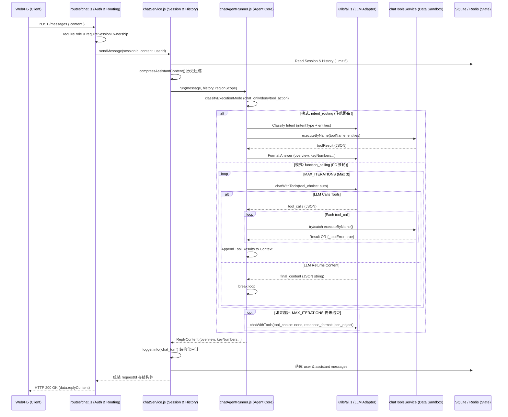

# Executive Chat 规格

**版本:** 2.2.5 | **PRD 4.0.5**（§5.7、§5.7.1、§8.5、§14.6）| **优先级:** P1（任务管理闭环跑通后实现）

**HTTP 契约正本：**请求/响应字段级定义以 [04-API-SPEC.md](./04-API-SPEC.md) **§6 Executive Chat Agent API**（含 §6.6 / §6.7 反馈与重新生成）为准；本文描述产品行为、意图、权限口径、数据溯源与 LLM 架构，避免与 04 重复维护两套 JSON。

## 目录

- [实现状态（与工程对齐）](#实现状态与工程对齐)
- [模式与演进（Intent Routing vs Function Calling）](#模式与演进intent-routing-vs-function-calling)
- [功能概述](#功能概述)
- [Agent 实现框架与执行链路](#agent-实现框架与执行链路)
  - [端到端执行流程 (End-to-End Flow)](#端到端执行流程-end-to-end-flow)
  - [核心技术实现细节](#核心技术实现细节)
  - [数据与安全边界](#数据与安全边界)
- [Agent 技术路线（Roadmap）](#agent-技术路线roadmap)
  - [路线总览](#路线总览)
  - [R0（当前）设计取舍](#r0当前设计取舍)
  - [R1（Function Calling）升级要点](#r1function-calling升级要点)
  - [R2（统计/预测）技术方向](#r2统计预测技术方向)
- [可观测性与运维建议](#可观测性与运维建议)
  - [如何查看与排查日志](#如何查看与排查日志)
- [与 API 规格的分工](#与-api-规格的分工)
- [角色与权限](#角色与权限)
- [MVP：Executive 辖区与 `stores.region` 的绑定策略](#mvpexecutive-辖区与-storesregion-的绑定策略)
- [入口](#入口)
- [支持的查询意图](#支持的查询意图)
  - [基础四类（PRD §5.7）](#基础四类prd-57)
  - [高阶统计与分析（PRD §5.7.1）](#高阶统计与分析prd-571)
- [如何新增意图与工具 (How to Add Intent & Tool)](#如何新增意图与工具-how-to-add-intent--tool)
- [统一回答格式](#统一回答格式)
  - [PRD §5.7.1 扩展字段（建议在 `replyContent` 内可选扩展）](#prd-571-扩展字段建议在-replycontent-内可选扩展)
- [多轮追问规则](#多轮追问规则)
- [性能与异步](#性能与异步)
- [首屏引导设计](#首屏引导设计)
- [HTTP API（摘要）](#http-api摘要)
- [用户对 AI 回复的反馈与重新生成（产品口径）](#用户对-ai-回复的反馈与重新生成产品口径)
- [数据溯源（意图 → 现有 REST）](#数据溯源意图--现有-rest)
- [数据权限裁剪（服务端）](#数据权限裁剪服务端)
- [LLM 与推理架构（厂商无关）](#llm-与推理架构厂商无关)
- [验收标准](#验收标准)
- [文档修订记录](#文档修订记录)

---

## 实现状态（与工程对齐）

与 [04-API-SPEC.md](./04-API-SPEC.md) §6 声明一致：**当前仓库已在** `server/app.js` **挂载** `app.use('/api/v1/chat', …)`，Executive Chat HTTP 路径为 **`/api/v1/chat/...`**。

- **Agent 模式（MVP）：**默认 `intent_routing`（意图路由 → 同步数据工具 → 格式化回答）；可通过环境变量 `CHAT_AGENT_MODE=function_calling` 切换至 Function Calling 模式（详见 04 §6 文首说明与实现代码）。
- **持久化：** 会话与消息见 [01-DATA-MODEL.md](./01-DATA-MODEL.md) §10（`chat_sessions` / `chat_messages`）；用户对 assistant 消息的点赞/点踩见 **`chat_message_feedback`**（与 04 §6.6、数据库文档一致）。
- **下钻能力：** `drill_down` 已支持“区域级 + 门店级”双路径；区域查询走 `getRegionDetailData`（区域汇总 + 门店排行），门店查询走 `getStoreDetailData`。
- **下钻缺参：**`intent_routing` 下若分类为 `drill_down` 但 `region` / `storeId` / `storeName` 均为空，直接返回结构化追问（不调用门店下钻工具），避免无效参数错误。
- **下钻歧义处理：** 门店名称查询支持「唯一命中直查 / 多命中回传候选门店 / 0 命中明确提示」，并以结构化 `replyContent` 返回追问建议（例如指定 `storeId`）。
- **其他 AI 能力（非 Chat 路由）：** 见 04 文首（如 `POST /api/v1/tasks/ai-generate-description` 等）。

若本文某句与 **04 §6 或当前 `app.js` 挂载** 冲突，**以 04 与代码为准**，并应回头修订本节。

---

## 模式与演进（Intent Routing vs Function Calling）

**MVP 期间**保留双实现：`CHAT_AGENT_MODE=intent_routing`（默认）与 `function_calling`。**MVP 关闭条件**要求：在配置真实 `DEEPSEEK_API_KEY` 下，**FC 路径**端到端验收通过（用户业务问法 → `tool_calls` → 工具执行 → 最终 `tool_choice: 'none'` + 可解析的 `ReplyContent` JSON）。验收前默认仍以 `intent_routing` 为主；**FC 稳定后**可将默认改为 `function_calling`，IR 仅作紧急回退（见下表）。

| 阶段 | 动作 |
|------|------|
| MVP 发布 | 默认 `intent_routing`；生产启用 FC 前须完成上述验收 |
| FC 稳定后（建议 2–4 周观测） | 可将默认改为 `function_calling`；IR 保留为 `CHAT_AGENT_MODE=intent_routing` |
| 长期（约 6 个月内） | 若 FC 指标稳定，可立项收敛主路径、弱化 IR（以 ADR 为准） |

**典型 LLM 调用次数（量级，不含重试）**

| 模式 | 说明 |
|------|------|
| **Intent Routing** | **2 次**：`chatIntentService.classify` + `chatAnswerService.format`（工具本地执行不计入 LLM） |
| **Function Calling** | **1～`MAX_ITERATIONS` 次**工具轮（每轮一次 `chatWithTools`，`tool_choice: 'auto'`）+ 必要时 **1 次**最终回答（`tool_choice: 'none'`，且可带 `response_format: json_object`）。最坏约 **4 次** LLM（`MAX_ITERATIONS=3` 且仍需收尾一跳） |

**成本与延迟**：FC 上限高于 IR；观测时结合 `chat_turn` 的 `responseTimeMs`、`agentMode` 与（如启用）分阶段耗时。P95 产品目标仍以 **5 秒内**（§功能概述）为口径。

**`intentType` 日志语义**：落库字段 `intent_type` 与日志 `intentType` 在 FC 下优先反映**已调用工具推导**的类别；若整轮**未发生任何 tool 调用**，最终类别可能来自 `inferIntentFromMessage`（正则兜底）。为此，`chat_turn` 结构化日志增加 **`intentResolvedBy`**：`intent_llm`（IR）、`tools` / `regex_fallback`（FC）、`execution_mode`（拒答/闲聊等前置短路，不经分类）。

**回归闸门**：意图与分类提示变更前后运行 `node scripts/test-intent-classify.js --golden`（需 API Key），用例见 `scripts/fixtures/intent-golden.json`。

---

## 功能概述

Executive Chat 是面向高管（VP、区域总监）的独立 H5 Chat 页面，允许用户通过自然语言查询培训进度数据，**5 秒内**（P95）获得结构化回答，支持多轮追问下钻；并支持 PRD **§5.7.1** 定义的**高阶统计、相关性与预测类**问题（分 EC-P0 / EC-P1 子能力批次）。

---

## Agent 实现框架与执行链路

> 本节描述 **server 真实代码结构**，用于后端研发、联调与排障；HTTP 字段正本仍以 [04-API-SPEC.md](./04-API-SPEC.md) §6 为准。

### 端到端执行流程 (End-to-End Flow)

Executive Chat 在架构上支持两种模式平滑切换：`intent_routing` (MVP 稳定回退) 与 `function_calling` (高阶组合查询)。二者共享底层的权限控制、可观测性与工具沙箱。



**执行链路拆解说明：**

1. **入口鉴权 (Auth & Ownership)**：用户发送消息后，`routes/chat.js` 首先执行 JWT 角色鉴权（必须是 Executive），然后通过 `requireSessionOwnership` 中间件查询 SQLite，确保当前访问的 `sessionId` 严格归属于该用户，防止越权访问。
2. **上下文装配与压缩 (History Load & Compress)**：进入 `chatService.js` 后，系统会查询最近的 6 条历史消息（即 3 轮对话）。为了防止超长工具结果带来的 Token 消耗爆炸，系统会调用 `compressAssistantContent()` 函数，仅提取历史 `assistant` 消息中的 `overview` 和 `keyNumbers` 生成精简摘要传入大模型。
3. **模式分发与短路拦截 (Execution Mode)**：Agent Core (`chatAgentRunner.js`) 接手后，先经过 `classifyExecutionMode` 的正则拦截。如果是纯打招呼（chat_only）或请求执行超出边界的操作（如催办/发邮件，deny），则直接短路返回结构化话术，无需调用 LLM。
4. **Agent 执行引擎 (Dual Track Strategy)**：
   - **Intent Routing 分支**（当前 MVP 默认）：进行两次 LLM 调用。第一跳进行意图与实体抽取（Classify Intent），接着本地调用工具获取数据（Data Sandbox），第二跳根据数据将结果格式化（Format Answer）为四段式 JSON。
   - **Function Calling 分支**（FC 多轮）：开启 `tool_choice: 'auto'` 循环（上限 `MAX_ITERATIONS = 3`）。模型可自主决定调用一个或多个工具。每调用一次，工具层在 `try/catch` 沙箱内运行，即便出错也会封装为 `{_toolError: true}` 塞入上下文反馈给模型，让其在下一轮感知并自行修正。若 3 轮内未获得最终文本结果，则强制以 `tool_choice: 'none'` 加 `json_object` 格式化兜底，返回结构化数据。
5. **审计与响应 (Audit & Response)**：Agent 返回标准的 `ReplyContent` 后，`chatService.js` 统一拦截生成结构化的 `chat_turn` 日志（包含耗时、调用工具轮次 `toolIterations` 等深度可观测指标），随后落库 SQLite，最后组装 `requestId` 响应前端。

### 核心技术实现细节

系统在关键路径上采用了一系列防御性和效率优化设计：

1. **路由与安全边界 (Routing & Auth)**
   - API 层拦截使用 `requireSessionOwnership` 中间件，严防越权读取或向他人会话注入消息。
   - 工具层所有查询必须携带由 `users.executive_regions` 解析的 `regionScope`，利用底层 `buildRegionFilter` 拼接 SQL，杜绝权限越界。

2. **上下文管理与压缩 (Context Compression)**
   - **历史截断**：由于 `ReplyContent` 是厚重的 JSON 对象，`chatService` 及 `chatAnswerService` 会在组装历史 Context 时，调用 `compressAssistantContent` 提取核心摘要（仅保留 `overview` + `keyNumbers`），极大降低了多轮对话带来的 Token 指数增长，减少延迟。
   - **工具级缓存指纹**：为避免同 `sessionId` 下跨权限产生缓存串门，工具缓存的 `cacheSignature` 融合了 `scopeFp` (包含区域列表和 RTM 维度)。

3. **FC (Function Calling) 多轮调度优化**
   - **单工具错误隔离**：在 `runFunctionCalling` 的批量工具调用期间，抛弃了会导致雪崩的 `Promise.allSettled`。通过对每一个 `executeByName` 执行独立的 `try...catch`，并在出错时回传形如 `{ _toolError: true, message: err.message }` 的对象给 LLM。这样能保留厂商必须的 `tool_call_id`，并让 LLM 动态感知部分工具失效，从而调整话术。
   - **强制 JSON 降级**：如果模型在到达最大迭代次数 (`MAX_ITERATIONS=3`) 后仍在思考，最后一次通信将强制下发 `tool_choice: 'none'` 并携带 `response_format: { type: 'json_object' }`，确保响应始终符合前端期待的四段式渲染结构。

4. **系统弹性与可观测性 (Resilience & Observability)**
   - **LLM 重试退避机制**：`utils/ai.js` 统一封装了 `withRetry` 逻辑，针对 HTTP 429 频控、5xx 崩溃和底层网络阻断，执行带抖动的指数退避重试 (Exponential Backoff)。
   - **Token 无阻塞锁**：获取苹果内部校验 Token 时 (`appleconnect`)，采用 `execAsync` + `tokenPromise` 单例锁，防止缓存穿透瞬间阻塞 Node.js 主事件循环。
   - **结构化业务追踪**：每次问答结束，服务通过 `utils/logger.js` 产出 `chat_turn` 日志事件，内部包含 `toolIterations` (工具调用轮数)、`intentResolvedBy` (正则推导/模型推导/短路推导) 以及延迟等高价值埋点，用于 Dashboard 观测。
   - **优雅退出**：针对 Session 高速缓存提供的 `ioredis` 连接池，在容器生命周期提供了 `redisAdapter.quit()` 支持。

### 数据与安全边界

- **权限收敛点：**以 `chat_sessions.role_scope + regions/rtm` 为准，查询时必须经 `chatToolsService.buildRegionFilter(...)` 裁剪。
- **数据来源约束：**回答数字来自 `tasks/assignments/stores` 同源聚合；禁止在回答层虚构指标。
- **会话隔离：**路由层与服务层双重校验 session 归属（`CHAT_004`）。
- **消息反馈约束：**仅 assistant 消息允许 `like/dislike/none`；regenerate 仅允许会话最后一条 assistant 消息（`CHAT_008`）。

---

## Agent 技术路线（Roadmap）

### 路线总览

| 阶段 | 模式 | 目标 | 当前状态 |
|------|------|------|---------|
| EC-R0 | Intent Routing | 用最小闭环跑通高管问答（两次 LLM + 本地工具） | **已上线（默认）** |
| EC-R1 | Function Calling | 让模型自主多轮选工具、组合查询、减少硬编码意图映射 | **已预埋（`CHAT_AGENT_MODE=function_calling`）** |
| EC-R2 | Analytics Agent | 面向 §5.7.1 的统计/相关性/预测子能力，支持异步重计算 | **已完成基础版**（EC-P0 全量 + EC-P1 基础实现） |
| EC-R3 | 可观测与评估闭环 | 基于反馈/重生成/日志形成持续优化机制 | 规划中 |

### R0（当前）设计取舍

- **优点：**链路稳定、可控性强、便于快速定位问题。
- **限制：**意图到工具是固定映射，复杂组合查询能力有限；扩展新统计子能力时需要继续加映射和规则。

### R1（Function Calling）升级要点

- **开关：**`CHAT_AGENT_MODE=function_calling`（默认仍为 `intent_routing`）。
- **核心机制：**`chatWithTools` + `TOOL_SCHEMAS` + 最多 `MAX_ITERATIONS=3` 工具循环。
- **工程要求：**
  - 工具 schema 与 `executeByName` 严格同名同参；统计分析工具在 FC schema 中的 **OpenAI `function.name`** 为 **`runAnalytics`**（实现文件仍为 `chat_tools/tool_runAnalytics.js`）。
  - 工具轮次：`chatWithTools` 使用 `tool_choice: 'auto'`，**不在**带工具的请求体上附加 `response_format`（避免与部分上游组合的兼容性风险）；仅在达到 `MAX_ITERATIONS` 后的**最终**一轮使用 `tool_choice: 'none'` 且 `response_format: { type: 'json_object' }` 约束结构化输出（DeepSeek OpenAI 兼容接口；若上游行为变化需回归验证）。
  - 会话工具缓存：`addRecord` 的签名包含 **regionScope 指纹**（含 `rtm` / 区域列表），避免不同权限范围误用缓存；工具抛错或归一化后的 `_toolError` 结果**不写**缓存。
  - 多轮上下文：落库的 assistant 消息在拼进 LLM 历史前经 `compressAssistantContent` 压缩（overview + 少量 keyNumbers 摘要），降低 token 占用。
  - 工具失败返回可解释结果，不中断整轮对话；
  - 超过迭代上限时强制 `tool_choice='none'` 输出最终回答。

### R2（统计/预测）技术方向

- **意图层：**保持 `intentType=analytics_query`，通过 `entities.analysisType` 区分子类型，避免枚举爆炸。
- **数据层：**优先复用 `/dashboard/*` 同源口径；缺失项走服务端只读聚合。
- **结果层：**统计类回答强制携带 `statisticsProvenance`；预测类强制携带 `forecastDisclaimer`。
- **异步层：**EC-P1 重计算支持 202 + `jobId`（或 WS）模式，前端展示“计算中”状态。
- **当前落地：**
  - EC-P0：`quantile_duration`、`completion_time_distribution`、`metric_correlation` 已可执行。
  - EC-P1：`progress_variance_by_channel`、`completion_rate_forecast`、`trimmed_mean_duration` 已提供基础可执行版本（预测为线性估计，需在 UI 标注非承诺口径）。

### 可观测性与运维建议

Executive Chat 的可观测性分为两层：**业务运行日志**（结构化审计）与 **AI 通信调试日志**（底层模型报文）。

#### 1. 业务运行日志 (Structured Business Logs)
由 `server/utils/logger.js` 统一接管，采用单行 JSON 格式，便于 ELK/Fluentd 等日志系统采集。
- **存储位置**：默认输出至 **标准输出 (stdout)**。在生产环境下，由 PM2（见 `ecosystem.config.js`）或 Docker 容器引擎接管并落盘（通常位于 `server/logs/app.log` 或系统标准日志挂载目录）。
- **关键事件**：
  - `chat_turn`：每轮成功落库的 assistant 消息对应一条记录（含 `sessionId`、`intentType`、`intentResolvedBy`、`agentMode`、`responseTimeMs`、`toolName`、`toolCacheHit`、`toolSkipped`、`toolIterations` 等）。
  - `tool_called`：工具被调用的记录（受 `LOG_LEVEL` 控制，调试时可设为 `debug`）。
  - `tool_execution_failed` / `session_regions_parse_error`：执行时遇到的业务或数据解析异常。

#### 2. AI 通信调试日志 (LLM Debug Logs)
专门记录与 DeepSeek/Gemini 接口的原始 Request/Response 报文，用于排查模型“幻觉”或厂商 API 故障。
- **开关与位置**：仅在环境变量 **`DEBUG_AI_LOG=true`** 时开启。日志将强制追加写入至 **`server/logs/ai_debug.log`**。
- **内容**：包含完整的 Prompt 上下文、模型生成的原始 JSON 字符串、HTTP 状态码以及大模型接口的精确响应耗时。

#### 3. LLM 容错与重试机制
`generateTextDeepSeek`、`generateTextDeepSeekStream` 与 `chatWithTools` 对 **429**（频控）、**5xx**（服务端错误）及典型网络错误（如 ECONNRESET、ETIMEDOUT）做指数退避重试（默认最多 3 次尝试）。
- **400/401/403/404** 与未配置 `DEEPSEEK_API_KEY` 时 **不重试**，直接抛错。
- 验证重试策略脚本：`node server/scripts/test-retry.js`。

#### 4. 关键产品指标 (KPIs)
- P95 响应时长（需包含多轮 `toolIterations` 的总耗时）。
- 工具调用成功率与 `CHAT_001`（系统兜底错误）占比。
- 用户反馈指标：regenerate 率、dislike 率。
- **故障降级约定**：LLM/工具失败时返回标准错误（`CHAT_001` / 503）或“部分数据回答 + 追问建议”，严禁向前端返回编造的虚假结论。

#### 如何查看与排查日志

以下是利用结构化日志（假定生产或 PM2 输出至 `server/logs/app.log`）排查问题的常用命令示例：

1. **查看最新的对话交互与耗时**：
   ```bash
   grep "chat_turn" server/logs/app.log | tail -n 20
   ```
2. **分析模型多轮调度深度 (FC Mode)**：
   提取出调用了多轮工具（`toolIterations > 1`）的对话回合：
   ```bash
   grep "chat_turn" server/logs/app.log | jq 'select(.toolIterations > 1)'
   ```
3. **定位意图识别或工具执行失败**：
   ```bash
   grep -E "tool_execution_failed|session_regions_parse_error" server/logs/app.log
   ```
4. **监控 API 频率超限与重试机制介入**：
   ```bash
   grep -E "ai_retry|deepseek_api_error|429|503" server/logs/app.log
   ```
5. **开启/追踪底层 LLM 通信调试报文**（排查模型幻觉时使用）：
   需在启动时设置 `DEBUG_AI_LOG=true`，然后追踪独立日志文件：
   ```bash
   tail -f server/logs/ai_debug.log
   ```

---

## 与 API 规格的分工

| 内容 | 文档 |
|------|------|
| 路径、请求/响应 JSON、`code` / `message` / `data` / `requestId` | [04-API-SPEC.md](./04-API-SPEC.md) §6.1–6.4、§6.6–6.7 |
| DeepSeek / 上游 LLM 代理与环境变量（§6.5） | [04-API-SPEC.md](./04-API-SPEC.md) §6.5 |
| 意图列表、权限裁剪、`stores.region`、溯源、LLM 可插拔、验收口径；反馈/重新生成的**产品语义** | **本文** |

**完整 URL 前缀：** 与全站一致，均为 **`/api/v1`**（例如 `POST /api/v1/chat/executive/sessions`）。

---

## 角色与权限

| 角色 | 数据权限 | 说明 |
|------|---------|------|
| VP（全国） | 全国维度 | 可查全公司任意区域、门店、个人（在实现允许的前提下） |
| 区域总监 | 本**大区**辖区 | 仅可查 `stores.region` 属于其授权大区列表内的门店及关联 Assignment |

**身份识别：** 通过 JWT 识别 `role === executive`；**辖区范围**由下列 MVP 策略之一绑定（见下节），服务端在所有聚合查询中 **`JOIN stores`**，并对区域型 Executive 施加 **`stores.region IN (...)`** 谓词（必要时叠加 `taskId`、时间窗等）。

**与 [01-DATA-MODEL.md](./01-DATA-MODEL.md) 的关系：** 大区名称与 **`stores.region`** 同源（如「华东」）；不在 `stores` 表外的平行维度上虚构「辖区」。

---

## MVP：Executive 辖区与 `stores.region` 的绑定策略

`users` 表当前无强制辖区字段；实现任选其一（须在工程与 seed 中一致）：

| 策略 | 做法 | 说明 |
|------|------|------|
| **A** | `users.executive_regions`（JSON 数组，元素为 `stores.region`） | 推荐长期方案；可与 DATA-MODEL 变更记录同步 |
| **B** | `POST /api/v1/chat/executive/sessions` 请求体携带 `regions[]`，服务端与会话绑定 | 仅本会话有效；见 04 §6.1 |
| **C** | Seed 约定（如 `executive_huadong` → `['华东']`） | 演示/MVP 临时 |

**全国型 Executive：** `roleScope: national`（04 §6.1），不加 `region` 过滤。

**大区型 Executive：** `roleScope: regional` 且 **`regions` 非空**；若为空则 **400**（见 04 §6.1）。

**按 RTM 分管：** 保留 `roleScope: rtm` + `rtm` 字段，与 PRD「大区」并存时，以产品一句说明为准：**PRD 默认「区域总监 = 大区」优先使用 `regional` + `regions[]`**；`rtm` 用于「按渠道分管」的补充场景。

---

## 入口

- **当前工程：** 独立 Executive 端页面在 **`TOT_frontend`**（如 `src/views/executive/`），与总部/店员端路由分离；具体路由与构建方式以根目录 README 与前端代码为准。
- **产品形态：** 仍为独立 H5/Web 端体验；历史文档中的 `executive.html` 指「独立 Executive 页」而非与 central/employee 混用同一套页面路由。
- 扫码或点击链接打开，Token 鉴权后创建/恢复会话并加载权限内数据。

---

## 支持的查询意图

### 基础四类（PRD §5.7）

| 意图类型 | `intentType`（见 04 §6.4） | 示例问题 | 说明 |
|---------|---------------------------|---------|------|
| 培训进度查询 | `progress_query` | 「Q1 新品培训完成率？」 | 全局或指定任务的完成率、人数 |
| 项目状态查询 | `project_status` | 「Trade-in 准备到哪一步了？」 | 特定培训项目当前阶段 |
| 预警查询 | `warning_query` | 「现在有什么问题需要关注？」 | 需关注门店/区域、P1/P2 口径（数据见溯源表） |
| 区域/门店下钻 | `drill_down` | 「华东区怎么样？」「最差的 5 家门店是哪些？」 | 按区域或门店细化 |

### 高阶统计与分析（PRD §5.7.1）

> **子能力优先级：** **EC-P0** = Chat 分析能力首发批次必含；**EC-P1** = 后续批次。Executive Chat **整体仍为产品 P1**。

| 场景 | `intentType`（建议） | `analysisType`（建议，见 04 §6.4 `entities`） | 示例问题 | EC |
|------|---------------------|-----------------------------------------------|---------|-----|
| 分位数 / 极值 | `analytics_query` | `quantile_duration` | 「华东区员工完成任务时间的 P90 是多少？」 | EC-P0 |
| 分布曲线 | `analytics_query` | `completion_time_distribution` | 「大家一般是任务下发后第几小时完成的？」 | EC-P0 |
| 相关性 | `analytics_query` | `metric_correlation` | 「起步异常率高的门店和完成率负相关吗？」 | EC-P0 |
| 渠道离散度 | `analytics_query` | `progress_variance_by_channel` | 「各渠道培训进度哪个方差最大？」 | EC-P1 |
| 趋势预测 | `analytics_query` | `completion_rate_forecast` | 「按现在速度，今晚 12 点整体达成率大概多少？」 | EC-P1 |
| 截尾均值 | `analytics_query` | `trimmed_mean_duration` | 「去掉最快最慢各 5%，平均耗时多少？」 | EC-P1 |

实现上可将 `intentType` 统一为 `analytics_query`，必须用 **`entities.analysisType`** 区分子类型，避免 04 §6.4 单一枚举爆炸。

---

## 如何新增意图与工具 (How to Add Intent & Tool)

在双轨制（Function Calling + Intent Routing）架构下，新增查询意图或数据工具（如 `ranking_query`）需要执行以下 5 步：

1. **新建/更新工具文件 (`server/chat_tools/`)**：
   新建 `tool_getRankingData.js`。导出对象须严格包含标准的 OpenAI `schema` 声明、执行控制 `meta`（如 `requiredRole: ['executive']`）以及异步的 `handler(args, regionScope)` 函数。工具层所有 DB 查询均须应用 `buildRegionFilter(regionScope)` 约束数据权限。

2. **在 Agent 调度器内注册 (`server/services/chatAgentRunner.js`)**：
   - 更新 `deriveIntentType()` 方法：`if (calledToolNames.has('getRankingData')) return 'ranking_query';`。
   - 更新 `runIntentRouting()` 内的 `toolMap` 字典：`ranking_query: 'getRankingData'`。

3. **补充意图模型提示词 (Prompt Engineering)**：
   在 `server/services/chatIntentService.js` 的 `SYSTEM_PROMPT` 中，追加新增意图的正负例（Few-Shot）。特别是对于容易混淆的意图（如 `warning_query` 和 `ranking_query` 的边界），必须写明区分规则。

4. **更新测试基线 (Golden Set Regression)**：
   在 `server/scripts/test-intent-classify.js` 或其配套的 JSON fixtures 中追加新意图测试用例。运行 `--golden` 测试确保原有的意图没有因为 Prompt 的改变而发生“分类漂移”。

5. **同步产品规格文档**：
   在本文档（09-EXECUTIVE-CHAT.md）的 **[支持的查询意图]** 章节登记意图类型和示例话术，并将对应的 `intentType` 同步到 [04-API-SPEC.md](./04-API-SPEC.md) 中。

---

## 统一回答格式

每次回答必须包含以下四段语义（与04 §6.2 `replyContent` 对齐：`overview` / `keyNumbers` / `attentionPoints` / `followUpSuggestions`）：

1. **状态概览** — `overview`：一句话概括  
2. **关键数字** — `keyNumbers[]`：完成率、人数、统计量等  
3. **需关注事项** — `attentionPoints[]`：预警与风险（无则空数组）  
4. **追问引导** — `followUpSuggestions[]`

### PRD §5.7.1 扩展字段（建议在 `replyContent` 内可选扩展）

与04 §6.2 兼容：在 **`data.replyContent`** 上增加可选键（04 已预留结构化对象，实现时向后兼容）：

| 字段 | 类型 | 必填 | 说明 |
|------|------|------|------|
| `statisticsProvenance` | object | 统计/推断类 **必填** | `timeWindow`、`taskFilter`、`sampleSize`、`includesIncomplete`、`regionFilter`、`rtmFilter` 等 |
| `visualizations` | array | 否 | 如 `{ "type": "histogram", "title": "...", "data": { ... } }` 或图表 URL |
| `forecastDisclaimer` | string | 预测类 **必填** | 模型假设、不确定性、非承诺口径 |
| `correlationNote` | string | 相关类 **推荐** | 「相关非因果」、Pearson 方向与强度 |
| `ecCapabilityTier` | string | 否 | `EC-P0` / `EC-P1`，与 PRD 子能力对齐 |

**示例（节选）：** 分位数回答须在 `keyNumbers` 或 `overview` 中给出 **P90 数值**，并在 `statisticsProvenance` 中写明样本范围。

---

## 多轮追问规则

- 支持**至少 3 轮**连续追问；上下文由 **`contextId`**（04 §6.1）与可选服务端会话存储承载  
- 下钻路径：全国 → 区域 → 门店 → 个人  
- 刷新页面或新会话：`contextId` / `sessionId` 策略由实现决定；产品要求**同一会话内**连贯
- 会话态采用 `memory_then_redis`：**默认内存**（TTL=30m、容量=20、LRU）；若设置 **`REDIS_URL`**（依赖 **`ioredis`** 已列入 `server/package.json`，无 URL 时不建立连接），则同会话工具缓存会 **写入 Redis**（`setex`，TTL 与 `CHAT_SESSION_STATE_TTL_MS` 一致），并在本机内存无记录时 **`hydrateIfNeeded`** 回填，便于多实例共享。**删除会话**时同步 `DEL` 对应 key（`tot:chat:ss:{sessionId}`）。验证：`npm run test:chat-redis`（`server` 目录）。

---

## 性能与异步

| 指标 | 目标 |
|------|------|
| 回答响应时间 | ≤ 5 秒（P95），常规进度/下钻类 |
| 数字一致性 | 与同源 Dashboard / 落库聚合一致 |
| 追问轮次 | ≥ 3 轮 |

**PRD §14.6：** **EC-P1** 重计算（如大规模方差、长序列外推、高清绘图）允许 **异步**：可返回 **202** + `jobId` + 轮询接口，或 WebSocket 推送结果（具体路径由实现 spec 补充）；**同步路径**仍须在 UI 标明「计算中」与口径。 **EC-P0** 默认应在5s 内完成或明确降级为简化回答。

---

## 首屏引导设计

创建会话成功后，04 §6.1 返回 `exampleQuestions`；首屏亦可固定展示：

```
你好，请问有什么可以帮你？

示例问题：
① Q1 新品培训现在什么情况？
② 哪个区域完成率最低？
③ 现在有什么预警需要关注？
```

---

## HTTP API（摘要）

**正本：** [04-API-SPEC.md](./04-API-SPEC.md) §6.1–6.4、§6.2.1、§6.6–6.7。

| 方法 | 路径 | 说明 |
|------|------|------|
| POST | `/api/v1/chat/executive/sessions` | 创建会话，返回 `sessionId`、`contextId`、`exampleQuestions` |
| POST | `/api/v1/chat/executive/sessions/{sessionId}/messages` | 发送消息，返回结构化 `replyContent` |
| DELETE | `/api/v1/chat/executive/sessions/{sessionId}` | 删除会话及其全部消息（仅所属 executive） |
| GET | `/api/v1/chat/executive/sessions/{sessionId}/history` | 分页历史 |
| POST | `/api/v1/chat/executive/sessions/{sessionId}/messages/{messageId}/feedback` | 点赞 / 点踩 / 取消（`like` / `dislike` / `none`），见 §6.6 |
| POST | `/api/v1/chat/executive/sessions/{sessionId}/messages/{messageId}/regenerate` | 基于上下文重新生成 assistant 回复，见 §6.7 |

**已废弃（非正本）：** ~~`POST /api/executive/chat`~~ — 不得作为新实现依据。

---

## 用户对 AI 回复的反馈与重新生成（产品口径）

**HTTP 字段与错误码**以 [04-API-SPEC.md](./04-API-SPEC.md) §6.6、§6.7 为准。以下为**行为约定**（便于产品、前端与数据同学对齐）：

| 能力 | 产品规则 |
|------|----------|
| **喜欢 / 不喜欢** | 仅针对 **`role === assistant`** 的消息；同一用户同一消息**仅保留一个**最终态（`like` / `dislike`）；可在二者间切换；再次点击同一态度可视为 **取消**（`none`，服务端可落库为删除该条反馈）。 |
| **重新生成** | **仅允许**针对当前会话中 **最后一条 assistant 消息**；生成**新的** assistant 消息落库，**保留**原回复（多版本并存），便于审计与对比。 |
| **权限** | 仅会话所属 `executive` 可操作；越权与资源不存在见 04 中 `CHAT_*` / `AUTH_*` 约定。 |

反馈数据用于质量评估与后续优化时，应遵守 PRD / 公司隐私与留存策略（不在本文展开字段级埋点）。

---

## 数据溯源（意图 → 现有 REST）

Agent 或后端工具层应优先调用已存在接口，保证与看板数字一致；路径均为 **`/api/v1`** 前缀。

| 意图 / 场景 | 主要数据源（04 文档节） | 备注 |
|-------------|----------------------|------|
| 进度/北极星/链路/预警计数 | `GET /dashboard/overview`（§5.1） | `warningCount` 等；executive 按权限裁剪 |
| RTM/渠道差异 | `GET /dashboard/heatmap`（§5.2） | `taskId` 必填等以 04 为准 |
| Top/Bottom 门店 | `GET /dashboard/store-rank`（§5.3） | |
| 按天/按小时完成趋势、外推输入 | `GET /dashboard/trend`（§5.4.5） | `type=hourly` 服务 PRD 预测类 |
| 预警列表明细 | `GET /dashboard/warnings`（§5.5） | **当前 04 写仅 `central`**；Executive 侧实现采用降级链路：`warnings -> store-rank -> overview -> trend`，并在结果中标注口径来源（`dataSource`/`caliberNote`）。 |
| 门店下钻、员工明细 | `GET /dashboard/store-detail`（§5.6） | **当前 04 写 `central` / `admin`**；若 PRD 要求 Executive 下钻到员工，需 **扩展权限或提供 Executive 只读同源聚合** |
| 任务列表 / Assignment 列表 | `GET /tasks`、`GET /assignments`（§3、§4） | `executive` 行为以 04 为准（部分列表可能为空，依赖聚合 API） |

**§5.7.1 专项：** 分位数、方差、Pearson、截尾均值、分布直方图等，若现有 REST 不直接暴露，允许 **服务端只读聚合**（与 Dashboard SQL 口径一致）或独立 **分析服务**；不得在 Chat 层捏造与 DB 不一致的数字。

---

## 数据权限裁剪（服务端）

所有涉及 Assignment/门店的查询必须能关联到 **`stores`**，并应用：

- **全国：**无 `region` 谓词（仍可按 `taskId`、时间窗过滤）  
- **大区：** `stores.region IN (:authorized_regions)`  
- **RTM（若使用 roleScope=rtm）：** `stores.rtm = :rtm`（与 DATA-MODEL 一致）

伪代码：

```javascript
function buildExecutiveDataScope(session) {
  if (session.roleScope === 'national') {
    return { regionFilter: null, rtmFilter: null };
  }
  if (session.roleScope === 'regional') {
    return { regionFilter: session.regions /* 非空 */ };
  }
  if (session.roleScope === 'rtm') {
    return { rtmFilter: session.rtm };
  }
  throw new Error('AUTH_003');
}
```

跨权访问返回 **`AUTH_003`**（与全站错误码风格一致，见 04）。

---

## LLM 与推理架构（厂商无关）

1. **意图识别 / 实体抽取：** 将自然语言转为 `intentType`、`entities`（任务名、区域、`taskId`、`topN`、`analysisType` 等）。  
2. **工具调用 / 数据拉取：** 调用上节 REST 或内部只读查询，填充事实表。  
3. **回答生成：** 将事实压缩为 PRD 四段结构 + 可选 `statisticsProvenance` / `visualizations`。

**适配层：** 通过环境变量配置 **`LLM_BASE_URL`**、**`LLM_API_KEY`**、**`LLM_MODEL`**（或等价命名）；协议可为 **OpenAI Chat Completions 兼容**或其他团队选型的 HTTP API。**规格不绑定**单一云厂商；DeepSeek、Claude、Azure OpenAI 等仅作部署选项。

**上下文：** 最近若干轮对话与 `contextId` 一并传入适配层；条数上限由实现定义（如 ≤6 轮）。

**降级：** 推理超时或上游故障时返回 **`CHAT_001`** 或04 约定的 **503**，前端提示重试；不得返回伪造指标。

---

## 验收标准

| 标准 | 口径 |
|------|------|
| 响应时间 | 常规提问 ≤ 5 秒（P95）；EC-P1 异步场景除外但需有明确 UX |
| 数字一致性 | 与 `GET /dashboard/*` 等同源数据一致 |
| 多轮追问 | ≥ 3 轮，上下文连贯 |
| 权限隔离 | 全国 vs 大区 vs RTM 裁剪正确；越权 **AUTH_003** |
| 首屏引导 | 示例问题可用（04 §6.1 或首屏固定文案） |
| 反馈与重新生成 | 符合 §6.6 / §6.7 与上节产品口径；仅末条 assistant 可 regenerate；反馈仅 assistant 消息 |
| EC-P0（PRD §10.2） | 分位数、分布、相关性能力可测、口径可追溯 |
| EC-P1 | 渠道方差、外推预测、截尾均值按批次交付 |

---

## 文档修订记录

| 版本 | 日期 | 变更 |
|------|------|------|
| 1.0.1 | — | 初版单接口草案 |
| 2.0.0 | 2026-04-10 | 对齐 PRD 4.0.5 §5.7/§5.7.1；HTTP 以 04 §6 为正本；`stores.region` 权限；溯源表；LLM 可插拔；废弃 `/api/executive/chat` 正本地位 |
| 2.1.0 | 2026-04-13 | 实现状态与工程对齐：`/api/v1/chat` 已挂载；补充 Agent 模式与 `CHAT_AGENT_MODE`；入口对齐 Vue 前端路径；HTTP摘要增加 §6.6 / §6.7；新增「反馈与重新生成」产品口径与验收行 |
| 2.2.0 | 2026-04-14 | 新增「Agent 实现框架」与「技术路线」：分层架构、端到端执行链路、模式演进（Intent Routing → Function Calling → Analytics）、可观测与降级策略 |
| 2.2.1 | 2026-04-14 | 补充 `drill_down` 实现状态：支持区域级+门店级双路径，以及门店名称歧义候选回传与结构化追问引导 |
| 2.2.5 | 2026-04-16 | 重构 `Agent 实现框架与执行链路`，新增 Mermaid 架构交互时序图。整理了路由中间件、并发锁、重试退避及 FC 强隔离的技术实现。新增本文档的目录索引 (TOC) 及「如何排查日志」的常用查询指令指南。 |
