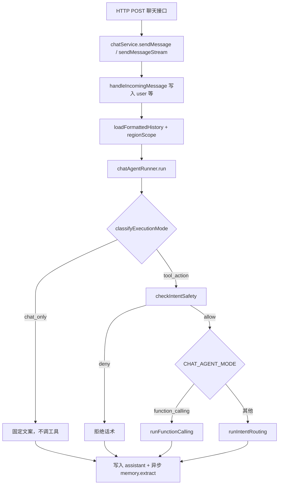

# Executive Chat 请求处理流程（实现对照）

**版本:** 1.0.1 | **更新日期:** 2026-04-23 | **状态:** Current

**本文定位：** 以当前后端代码为准，描述「用户发送一条消息 → 助手回复落库」的**完整调用链、分支条件与数据流**。  
**不重复：** HTTP 字段级契约见 [04-API-SPEC.md](./04-API-SPEC.md) §6；产品能力与分层架构摘要见 [09-EXECUTIVE-CHAT.md](./09-EXECUTIVE-CHAT.md)；意图与工具清单见 [10-EXECUTIVE-CHAT-INTENTS-TOOLS.md](./10-EXECUTIVE-CHAT-INTENTS-TOOLS.md)。

**实现锚点（主要文件）：**

| 层级 | 路径 |
|------|------|
| 路由 | `TOT_backend/server/routes/chat.js` |
| 会话与持久化 | `TOT_backend/server/services/chatService.js` |
| Agent 编排 | `TOT_backend/server/services/chatAgentRunner.js` |
| 工具注册与执行 | `TOT_backend/server/services/chatToolsService.js`、`TOT_backend/server/chat_tools/*.js` |
| 模型与流式 FC | `TOT_backend/server/utils/ai.js`（`chatWithToolsStream`、`simpleChat`） |
| 意图分类（routing 模式） | `TOT_backend/server/services/chatIntentService.js` |
| 回答格式化（routing 模式） | `TOT_backend/server/services/chatAnswerService.js` |
| 会话工具结果缓存 | `TOT_backend/server/services/chatSessionStateService.js` |
| 长期记忆（异步） | `TOT_backend/server/services/chatMemoryService.js` |

---

## 1. 环境开关（与代码一致）

| 变量 | 默认 / 说明 | 影响 |
|------|----------------|------|
| `CHAT_AGENT_MODE` | 未设置时等同 `function_calling` | `function_calling`：主路径为 `runFunctionCalling`；否则走 `runIntentRouting`（意图 LLM + 单次工具 + 格式化 LLM）。 |
| `CHAT_SESSION_STATE_ENABLED` | 设为 `0` 时关闭 | 非 `0` 且存在 `sessionId` 时：`runFunctionCalling` / `runIntentRouting` 会按签名读写会话内工具结果缓存（`getLatestBySignature` / `addRecord`），减少重复查库。 |
| `CHAT_SESSION_STATE_TTL_MS` / `CHAT_SESSION_STATE_CAPACITY` | 可选 | 控制 `chatSessionStateService` 内存条目的 TTL 与条数上限（默认见 `chatSessionStateService.js`）。 |

**会话缓存与 Redis：** `hydrateIfNeeded` 仅在 **`redisAdapter` 可用**（`redisAdapter.isAvailable()`）且会话在内存中尚无记录时，尝试从 Redis 拉取快照；未配 Redis 时仍可使用**当前进程内存**中的缓存。`addRecord` 成功后在有 Redis 时异步 `persistSessionToRedis`。

---

## 2. 总览时序



---

## 3. 入口层：`chatService`

### 3.1 会话校验与消息入库

1. 校验 `chat_sessions` 存在且 `user_id` 与当前用户一致。
2. **`handleIncomingMessage`**（`chatService.js`）  
   - 可选 `messageId` 幂等：已存在 `client_message_id` 则 `409`。  
   - 若 body 含 `clarificationResponse.toolCallId`：先插入 `role = tool` 行（澄清选择结果），再插入展示用 `user` 行。  
   - 否则插入普通 `user` 行。  
3. 从会话行构造 **`regionScope`**：`type`（`national` / `regional` / `rtm`）、`regions` JSON、`rtm` 字符串。后续所有工具必须在此范围内查询。

### 3.2 历史上下文

- **`loadFormattedHistory`**：按 `created_at, rowid` 升序取该会话**最近 10 条** `chat_messages`。  
- `role === 'assistant'` 时，`content` 经 **`compressAssistantContent`** 压缩后再进入模型上下文。  
- 从 DB 读出的行可含 `tool_calls`、`tool_call_id` 等字段；但 **`runFunctionCalling` 拼入模型 `messages` 时当前实现为** `history.map((m) => ({ role: m.role, content: m.content }))`，**不会**把 `tool_calls` / `tool_call_id` 一并传给 API。多轮工具调用主要依赖**当次请求内** `messages` 数组在循环中追加的 `assistant`（含 `tool_calls`）与 `tool` 行；若历史里需完整 FC 协议回放，应以当时代码为准（或扩展映射）。

### 3.3 调用 Agent

```text
chatAgentRunner.run(userMessage, history, regionScope, options)
```

`options` 常见字段：`sessionId`、`userId`、`signal`（SSE 断开中止）、`streamFormatCallbacks.onDelta`（流式增量）。

### 3.4 助手消息持久化

- **`storageContentFromAgentResult`**：若结果含非空 `markdownContent`，则整段 Markdown 写入 `chat_messages.content`；否则将结构化对象 `JSON.stringify` 写入（兼容 legacy）。  
- `intent_type` ← `result._intentType`；`tool_calls` ← 仅当 `result._toolMeta.toolCalls` 存在时序列化写入（当前 FC 主路径的 `_toolMeta` 以摘要字段为主，该列可能为 `null`，以代码为准）。  
- **`setImmediate`**：异步调用 **`chatMemoryService.extract(sessionId)`**，不阻塞本次 HTTP 响应；记忆在**后续轮次**通过 `getMemories(userId)` 注入 FC 的 system prompt。

---

## 4. 编排层：`chatAgentRunner.run`

### 4.1 执行模式：`classifyExecutionMode`

- **`message` 缺失或非字符串** → **`tool_action`**（与「trim 后空串」分支不同）。  
- **trim 后为空串** → **`chat_only`**。  
- 与 **`CHIT_CHAT_RE`** 匹配的寒暄（如你好、谢谢、help 等）→ **`chat_only`**：直接返回固定介绍文案，`_intentType: 'chat_only'`，**不调用**语义监工与主模型工具链路。  
- 其余 → **`tool_action`**。

### 4.2 语义监工：`checkIntentSafety`（仅 `tool_action`）

- 使用 **`simpleChat`**（内部为 DeepSeek 非流式补全）判断用户是否在要求「发邮件 / 催办 / 改库」等危险操作。  
- 返回 **`deny`**：固定拒绝话术，`_intentType: 'deny'`，`_intentResolvedBy: 'semantic_supervisor'`。  
- 调用失败：记录 warn，**默认 `allow`**，交给主 Agent。

### 4.3 去重本轮 user

- **`historyExcludingPendingUserTurn`**：若 `history` 最后一条为 `user` 且内容与当前 `userMessage` trim 后一致，则去掉该条，避免「DB 已插入 user + messages 再带同句 user」重复。

### 4.4 模式分流

- **`CHAT_AGENT_MODE === 'function_calling'`**（默认）→ **`runFunctionCalling`**。  
- 否则 → **`runIntentRouting`**。

---

## 5. 主路径：`runFunctionCalling`（Function Calling 循环）

### 5.1 消息构造

1. **`fallbackIntent`**：`inferIntentFromMessage` 基于正则得到兜底 `_intentType`（工具执行后可能被 **`deriveIntentType`** 按实际工具名覆盖）。  
2. **记忆**：`chatMemoryService.getMemories(userId)` 非空时拼入 system 中的「个人偏好与记忆」段。  
3. **`messages`**：`system`（角色、工具指引、Markdown/echarts/suggestions 规则）+ `history` 映射的 `{role, content}` + 当前 `user`。

### 5.2 循环（最多 `MAX_ITERATIONS = 5`）

每轮：

1. 若启用会话状态：`chatSessionStateService.hydrateIfNeeded(sessionId, regionScope)`（无 Redis 或内存已有记录时实质为 no-op，见 §1）。  
2. **`chatWithToolsStream`**（`utils/ai.js`）：  
   - 请求 DeepSeek `chat/completions`，`stream: true`，附带 **`chatToolsService.TOOL_SCHEMAS`** 与 `tool_choice: 'auto'`。  
   - 流式解析 `delta`：`reasoning_content`（脱敏后）与 `content` 通过 `onDelta` 透出；结束时组装完整 `content` 与 `tool_calls` 数组。  
3. **若无 `tool_calls`**：将 `content` 作为 **`finalContent`**，跳出循环。  
4. **若有 `tool_calls`**：对每个调用：  
   - 解析 `function.arguments` JSON。  
   - 计算 **`buildToolCacheSignature(toolName, args, regionScope)`**。  
   - 若会话缓存命中：直接使用缓存的 `result`。  
   - 否则 **`chatToolsService.executeByName(name, args, regionScope)`**：schema 校验 → 角色/scope 策略 → handler 执行（超时见工具 meta）。  
   - 成功且非仅缓存： **`chatSessionStateService.addRecord`**（带 `expectedVersion` 做并发版本校验，具体见该服务实现）。  
   - 流式：`onDelta('', { phase: 'tool_start'|'tool_end', text: toolName })`。  
   - 记录 **`calledToolNames`**。  
5. **歧义短路**：若任一结果为 **`needDisambiguation`**：  
   - 流式：通过 `onDelta(..., { phase: 'clarify' })` 下发结构化澄清 payload（含 `toolCallId`、`candidates` 等）。  
   - 返回 **`buildDisambiguationReply`** 风格的结构化回复（并带 `_toolMeta`），**不再**追加 tool 消息进入下一轮。  
6. 否则：向 **`messages`** 追加 `assistant`（含 `tool_calls`）及多条 `tool`（`tool_call_id` + `JSON.stringify(result)`），进入下一轮，直到模型不再请求工具或达到迭代上限。

### 5.3 结束与返回值

- 若循环结束仍无正文且曾调过工具：降级提示「步骤过多」类文案。  
- 若从未得到正文：通用失败提示。  
- 返回对象核心字段：  
  - **`markdownContent`**：主答案（FC 基线）。  
  - **`_intentType`**：`deriveIntentType(calledToolNames, fallbackIntent)`。  
  - **`_intentResolvedBy`**：调过工具为 `tools`，否则 `regex_fallback`。  
  - **`_toolMeta`**：工具名摘要（含 `multi`）、迭代次数等。

---

## 6. 降级路径：`runIntentRouting`

适用于 **`CHAT_AGENT_MODE` ≠ `function_calling`**（任意其他字符串，如 `intent_routing`）。

1. **`chatIntentService.classify`**：`generateTextDeepSeek` 输出 JSON → `intentType` + `entities`。  
2. 按意图做参数校验（如 `analytics_query` 缺 `analysisType`、`drill_down` 缺区域/门店等）可能直接返回提示，**不调工具**。  
3. 特殊分支：`[绘图]` + `analytics_query` 时可从会话状态恢复上一轮分析结果，避免重复执行工具。  
4. 意图映射到固定工具名（见 [10-EXECUTIVE-CHAT-INTENTS-TOOLS.md](./10-EXECUTIVE-CHAT-INTENTS-TOOLS.md)），`matrix_query` 下对 `entities` 做参数归一化；再经 **`chatSessionStateService`** 按签名命中缓存或调用 **`executeByName`**（常见为单轮一次工具）。  
5. **`buildDisambiguationReply`** 处理门店歧义。  
6. **`chatAnswerService.format`**：基于工具结果与历史生成 **严格 JSON** 结构（overview、keyNumbers、visualizations 等）；传入 `streamFormatCallbacks.onDelta` 时走 `generateTextDeepSeekStream`，否则 `generateTextDeepSeek`。  
7. 返回 legacy 结构化回复，并 **`attachToolMeta(..., 'intent_llm')`**。

---

## 7. 工具执行层：`chatToolsService.executeByName`

1. 工具必须在启动时由 **`server/chat_tools/*.js`** 注册（`schema.function.name` + `handler`）；`meta.enabled === false` 跳过。  
2. **`validateToolArgs`**：按 JSON Schema 的 `required` / `properties` 做基础校验。  
3. **`authorizeToolCall`**：Executive Chat 默认 `userRoles: ['executive']`；`scopePolicy === 'national_only'` 时要求 `regionScope.type === 'national'`。  
4. **`executeWithTimeout`**：默认超时见各工具 `meta.timeoutMs`。  
5. 错误统一包装为 `{ error: { code, message, recommendation } }`，避免栈信息泄漏给模型。

---

## 8. 流式 SSE 与 `chatService.sendMessageStream`

- 响应头由 **`writeSseHeaders`** 设置；事件由 **`createSseSender`** 发送。  
- `chatAgentRunner` 的 `onDelta` 映射为 **`delta`** 事件：`text`、`phase`（`content` / `reasoning` / `tool_start` / `tool_end` / `clarify`）、`reasoningLevel`。  
- 客户端断开：`sendMessageStream` 在 `req.on('close')` 中对 `AbortController` 调用 **`abort()`**，并把 **`signal`** 传入 `chatAgentRunner.run` → `chatWithToolsStream(options)`。但当前 **`utils/ai.js` 的 `chatWithToolsStream` 未将 `signal` 传给 `fetch`，也未在读取流时响应中止**，因此**通常不会**因断开而中断 DeepSeek 请求；`sendMessageStream` 中的 `AbortError` 分支在当前 FC 路径上**很少触发**。若产品要求「停止生成」真正打断上游，需在 `ai.js` 中接入 `AbortSignal`。  
- 成功结束：发送 **`done`**，payload 含 `messageId`、`markdownContent` 或 `replyContent`、耗时等（与 [04-API-SPEC.md](./04-API-SPEC.md) 对齐）。

---

## 9. 与「找答案」相关的数据事实

- **答案依据**：默认路径下，事实来自 **工具 handler 查询 SQLite（及工具内逻辑）** 返回的 JSON，再由 **主模型** 组织为 Markdown；**不是**全文检索外部知识库。  
- **长期记忆**：影响 **system prompt 措辞与偏好**，不替代工具数据。  
- **歧义恢复**：用户选择澄清项后，前端再次发消息并带 **`clarificationResponse`**，`handleIncomingMessage` 写入 **`tool` 行**，使 FC 消息序列连续；细节见 `chatService.js` 与前端契约。

---

## 10. 文档维护

- 代码变更涉及编排顺序、新分支、新环境变量或 SSE 语义时：**同步更新本文**。  
- 若仅新增工具或意图映射：优先更新 [10-EXECUTIVE-CHAT-INTENTS-TOOLS.md](./10-EXECUTIVE-CHAT-INTENTS-TOOLS.md)，并在本文 §1 表格或 §7 中必要时补一行「锚点」说明。
